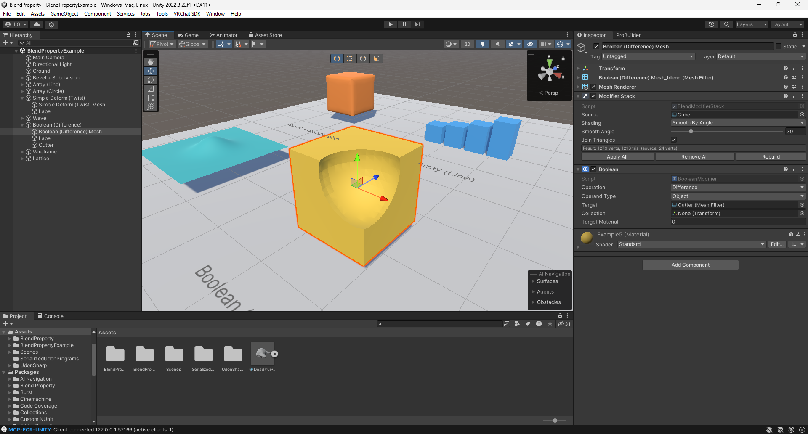
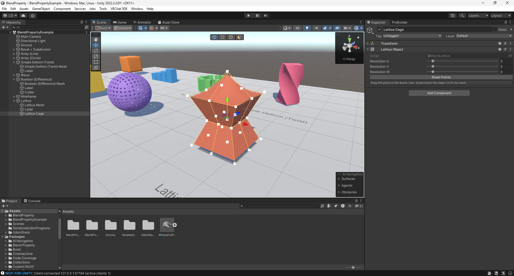
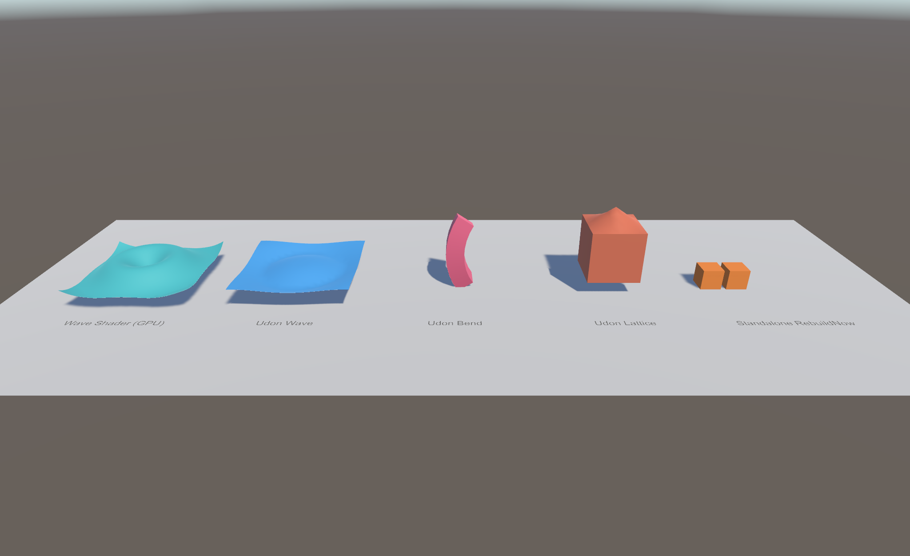
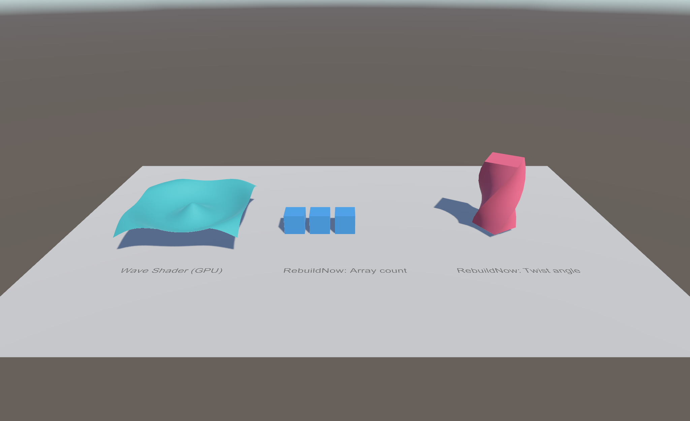

# Blend Property: User Guide

Blend Property brings Blender's modifier stack to Unity. Each modifier is a component on a GameObject with a MeshFilter. The stack runs in the editor and saves its result as a mesh asset. The modifier components are stripped from builds, so only that baked mesh ships.


## Install

Use either method:

- **Package Manager → + → Add package from git URL…** and enter `https://github.com/LogicCuteGuy/BlendProperty.git`.
  To pin a version, append a tag, for example `#v0.1.0`.
- Copy the `com.logiccuteguy.blendproperty` folder into your project's `Packages/` folder.

The package needs Unity 2022.3 or newer. If ProBuilder is installed, the ProBuilder bridge turns on automatically.

## Open the example scene

In the Project window, open `Packages/Blend Property/Example/BlendPropertyExample.unity`.

The scene comes without baked meshes. Each stack rebuilds the first time the scene opens and saves its result to `Assets/BlendProperty/Baked/`.

| Object | Stack | What to try |
|---|---|---|
| Bevel + Subdivision | Bevel → Subdivision Surface | Change Bevel **Segments**, or turn off Subdivision |
| Array (Line) | Array (Line, Relative) | Change **Count** and the per-copy **Scale** |
| Array (Circle) | Array (Circle) | Change **Radius**, or switch **Circle Segment** to Arc |
| Simple Deform (Twist) | Subdivision (Simple ×3) → Simple Deform | Switch **Mode** to Bend or Taper |
| Wave | Subdivision (Simple ×2) → Wave | Scrub **Time** |
| Boolean (Difference) | Boolean (target: the hidden *Cutter* sphere) | Move *Cutter*. The hole follows it |
| Wireframe | Wireframe | Change **Thickness**, or turn off **Replace Original** |
| Lattice | Subdivision (Simple ×3) → Lattice | Select *Lattice Cage* and drag its points |

## Build a stack

1. Select an object with a MeshFilter, such as a primitive, an FBX child or a ProBuilder mesh.
2. Click **Add Component → Blend Modifier**, then pick a modifier from **Generate**, **Deform**, **Edit** or **Normals**.
   A **Modifier Stack** component is added with the first modifier. It stores the original mesh and the shading settings.
3. Add more modifiers. They run top to bottom in component order.


The **Modifier Stack** header shows the vertex and triangle counts of the result. Its buttons are:

- **Apply All**: bakes the whole stack into the source mesh and removes the modifiers.
- **Remove All**: removes every modifier without applying them and restores the original mesh. This is one undo step.
- **Rebuild**: forces a rebuild, for example after the source mesh changed on disk.

### Reorder, toggle and apply

- **Reorder** modifiers by dragging their headers, or use the ⋮ menu (Move Up/Down, Move to First/Last).
- **Toggle** a modifier with its component checkbox, like Blender's viewport toggle. Unchecking **Modifier Stack** shows the original mesh.
- **Apply** a modifier from its ⋮ menu. This bakes that modifier and every enabled modifier above it into the source mesh.
- **GameObject → Blend Modifier → Apply All in Children** and **Remove All in Children** work on a whole model at once.

## Modifiers that use other objects

Boolean, Hook, Lattice, Curve, Shrinkwrap, Warp, Mirror (Mirror Object), Array (Curve / Transform) and Screw (Axis Object) read another object's transform. Moving that object rebuilds the stack live.



For Boolean, hide the cutter's MeshRenderer yourself, as the example does. The cutter is not removed from the scene.

### Lattice

1. Add **Add Component → Blend Modifier → Lattice Object** to an empty GameObject. Move and scale it until the cage encloses the mesh.
2. Set **Resolution U / V / W**. The default is a 2×2×2 cage.
3. On the mesh, add **Deform → Lattice** and assign the cage.
4. Select the cage and drag its points in the Scene view. **Reset Points** puts them back.



## Baked meshes and builds

- Results are saved as `.asset` meshes in `Assets/BlendProperty/Baked/`. They are needed: the MeshFilter points at them.
- **Tools → Blend Modifier → Delete Unused Baked Meshes** removes baked meshes that no scene or prefab uses anymore.
- On build, every Blend Property component is stripped, unless **Keep at Runtime** is on (see Runtime). The MeshFilter keeps the baked mesh, so the build has no runtime cost. This also makes the package safe for VRChat worlds: the components implement `IEditorOnly` when the VRChat SDK is installed.

## Runtime

By default nothing runs at runtime: the build ships the baked mesh. Choose one of these when something has to change while the game or world runs.

| Target | Use | Cost |
|---|---|---|
| Standalone build (PC, mobile, console) | **Keep at Runtime** + `RebuildNow()` | The whole stack re-runs on each call |
| VRChat world | Blend Udon deformers | CPU in Udon, about 1,000 animated vertices per mesh |
| Any, wave motion only | **Blend Property/Wave** shader | GPU, free on the CPU |

### Project detection

The package checks at compile time which kind of project it's in, using Unity version defines. Nothing needs to be set up.

| | VRChat project (VRChat SDK installed) | Standalone project (no VRChat SDK) |
|---|---|---|
| Modifier stacks in builds and Play Mode | Always stripped; only the baked mesh ships | Stripped, unless **Keep at Runtime** is on |
| `Udon/` (Blend Udon deformers) | Compiles (`BLEND_UDON`) | Not compiled |
| `Example/Standalone/Scripts` | Not compiled, so VRChat never sees a plain MonoBehaviour | Compiles |
| Wave shader | Works | Works |

### Runtime example scenes

There is one scene per project type. Open the one that matches your project and press **Play**.

**VRChat:** `Packages/Blend Property/Example/VRChat/BlendPropertyVRChatExample.unity`



| Object | Shows |
|---|---|
| Wave Shader (GPU) | The Wave shader on a subdivided plane, with no script |
| Udon Wave | BlendUdonWave animating a plane |
| Udon Bend | BlendUdonSimpleDeform (Bend, Every Frame). An Animator spins its **Origin**, so the bend direction turns |
| Udon Lattice | BlendUdonLattice. An Animator raises the top-centre cage point |

**Standalone:** `Packages/Blend Property/Example/Standalone/BlendPropertyStandaloneExample.unity`



| Object | Shows |
|---|---|
| Wave Shader (GPU) | The Wave shader, which needs no script |
| RebuildNow: Array count | `RuntimeRebuildDemo` changes the Array count from 1 to 5, once a second, and calls `RebuildNow()` |
| RebuildNow: Twist angle | `RuntimeRebuildDemo` swings the Simple Deform angle every frame and calls `RebuildNow()` |

If you open a scene in the other kind of project, its scripted objects show a missing-script warning and don't move.

### Standalone: Keep at Runtime

1. On the Modifier Stack, tick **Keep at Runtime**.
2. Enable **Read/Write** on the source mesh's import settings. Built-in primitives are already readable. The build logs a warning if the source isn't.
3. From any script, change modifier fields and rebuild:

```csharp
var stack = GetComponent<BlendProperty.BlendModifierStack>();
stack.GetComponent<BlendProperty.ArrayModifier>().count = level + 2;
stack.RebuildNow();
```

`RebuildNow()` writes into one scene-only mesh that is reused on every call, and updates the MeshCollider if it used the old result. Turning off the stack component shows the source mesh. In a project with the VRChat SDK installed, stacks are always stripped and the Inspector warns about it.

### VRChat: Udon deformers

The modifier stack can't run in Udon: its mesh code uses C# classes, structs and collections that Udon doesn't support, and even simple modifiers would be too slow there. The Udon deformers are small UdonSharp behaviours that reshape the baked mesh instead. They compile with stock UdonSharp and with LCGUdonSharp.

1. Bake the shape you want with modifiers as usual. For example, Subdivision gives a flat plane enough vertices to wave.
2. Add one of these to the same object:
   - **BlendUdonWave**: **Animate** advances **Time** every frame. Turn it off and call `Deform()` to drive it yourself.
   - **BlendUdonSimpleDeform**: deforms once on Start. Turn on **Every Frame** to follow an animated **Origin**, Angle or Factor.
   - **BlendUdonLattice**: choose **⋮ → Create Cage Points**. Animate, constrain or pick up the point Transforms, and the mesh re-deforms only on frames where a point or the cage moved.
3. Use one deformer per mesh. Each one starts from the mesh as it was on Start.

Distances are in metres, like the modifiers. **Recalculate Normals** gives correct lighting on the moved surface, but shows shading seams where the mesh is split along UV seams. Turn it off for small deformations.

### Wave shader

Assign **Blend Property/Wave** to the material. It has the Standard shader's colour, albedo, smoothness and metallic, plus the Wave settings. The motion runs on the GPU, so mesh size doesn't matter and no script is needed. Distances are in the mesh's own units. Built-in render pipeline only.

## ProBuilder

Modifiers stay live while you edit a ProBuilder shape. In vertex, edge or face mode the cage is shown without modifiers so you can select elements. **Apply** writes the result back into the `ProBuilderMesh`, so it stays editable.

## Units and performance

- Distances are in metres in the scene, whatever the object's scale. A Bevel width of 0.02 is 2 cm on any object.
- Unity is Y-up. Modifiers that default to Blender's Z axis default to Y here.
- Only the part of the stack that changed is rebuilt. Stacks that take more than 80 ms to rebuild update when you release the mouse, so dragging stays smooth.

See the [README](../README.md) for the full modifier list, the options each modifier supports and the known limits.

## Troubleshooting

| Problem | Fix |
|---|---|
| The mesh doesn't update | Click **Rebuild** on the Modifier Stack. Check the Console for a modifier exception |
| Shading looks faceted | Set **Shading** on the Modifier Stack to Smooth or Smooth By Angle, or raise **Smooth Angle** |
| Boolean gives holes or nothing | Both meshes must be closed. Keep the cutter under a few thousand faces |
| Subdivision or Bevel looks wrong on an imported mesh | Keep **Join Triangles** on, so triangle pairs are rebuilt into quads first |
| SkinnedMeshRenderer isn't supported | Only MeshFilter meshes are supported. Bake the pose to a static mesh first |

## Write your own modifier

Create one class that derives from `BlendModifier`:

```csharp
using BlendProperty;
using UnityEngine;

[AddComponentMenu("Blend Modifier/Deform/Inflate")]
public class InflateModifier : BlendModifier
{
    public float amount = 0.05f;

    public override void Apply(MeshData mesh)
    {
        var center = Vector3.zero;
        foreach (var p in mesh.pos) center += p;
        center /= Mathf.Max(1, mesh.pos.Count);
        for (int i = 0; i < mesh.pos.Count; i++)
            mesh.pos[i] += (mesh.pos[i] - center).normalized * amount;
    }
}
```

If the modifier reads another object, override `Dependencies()` and return that object. The stack then rebuilds when the object moves.
