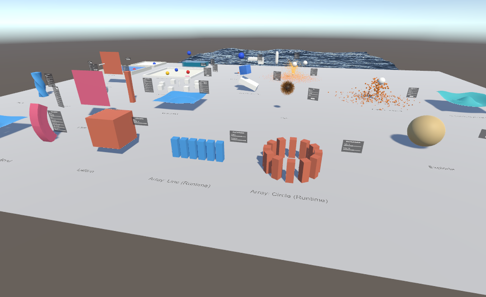

# Blend Property: User Guide

Blend Property brings Blender's modifier stack to Unity. Each modifier is a component on a GameObject with a MeshFilter. The stack runs in the editor and saves its result as a mesh asset. By default the modifier components are stripped from builds, so only that baked mesh ships. Standalone games can retain the stack or use the runtime physics components; VRChat uses the UdonSharp versions.

## Illustrated tutorials

- [All modifiers: setup and before/after screenshots](IllustratedModifiers.md) — every modifier, including the main Array and Simple Deform modes.
- [All runtime example stations: editor setup and Play Mode results](IllustratedRuntime.md) — one walkthrough per station.
- [Physics, interaction and editor workflow](IllustratedWorkflow.md) — Physics Tab, helper components, rigid bodies, constraints and the reusable capture tool in Assets.

The new screenshots show the normal Unity Editor and its normal Inspector. Click an image to open it at full size.


## Install

The package needs Unity 2022.3 or newer. If ProBuilder is installed, the ProBuilder bridge turns on automatically.

### VCC / ALCOM

Blend Property is available through the LogicCuteGuy VPM repository.

1. [Add the LogicCuteGuy VPM repository](https://vpm.logiccuteguy.com/) to VCC / ALCOM. You can also add `https://vpm.logiccuteguy.com/index.json` manually in the app's repository settings.
2. Open **Manage Project** for your Unity project and enable the LogicCuteGuy repository if needed.
3. Find **Blend Property** (`com.logiccuteguy.blendproperty`) and add the latest available version to the project.
4. Open the project in Unity and let the package import.

### Unity Package Manager / manual

- **Package Manager → + → Add package from git URL…** and enter `https://github.com/LogicCuteGuy/BlendProperty.git`.
  To pin a version, append a tag, for example `#v0.2.0`.
- Download the `com.logiccuteguy.blendproperty-<version>.zip` package asset from [GitHub Releases](https://github.com/LogicCuteGuy/BlendProperty/releases) and extract it into `Packages/com.logiccuteguy.blendproperty/`, with `package.json` directly inside that folder.

Choose one installation method per project to avoid duplicate copies.

## Open the example scene

In the Project window, open `Packages/Blend Property/Example/BlendPropertyExample.unity`.

The scene comes without baked meshes. Each stack rebuilds the first time the scene opens and saves its result to `Assets/BlendProperty/Baked/`.

| Object | Stack | What to try |
|---|---|---|
| Bevel + Subdivision | Bevel → Subdivision Surface | Change Bevel **Segments**, or turn off Subdivision |
| Array (Line) | Array (Line, Relative) | Change **Count** and the per-copy **Scale** |
| Array (Circle) | Array (Circle) | Change **Radius**, or switch **Circle Segment** to Arc |
| Simple Deform (Twist) | Subdivision (Simple ×3) → Simple Deform | Switch **Mode** to Bend or Taper |
| Wave | Subdivision (Simple ×2) → Wave | Scrub **Time** |
| Boolean (Difference) | Boolean (target: the hidden *Cutter* sphere) | Move *Cutter*. The hole follows it |
| Wireframe | Wireframe | Change **Thickness**, or turn off **Replace Original** |
| Lattice | Subdivision (Simple ×3) → Lattice | Select *Lattice Cage* and drag its points |

## Build a stack

1. Select an object with a MeshFilter, such as a primitive, an FBX child or a ProBuilder mesh.
2. Click **Add Component → Blend Property → Modifiers**, then pick a modifier from **Generate**, **Deform**, **Edit** or **Normals**.
   A **Modifier Stack** component is added with the first modifier. It stores the original mesh and the shading settings.
3. Add more modifiers. They run top to bottom in component order.


The **Modifier Stack** header shows the vertex and triangle counts of the result. Its buttons are:

- **Apply All**: bakes the whole stack into the source mesh and removes the modifiers.
- **Remove All**: removes every modifier without applying them and restores the original mesh. This is one undo step.
- **Rebuild**: forces a rebuild, for example after the source mesh changed on disk.

### Reorder, toggle and apply

- **Reorder** modifiers by dragging their headers, or use the ⋮ menu (Move Up/Down, Move to First/Last).
- **Toggle** a modifier with its component checkbox, like Blender's viewport toggle. Unchecking **Modifier Stack** shows the original mesh.
- **Apply** a modifier from its ⋮ menu. This bakes that modifier and every enabled modifier above it into the source mesh.
- **GameObject → Blend Property → Modifiers → Apply All in Children** and **Remove All in Children** work on a whole model at once.

## Modifiers that use other objects

Boolean, Hook, Lattice, Curve, Shrinkwrap, Warp, Mirror (Mirror Object), Array (Curve / Transform) and Screw (Axis Object) read another object's transform. Moving that object rebuilds the stack live.


For Boolean, hide the cutter's MeshRenderer yourself, as the example does. The cutter is not removed from the scene.

### Lattice

1. Add **Add Component → Blend Property → Modifiers → Lattice Object** to an empty GameObject. Move and scale it until the cage encloses the mesh.
2. Set **Resolution U / V / W**. The default is a 2×2×2 cage.
3. On the mesh, add **Deform → Lattice** and assign the cage.
4. Select the cage and drag its points in the Scene view. **Reset Points** puts them back.


## Baked meshes and builds

- Results are saved as `.asset` meshes in `Assets/BlendProperty/Baked/`. They are needed: the MeshFilter points at them.
- **Tools → Blend Property → Delete Unused Baked Meshes** removes baked meshes that no scene or prefab uses anymore.
- On build, every Blend Property component is stripped, unless **Keep at Runtime** is on (see Runtime). The MeshFilter keeps the baked mesh, so the build has no runtime cost. This also makes the package safe for VRChat worlds: the components implement `IEditorOnly` when the VRChat SDK is installed.

## Runtime

By default nothing runs at runtime: the build ships the baked mesh. Choose one of these when something has to change while the game or world runs.

| Target | Use | Cost |
|---|---|---|
| Standalone build (PC, mobile, console) | **Keep at Runtime** + `RebuildNow()` | The whole stack re-runs on each call |
| Standalone physics / live GPU modifiers | The same Blend Udon components and bake commands, running as MonoBehaviours | Native Unity callbacks and GPU simulation; requires a compatible graphics device |
| VRChat world | Blend Udon deformers | GPU simulation, with Udon uploading settings and copying vertices back |
| Any, wave motion only | **Blend Property/Wave** shader | GPU, free on the CPU |

### Project detection

The package checks at compile time which kind of project it's in, using Unity version defines. Nothing needs to be set up.

| | VRChat project (VRChat SDK installed) | Standalone project (no VRChat SDK) |
|---|---|---|
| Modifier stacks in builds and Play Mode | Always stripped; only the baked mesh ships | Stripped, unless **Keep at Runtime** is on |
| `Udon/` (all 21 runtime components) | UdonSharp behaviours (`BLEND_UDON`) | Native MonoBehaviours, with the same inspectors and bake commands |
| `Example/Standalone/Scripts` | Not compiled, so VRChat never sees a plain MonoBehaviour | Compiles |
| Wave shader | Works | Works |

### Runtime example scenes

There is one scene per project type. Open the one that matches your project and press **Play**.

**VRChat:** `Packages/Blend Property/Example/VRChat/BlendPropertyVRChatExample.unity`


| Object | Shows |
|---|---|
| Wave Shader (GPU) | The Wave shader on a subdivided plane, with no script |
| Wave | A Wave modifier with **Runtime** GPU animating a plane |
| Bend | A Simple Deform modifier (Bend) with **Runtime** GPU. An Animator spins its **Origin**, so the bend direction turns |
| Lattice | A Lattice modifier with **Runtime** GPU; the Lattice Object's 27 children are its points. An Animator raises the top-centre one |
| Cloth | BlendUdonCloth on a 1,024-vertex sheet with a plain Standard material. An Animator swings it into a sphere collider |
| Twist, Taper, Stretch | Simple Deform modifiers with **Runtime** GPU on a column, one mode each; change them from the panel |
| Wave HD | A Wave modifier with **Runtime** GPU on a 1,681-vertex grid |
| Runtime Array Line / Circle | Udon generates a combined mesh at runtime from `RuntimeArraySource.asset`. The panels change Copies and Spacing / Radius, using the same synced controls as the other stations. Editor preview meshes make both arrays visible before Play |
| Wind Field | BlendUdonForceField (Wind) blowing through a BlendUdonCloth sheet. Pick up the field to aim the wind; the panel's **Type** switches to any field type (try Turbulence); **Reset** puts it back |
| Smoke | BlendUdonFluid in a 2 × 3 × 2 m box: a smoke source on the floor and an effector ball the plume flows around (both pickups). The panel has Simulate, Heat, Vorticity, Dissolve, Time Scale, Clear Smoke and Reset |
| Waves | BlendUdonDynamicWaves on a 1,681-vertex pool; two floating balls orbit (a Vortex and a pulling Force field) and leave ripples. The balls are pickups. The panel has Speed, Damping, Spring, Smoothness, Flatten and Reset |
| Liquid | BlendUdonFluid with the Liquid domain type in a 2.4 × 1.4 × 1.4 m tank, filled to 30 %. Drop the ball (a pickup) in to splash, or carry the water source (a pickup) over the tank to pour more in. The panel has Simulate, Fill Level, Time Scale, Viscosity, Source Radius (a second BlendUdonPanel inside it drives the water source), Refill and Reset |
| Fire | BlendUdonFluid with a Fire + Smoke source (a pickup, like a torch): flames rise and turn into dark smoke. The panel has Simulate, Reaction Speed, Flame Smoke, Vorticity, Dissolve, Clear Smoke and Reset |
| Snow (Displace) | BlendUdonDynamicWaves with the Displace surface: an orbiting ball (a pickup) leaves a track in the snow that fills back in over 10 s. The panel has Dissolve, Flatten and Reset |
| Dynamic Paint | BlendUdonDynamicPaint on a floor; three ball brushes orbit (a Vortex and a pulling Force field) and leave trails that dissolve after 8 s; the fresh paint behind each ball is darker while it is wet. The balls and the eraser are pickups. The panel has Dissolve, Clear Paint and Reset |
| Soft Body | BlendUdonCloth with **Shape** on a 1,350-vertex rounded cube: a GPU jelly with Box colliders for the floor and ramp. It is a pickup, so you can throw it. The panel has Simulate, Shape, Structural, Friction and Reset |
| Particles | BlendUdonParticles on a small sphere: a fountain of 4,000 sparks that bounce off a ball and the floor (Sphere and Box colliders, each with its own Collision: the ball is bouncier). The emitter and the ball are pickups: carry the emitter and the sparks trail behind it. The panel has Lifetime, Random, Bounce (the floor's), Size and Reset |
| Hair | BlendUdonHair on a sphere: a fuzzy ball with 3,000 strands of 6 segments that hang, sway in a gentle Turbulence field and lie on the ball (its own Sphere Collider is in the hair's colliders). The ball is a pickup: swing it around. The panel has Simulate, Stiffness, Air Damping, Substeps and Reset |
| Explode | BlendUdonExplode on a sphere: call `Explode` and its faces fly out, tumble and land on the floor; `ResetExplode` puts it back |
| Cell Fracture | BlendUdonFracture on a crate cut into 14 pieces with a light interior material. Throw the ball (a pickup) at it faster than 3 m/s and it breaks |
| Particle Instance | A copy of the Particles fountain with **Render As Object**: 400 lit cubes that tumble, bounce off the ball and cast shadows |
| Ocean | The Ocean shader on a 30 × 30 m grid beyond the edge of the ground. A crate, a raft, a ball and a buoy (pickups) float on it with BlendUdonBuoyancy. The panel sets material properties: Generate Foam, Wind Velocity, Choppiness, Wave Scale and Foam Coverage |
| Vortex Field | BlendUdonForceField (Vortex) swirling 8 Rigidbody cubes (switch **Type** to Harmonic and raise Strength to pull them together). The field and the cubes are pickups; the cubes are synced and respawn if they fall off. **Reset** on the panel puts everything back |



The Array stations are children of **Runtime Example**, next to Lattice. Their
`BlendUdonRuntimeArray` component generates a centered line or a full circle around
local Y. From Udon, set `count`, `circle`, `spacing`, or `radius`, then call
`Generate()`. The controls reuse `BlendUdonPanel` and `BlendUdonSyncedPanel`, so
panel settings are shared; each client generates its own mesh. This is a small
CPU generation example, separate from evaluating the editor modifier stack:
it supports one readable triangle submesh, normals and UV0, up to 32 copies and
65,535 output vertices. Generated geometry has no collider. For repeatable Udon
VM checks during Play, use **Tools → Blend Property → Examples → Check Runtime
Array (Play Mode)**.

**Standalone:** `Packages/Blend Property/Example/Standalone/BlendPropertyStandaloneExample.unity`


| Object | Shows |
|---|---|
| Wave Shader (GPU) | The Wave shader, which needs no script |
| RebuildNow: Array count | `RuntimeRebuildDemo` changes the Array count from 1 to 5, once a second, and calls `RebuildNow()` |
| RebuildNow: Twist angle | `RuntimeRebuildDemo` swings the Simple Deform angle every frame and calls `RebuildNow()` |

If you open a scene in the other kind of project, its scripted objects show a missing-script warning and don't move.

### Standalone: Keep at Runtime

For physics, paint, hair, particles, fluids, destruction and live GPU modifiers, the components and bake instructions below also work in standalone projects without the VRChat SDK. Their existing `BlendUdon…` names and script GUIDs are retained. Native `LateUpdate` runs the simulation callbacks, and Unity `AsyncGPUReadback` copies GPU vertices back to meshes.

**Network Event** sends its event locally; **Synced Control Panel** applies local controls. Multiplayer replication, VRC pickups and player discovery remain VRChat integrations. Wire brush input to `OnPickupUseDown()` / `OnPickupUseUp()` (or `useHeld`) when **Require Use** is enabled. **Player Colliders** accepts Humanoid **Avatars** (first one local) and an optional **Viewpoint** Transform for a camera or XR head; use `RegisterPlayer(Animator)` / `UnregisterPlayer(Animator)` for runtime joins and removals. A viewpoint alone supplies the head collider. The Built-in pipeline and graphics hardware requirements of each GPU feature still apply.

To change any modifier from C# at runtime, retain the full stack instead:

1. On the Modifier Stack, tick **Keep at Runtime**.
2. Enable **Read/Write** on the source mesh's import settings. Built-in primitives are already readable. The build logs a warning if the source isn't.
3. From any script, change modifier fields and rebuild:

```csharp
var stack = GetComponent<BlendProperty.BlendModifierStack>();
stack.GetComponent<BlendProperty.ArrayModifier>().count = level + 2;
stack.RebuildNow();
```

`RebuildNow()` writes into one scene-only mesh that is reused on every call, and updates the MeshCollider if it used the old result. Turning off the stack component shows the source mesh. In a project with the VRChat SDK installed, stacks are always stripped and the Inspector warns about it.

**Keep at Runtime** leaves the whole stack under your script's control; it does not also install a GPU deformer on the same mesh. Leave it off to use the automatic **Runtime → GPU** conversion.

### VRChat: Udon deformers

The modifier stack can't run in Udon: its mesh code uses C# classes, structs and collections that Udon doesn't support, and even simple modifiers would be too slow there. The Udon deformers are small UdonSharp behaviours that reshape the baked mesh instead. They compile with stock UdonSharp and with LCGUdonSharp.

1. Bake the shape you want with modifiers as usual. For example, Subdivision gives a flat plane enough vertices to wave.
2. Add one of these to the same object:
   - **Runtime GPU modifiers**: no component to add. Set **Runtime** to GPU on a Wave, Simple Deform, Lattice, Hook or Warp modifier at the bottom of the stack. At build (and in Play mode) the mesh ships without it and a BlendUdonDeformStack runs it live, in stack order, up to 8 per mesh. It follows the Simple Deform **Origin**, the Hook **Target**, Warp **From** / **To** and the Lattice Object (with exactly U × V × W children, the children are its points: animate or pick them up). Wave advances **Time** while **Animate** is on. Not live: Wave **Along Normals** and Warp **Preserve Volume**; one Lattice per mesh, up to 8 × 8 × 8 points. From your Udon: `var d = GetComponent<BlendUdonDeformStack>(); int w = d.FindOp("Wave"); d.SetFloat(w, "height", 1f);` (names are the modifier's: height, angle, factor, strength, radius...).
   - **BlendUdonCloth**: Blender Cloth / Soft Body / Collision simulated on the GPU. Paint the vertex color red channel to pin (1 = pinned, in between = soft body goal weight), or set **Goal** when the mesh has no vertex colors. Pinned vertices follow the object, so move or animate it to swing the cloth. Colliders are Sphere, Capsule and Box (up to 8 each), with **Friction**. UV-seam splits are welded. **Shape** makes a closed mesh keep its rest shape and wobble like jelly; with no goal or pinned vertices it falls, tumbles, can be picked up and thrown, and the object follows it. `ResetSimulation()` puts it back where it started. Shape and Friction are per 1/30 s, independent of **Substeps**. Choose **⋮ → Bake Cloth** once, and again after changing the mesh, vertex colors or **Goal**. The mesh needs **Read/Write** enabled.
   - **BlendUdonParticles** (Add Component → Blend Property → Physics → Simulation → Particle System): Blender's Particle System (Emitter) on the GPU, laid out like Unity's Particle System modules. **GameObject → Blend Property → Physics → Particle System** makes a ready-baked spark fountain (a Cone shape) at the Scene view pivot and starts its preview. **Main:** **Emitting** (or **Play** / **Stop**, and the **StartEmitting** / **StopEmitting** events), **Duration** and **Looping**, **Lifetime** (**Lifetime Randomness** shortens some), Start Speed (**Normal**), **Size**, a random **Start Color** between two colours, **Start Rotation**, **Simulation Space** (World: particles stay where they were born; Local: they move with the emitter) and **Gravity**. **Emission:** **Auto Rate** (Max Particles / Lifetime a second, Blender's steady stream) or **Rate** per second, **Rate over Distance**, and **Bursts** (time, count, cycles, interval); `Emit(count)` adds particles from Udon. **Shape:** this object's **Mesh** (vertices or faces, **Emit From**; the mesh needs **Read/Write**) or a Sphere, Hemisphere, Cone, Box, Circle or Edge, pointing up (+Y); **Radius Thickness** 0 is the surface only, 1 anywhere inside. **Velocity:** **Object Aligned**, **Object Velocity** (inherited from the emitter), **Random**, **Velocity over Lifetime** and **Max Speed**. **Forces:** Force Fields (up to 4), **Damping**, **Brownian**, a swirling **Noise** (strength, frequency, scroll speed) and **Substeps**. **Over Lifetime:** a colour gradient and a size curve (off: the material's End Color and End Size), and rotation speed. **Texture Sheet Animation:** tiles X × Y, cycles, random start frame (turn off Round on the material). **Renderer:** Billboard, Stretched (length and speed scale), Horizontal or Vertical quads, drawn by the **Particles** renderer the bake adds as a child with a **Blend Property/Particles** material (texture, round soft edges, Additive glow). **Collision:** Sphere, Capsule and Box colliders (up to 8 each) on **Collision Layers**. Each collider sets its own **Bounce**, **Friction** and **Kill On Hit** with a **BlendUdonCollision** (Collision) component on it, like Blender's Collision modifier; without one it bounces 0.3 with friction 0.2. **Preview** in the Inspector plays it in the Scene view without Play mode (**Restart**, **Emit 30**); `ResetSimulation()` / `Clear()` clears the particles. Changing **Max Particles**, **Emit From**, **Render As** or **Instance Mesh** rebakes; **⋮ → Bake Particles** bakes by hand, again after changing the mesh. Udon only sends a few settings a frame, so tens of thousands of particles are fine. Local only: each player sees their own. **Render As Object** (Blender's Particle Instance) draws a copy of **Instance Mesh** for each particle instead, lit and casting shadows, with the **Blend Property/Particle Instance** material: **Size** is then the mesh's scale, **Align To Velocity** points its forward (+Z) along the motion, otherwise each copy gets a random turn, and **Spin** turns it over its life. Keep **Max Particles** × the mesh's vertices under 4 million. Not available: hair, children, and collisions between particles.
   - **BlendUdonHair**: Blender Hair with Hair Dynamics on the GPU. **Number** strands of **Segments** grow **Hair Length** metres from the mesh's faces along their normals, at random area-weighted spots.
     - **Physics:** gravity, wind and Force Fields (up to 4) swing them. **Stiffness** springs them back toward that rest shape (0.03 = limp hair that drapes over the mesh, 0.3 = fur that stands up, 1 = stiff as combed); the same value gives the same look at any **Substeps**. **Air Damping** slows them per 1/30 s. Each strand is solved from its root to its tip, so it never stretches. **Substeps** are GPU steps per 1/60 s, taken at a fixed size, so uneven frame rates don't shake the hair.
     - **Collisions:** Sphere, Capsule and Box colliders (up to 8 each). Add the mesh's own collider so the hair lies on it.
     - **Drawing:** strands are smooth ribbons on the **Hair** renderer the bake adds as a child, narrowing from **Root Width** to **Tip Width**. Its **Blend Property/Hair** material has the root and tip colour, the highlight and Shininess, and lights the strands from the main directional light and ambient light.
     - **Simulate** off keeps the strands in their rest shape, moving rigidly with the object.
     - **Bake:** choose **⋮ → Bake Hair** once, and again after changing **Number**, **Segments**, **Hair Length** or the mesh. The mesh needs **Read/Write** enabled.
     - **Not available:** children, clumping, kink, combing, hair-to-hair collision, and shadows cast by the hair.
   - **BlendUdonForceField**: Blender's Force Field. **Force** pushes away from the object (negative Strength pulls in), **Wind** blows along its up axis (Blender's Z; rotate the object to aim it), **Vortex** spins around its up axis, **Turbulence** blows swirling gusts that drift over time (**Size**: metres between gusts), **Drag** slows things down (Strength per m/s of speed, plus **Quadratic** that grows with speed), **Harmonic** springs things back to the object (Strength per metre away, **Damping** stops the bouncing). Strength is an acceleration in m/s², so heavy and light things react the same. **Power** is Blender's falloff power: strength × (1 + distance)^-Power; **Max Distance** cuts it off (0 = unlimited). Add it to a cloth's or fluid's **Force Fields** list (the GPU ones take up to 4) and list Rigidbodies on the field itself (one with several solid colliders, such as an Array with **Collider Per Copy**, is pushed at each collider, so a vortex spins it). Move or animate the object to move the field; disable the component to switch it off. To let players carry it, add a VRC Pickup, a kinematic Rigidbody and a trigger collider (as in the example). A cloth with an active field doesn't sleep. Drive it in-world with BlendUdonPanel (fields `type`, `strength`, `power`, `maxDistance`, `size`, `quadratic`, `damping`, **After Change** empty). Very high Drag (over about 30) can overshoot in a cloth and jitter.
   - **BlendUdonFluid**: Blender's Fluid domain, type Gas (smoke and fire) or Liquid (**Domain Type**; rebake after changing it). Put it on a Cube scaled to the box you want (rotating it is fine), choose **⋮ → Bake Fluid Domain** (again after changing **Resolution**, **Pressure Iterations**, **Max Particles**, **Solver Iterations** or the box's proportions), and the Cube gets a **Blend Property/Smoke** (or **Liquid**) material that draws it. The grid has cubic cells, **Resolution** of them along the longest side (40 = 27 × 40 × 27 for the example). List the smoke sources under **Flows**, Sphere Colliders the smoke flows around under **Effectors** (moving ones push it) and BlendUdonForceField objects under **Force Fields** (up to 8, 8 and 4). **Buoyancy Density** and **Heat** are the upward push per unit of smoke and of heat, in m/s²; heat cools over **Cool Time**. **Vorticity** keeps small swirls alive, **Dissolve** is the seconds smoke takes to fade (0 = never), **Time Scale** speeds it up or slows it down. Fire: fuel from Fire sources burns at **Reaction Speed** (per second); burning lights the flame and leaves **Flame Smoke** smoke and **Flame Heat** heat per unit of fuel, so flames rise and turn into smoke; **Flame Fade** is how long a flame glows after its fuel is gone. **Liquid**: the box holds water particles that fall under **Gravity** (m/s², world space), splash around effectors and settle flat; after a reset the box is filled up to **Fill Level** (0..1 of the box height), and Liquid sources pour more in. It is Position Based Fluids (Macklin & Müller 2013, the method of NVIDIA Flex): each step the particles are moved until every one has the water's rest density, so the water can't be squashed or bounce like a spring at any frame rate, and none is lost or created. **Max Particles** (4096, 16384 or 65536) is how many there are; the box holds that many when full, and sources stop adding once all are in use. Fewer particles are faster but chunkier (the example's 16384 are 6.6 cm apart in a 2.4 × 1.4 × 1.4 m box); use 4096 for Quest. **Solver Iterations** (default 3) trade GPU time for stiffer water, and **Viscosity** (0..1) is how much each bit of water moves with its neighbours: higher calms splashes sooner. Each frame runs up to 3 steps of at most 1/45 s (more with a high **Time Scale**; past 3 steps the water just moves slower). **Resolution** is only the grid the surface is drawn from. The settings under Smoke and Fire don't apply to it. The walls of the box are closed. `ResetSimulation` refills it. Simulation is off until **Simulate** is ticked, and it skips while no camera sees the box. Udon only uploads settings; the GPU does the rest (a sort of the particles by grid cell and the density solve, about 110 passes a step at 16384 particles) and nothing is read back. Changes are local to each player.
   - **BlendUdonFluidFlow**: a source (Blender Flow, Inflow) filling a sphere of **Radius**. **Flow Type**: Smoke (**Density** and **Temperature**, i.e. heat), Fire (**Fuel**, which burns into flame, heat and smoke), Fire And Smoke (both) or Liquid (a tap in a Liquid domain: water pours out of the sphere, as fast as **Initial Velocity**, or 1 m/s without it; the part of the sphere outside the box adds nothing). **Use Initial Velocity** also pushes the smoke with **Initial Velocity** plus the object's own motion × **Source**. Put it on a pickup to carry smoke around.
   - **Blend Property/Smoke** (shader): draws the smoke by ray-marching the domain box, lit by the main directional light with simple self-shadowing. **Thickness**, **Smoke Color**, **Self Shadow**, **Ambient**, **Steps** (quality vs. cost), an optional **Heat Glow**, and for fire **Flame Color**, **Flame Edge Color** (the cooler outside of the flame) and **Flame Brightness**. Flames give their own light, so they show in the dark. It is visible from inside the box. Opaque objects in the smoke cut it off only when the camera renders a depth texture (in VRChat: a realtime light with shadows).
   - **Blend Property/Liquid** (shader): draws a Liquid domain by ray-marching to the water's surface and shading it like water: the reflection probe's sky with Fresnel, a sun highlight, and **Color** that gets stronger with the depth of water behind the surface (**Murkiness**; **Color** alpha is how opaque deep water gets). **Smoothness**, **Ambient**, **Steps** (quality vs. cost). Where water touches the box walls the walls are its surface, like a glass tank. Opaque objects in the water cut it off under the same depth-texture condition as Smoke.
   - **BlendUdonDynamicPaint**: Blender's Dynamic Paint canvas with a Paint surface. Put it on the mesh to paint, list its brushes, then choose **⋮ → Bake Dynamic Paint** (again after changing the mesh or **Resolution**). The paint is stored per texel of the mesh's UVs, so the mesh needs UVs inside 0..1 that don't overlap (overlapping islands share paint). It is drawn over the material's texture named in **Texture Property** (`_MainTex` by default), so any shader works. **Dissolve** is the seconds paint takes to fade (0 = it stays). Brushes also leave the surface wet (Blender's Wetmap): wet areas darken by **Wet Darkening** and dry over **Dry Time** seconds (0 = no wetness); erasers don't wet. `ClearPaint` wipes paint and wetness. Up to 8 brushes paint at once. Udon only uploads brush positions while a brush is near the mesh or paint is fading, and the GPU does the rest; nothing is read back. Changes are local to each player.
   - **BlendUdonDynamicWaves**: Blender's Dynamic Paint canvas with a Waves or Displace surface (**Surface Type**). **Displace**: where a brush comes within its **Radius** it presses a dent of the overlap × its **Strength**; dents keep the deepest press and flatten out again over **Dissolve** seconds (0 = they stay). Everything below about Waves applies to both except the wave settings. **Waves**: List BlendUdonPaintBrush objects; a brush pushes the water aside where it comes within its **Radius** (by the overlap × its **Strength**), so moving brushes leave wakes and the water level stays the same. **Speed** (m/s), **Damping** (per second), **Spring** (pull back to flat), **Smoothness** and **Time Scale** match Blender's settings. Choose **⋮ → Bake Dynamic Waves** (again after changing the mesh or **Resolution**). The waves move along the vertex normals and are written back into the mesh, so any shader works; the mesh needs enough vertices to show them and non-overlapping UVs inside 0..1. Keep **Resolution** close to the number of vertices across the mesh: finer waves than the vertices show up as spikes. It runs at a fixed step (set by Speed and the texel size), so the frame rate doesn't change the result, and only while a brush touches the mesh and for a few seconds after, until the ripples have died out. `ResetWaves` flattens it. Changes are local to each player.
   - **BlendUdonPaintBrush**: a proximity brush for painting a flat canvas or a mesh's texture, with familiar pen/paint controls:
     - **Tool**: **Brush** connects movement into a continuous stroke; **Pen** uses a hard edge and does not build up while still; **Airbrush** builds up while held in place, with Flow adjusted for elapsed time; **Stamp** applies one image when entering the canvas bounds or starting a new stroke. Stamp does not connect movement. Jumps over 1 metre (or 8 radii for a large brush) start a separate stroke.
     - **Radius** is in world metres. **Hardness** controls the edge (Pen always uses 1); **Flow** is the existing `strength` field. **Opacity**, **Color** alpha and **Pressure** multiply each application. Repeated applications build up. Pressure 0 lifts the brush; drive `pressure` from your own trigger/tablet/UI input. Hardware pressure is not detected automatically.
     - **Tip Texture** accepts an imported image without Read/Write. With **Use Texture Color** off, white/opaque pixels paint and black/transparent pixels leave gaps. Turn it on to stamp the image's RGB tinted by **Color**, with its alpha as coverage; choose white Color to keep the image's colours. No image keeps the round brush. **Angle** rotates the image; its size follows Radius.
     - **Tip** optionally places the nib at a child Transform; otherwise the brush object's position is used. The image projects along Tip's local Z onto its XY plane, with local Y pointing up. Point Z toward the surface. This remains a proximity volume, so nearby back faces can also receive paint.
     - **Drawing** enables painting. **Require Use** draws only while holding the Use trigger on a VRC Pickup on the brush object; releasing or dropping lifts the pen. UI/Udon can call `_StartDrawing()` / `_StopDrawing()` (leave Require Use off for UI control). **Erase** removes paint and wetness with the same tip and strength. `ClearPaint()` on the canvas restores the base texture.
     - **Setup for either workflow**: add BlendUdonDynamicPaint to a flat mesh or the object to paint, give it non-overlapping UVs inside 0..1, list the brush under **Brushes**, choose **Bake Dynamic Paint**, then paint in Play mode or VRChat. Existing baked canvases use the new shader without rebaking; changing mesh or Resolution still needs a bake. The canvas composites over the material texture selected by **Texture Property** (for example `_MainTex`). Up to 8 active brushes have independent tip textures. Paint is local, and there are no vector paths, layers, undo history or file export.
     - The same brush makes waves on BlendUdonDynamicWaves: Tip, Drawing, Require Use and Pressure apply there too; image, colour, opacity and paint-tool modes affect Paint surfaces only.
   - **BlendUdonExplode**: Blender's Explode modifier. Choose **⋮ → Bake Explode**: every face becomes its own piece and the materials become **Blend Property/Explode** copies (colour, texture, smoothness kept). `Explode()` sends every piece out along its normal at **Speed** (each 50-150 % of it) plus **Random**, tumbling at **Spin** radians a second and falling with **Gravity**; with **Use Floor** each piece stops where it reaches **Floor Offset** metres below the pivot. **Lifetime** above 0 shrinks the pieces away. `ResetExplode()` puts it back. The shader works it all out from the start time, so it costs nothing while it runs. **Disable Colliders** turns the object's colliders off while exploded. **Networked** (on): one call explodes it for everyone. **⋮ → Unbake Explode** restores the mesh and materials. The pieces are single faces, like Blender's (add Solidify first for thickness).
   - **BlendUdonFracture**: Blender's Cell Fracture. Choose **⋮ → Bake Fracture**: the mesh is cut into **Piece Count** Voronoi pieces around random points inside it (**Seed** gives other cuts), each the mesh intersected with its cell, so non-convex closed meshes work. The cut faces get **Interior Material**. Each piece is a hidden child with a convex Mesh Collider and a Rigidbody, its mass shared out by size. At runtime the object breaks when something hits it faster than **Break Speed** (with **Break On Impact**) or when `Break()` is called: it hides itself, drops it if held, and the pieces fly with its speed and spin plus **Explosion** m/s outward. `ResetFracture()` rebuilds it. **Networked** (on): the break reaches everyone, and each player then runs the pieces' physics on their own, so they land a little differently; players who join later see it whole. Baking takes about half a second for 14 pieces of a cube; **⋮ → Unbake Fracture** removes the pieces.
   - **BlendUdonResetObjects**: puts a list of objects back where they started. Wire a Button's **On Click** → `SendCustomEvent("ResetObjects")`. Objects with VRC Object Sync are respawned for everyone; the rest move back for the player who pressed it.
   - **BlendUdonClothPanel**: in-world controls for one cloth. Put it on a world-space Canvas with a VRC Ui Shape and assign the cloth and any of: a Simulate Toggle, Gravity, Wind, Air Damping, Structural, Bending, Goal Stiffness, Collision Distance and Substeps Sliders. Wire each Toggle/Slider **On Value Changed** to the panel's UdonBehaviour → `SendCustomEvent("Apply")` and a Reset Button's **On Click** to `SendCustomEvent("ResetCloth")`. A Text inside a Slider shows its name and value. Changes are local to each player.
   - **BlendUdonPanel**: in-world controls for any Blend Udon deformer, or for a shader. Put it on a world-space Canvas with a VRC Ui Shape, set **Target** (the deformer) or **Modifier** (a modifier with Runtime GPU) and list Toggles with their bool field names and Sliders with their field names. A Slider with **Whole Numbers** drives an int or enum field, and **Slider Choices** (e.g. `Twist,Bend,Taper,Stretch`) shows names instead of numbers. Leave Target empty and set **Target Renderer** to drive material properties instead (e.g. `_Height`, `_Speed` on Blend Property/Wave); Toggles then set 1 / 0. Wire each control's **On Value Changed** to `SendCustomEvent("Apply")`. **After Change** (default `Deform`) is sent to the target after every change, so deformers that don't run every frame still update. For a CPU / GPU switch, put both deformers on the mesh (one turned off), set **CPU Target**, **GPU Target** and a **GPU Toggle**; the panel turns one off and the other on. Every example in the scene has a panel.
   - **BlendUdonSyncedPanel** (Synced Control Panel): makes a Control Panel or Cloth Panel shared. Put it next to the panel and wire each Toggle / Slider **On Value Changed** → `SendCustomEvent("Changed")` on it instead of `Apply` on the panel. Whoever moves a control takes ownership and the values reach every player, late joiners included. Leave its Toggles / Sliders empty to use the Control Panel's own.
   - **BlendUdonNetworkEvent** (Network Event): sends **Event Name** (e.g. `ResetSimulation`, `ClearPaint`, `ResetWaves`) to **Target** on every player's machine, so local simulations reset together. Wire a Button's **On Click** → `SendCustomEvent("Send")`. Late joiners don't get it (they start fresh anyway).
3. Use one deformer per mesh. Each one starts from the mesh as it was on Start.


BlendUdonCloth runs the physics in a Custom Render Texture, in steps of a fixed size (**Substeps** per 1/60 s), so it behaves the same at any frame rate and a resting soft body settles completely. Positions are kept relative to where the object was at its last reset, so float precision holds up far from the world origin. It copies the finished vertices back into the mesh with `VRCAsyncGPUReadback`. The mesh keeps its own material, so any shader works (Standard, lilToon, Poiyomi, your own), and colliders and culling see the real shape. Udon only uploads the settings and copies one position per vertex: about 0.6 ms a frame for the example's 1,024-vertex sheet, measured in the editor. It stays exact against colliders, but the shape on screen is one or two frames behind the simulation, so pinned edges trail a fast-moving object slightly. More **Substeps** make it stiffer at little cost. The baked data goes to `Assets/BlendProperty/Baked`. Supported colliders are Sphere, Capsule and Box; convex Mesh colliders are not supported. Tested on PC; Quest needs float render textures.

Runtime GPU modifiers do the per-vertex maths in a Custom Render Texture and copies the result into the mesh with `VRCAsyncGPUReadback`, like BlendUdonCloth, so any shader works. On the 1,681-vertex Wave HD example, the old Udon CPU wave cost 4.8 ms a frame and the GPU path 0.011 ms to upload plus the vertex copy (about 0.5 µs per vertex, from the cloth measurement). The result matches the baked modifier to float precision and shows one or two frames late. It writes nothing while nothing changes.

Distances are in metres, like the modifiers. **Recalculate Normals** gives correct lighting on the moved surface, but shows shading seams where the mesh is split along UV seams. Turn it off for small deformations.

### VRChat: from your own UdonSharp

The Udon deformers are plain UdonSharp behaviours in the `BlendProperty.Udon` namespace, so your scripts can call them.

**Runtime GPU modifiers.** The BlendUdonDeformStack is added at build, so it isn't there to drag into an Inspector field. Reference the GameObject and get it on Start:

```csharp
using UdonSharp;
using UnityEngine;
using BlendProperty.Udon;

public class MyWaveControl : UdonSharpBehaviour
{
    public GameObject target; // the object with the Modifier Stack
    BlendUdonDeformStack deform;
    int wave;

    void Start()
    {
        deform = target.GetComponent<BlendUdonDeformStack>();
        wave = deform.FindOp("Wave"); // the modifier's name in the stack, e.g. "Simple Deform 2"
    }

    public override void Interact()
    {
        deform.SetFloat(wave, "height", deform.GetFloat(wave, "height") + 0.5f);
    }
}
```

`SetFloat`, `GetFloat`, `SetBool` and `GetBool` take the modifier's index from `FindOp` and a field name. `SetFloat` re-deforms on the next frame; call `Deform()` only after editing the `opA`..`opD` arrays yourself. An unknown name or an index of -1 does nothing.

| Modifier | Fields |
|---|---|
| Wave | `height` `width` `narrowness` `speed` `startX` `startZ` `offset` `time` `motionX` `motionZ` `cyclic` `animate` `life` `damping` |
| Simple Deform | `mode` `angle` `factor` `axis` `lowerLimit` `upperLimit` |
| Lattice | `strength` |
| Hook / Warp | `strength` `radius` `falloff` |

**The other components** are in the scene, so drag them into a field and call their public methods (`fracture.Break();`), or send the event by name from any UdonBehaviour (`ub.SendCustomEvent("Break")`):

| Component | Methods |
|---|---|
| BlendUdonFracture | `Break` `ResetFracture` (to everyone when Networked), `BreakLocal` `ResetLocal` |
| BlendUdonExplode | `Explode` `ResetExplode` (to everyone when Networked), `ExplodeLocal` `ResetLocal` |
| BlendUdonCloth, BlendUdonHair, BlendUdonFluid | `ResetSimulation` |
| BlendUdonParticles | `StartEmitting` `StopEmitting` `ResetSimulation` |
| BlendUdonDynamicWaves | `ResetWaves` |
| BlendUdonDynamicPaint | `ClearPaint` |
| BlendUdonResetObjects | `ResetObjects` |

Their settings are public fields, so you can set them directly too (e.g. `particles.emitting = false;`).

### Physics component (Blender's Physics tab)

Add **Blend Property → Physics → Physics Tab** to an object to get Blender's Physics tab in the Inspector: one button per physics type. Clicking one adds the matching component, sets it up and bakes it; clicking it again removes it, and puts back any mesh or material it replaced.

| Button | Adds |
|---|---|
| Force Field | BlendUdonForceField; the popup is its **Type** |
| Collision | A collider if there is none (Sphere, Capsule or Box, guessed from the mesh name, since the GPU simulations only use those), listed in every simulation |
| Cloth | BlendUdonCloth (GPU simulation, baked for every mesh size) |
| Dynamic Paint | Canvas: BlendUdonDynamicPaint. Waves: BlendUdonDynamicWaves. Brush: BlendUdonPaintBrush |
| Fluid | Gas or Liquid: BlendUdonFluid (baked, with its material). Flow: BlendUdonFluidFlow (Liquid when every domain is a liquid) |
| Rigid Body | Active: a Rigidbody plus a convex Mesh Collider. Passive: a kinematic Rigidbody |
| Rigid Body Constraint | Fixed, Hinge, Point, Slider, Spring or Generic: the matching Unity joint. Set **Connected Body** on it (Blender's Object 2) |
| Particles | BlendUdonParticles (baked); the popup is **Render As** (Halo or Object) |
| Hair | BlendUdonHair (baked) |
| Ocean | An Ocean material on the renderer and BlendUdonBuoyancy |
| Explode | BlendUdonExplode (baked) |
| Cell Fracture | BlendUdonFracture (baked), plus a convex Mesh Collider if there is no collider |

**Player body:** **GameObject → Blend Property → Physics → Player Colliders** turns every player's body into colliders: Head, Chest, Hips, Hands and Feet (spheres) and Upper/Lower Arms and Legs (capsules), following each avatar's bones every frame and sized to its height. Nothing to bake: a body is made at runtime for each player who joins (from the hidden **Body Template** child) and removed when they leave, and every Blend Udon simulation in the scene gets them on top of its own collider lists. **All Players** off: only your own body. Turn parts on or off and set their radius (for a 1.6 m eye height) on the component. Cloth, hair and particles push off them, heads and hands stir fluids, hands and feet paint Dynamic Paint canvases and push Dynamic Waves (each carries a Paint Brush: change its colour or radius on the Body Template), and your own hands and feet break a Cell Fracture they hit faster than its Break Speed. The parts are triggers on Ignore Raycast, so they never push players, rigid bodies or the laser. The GPU simulations take up to 8 spheres and 8 capsules, counting only colliders within 1 m of them (your own body first).

Objects with a Physics component link to each other the way Blender's effectors do. Every simulation feels every Force Field, collides with every object that has Collision on, lists every brush or flow, and every Active rigid body floats on oceans and feels Force Fields. **Scope** limits this: **Scene** (the default) links with everything, and **Parent** links only with objects under the same parent, so one corner of a world doesn't push another. Lists on components you set up by hand, without a Physics component, are never filled in, only cleared of things you remove. Cloth, Soft Body, Waves and Explode all move the mesh, so only one of them can be on per object. The Physics component configures the scene; the components it adds run the simulations in standalone games and VRChat worlds.

### Wave shader

Assign **Blend Property/Wave** to the material. It has the Standard shader's colour, albedo, smoothness and metallic, plus the Wave settings. The motion runs on the GPU, so mesh size doesn't matter and no script is needed. Distances are in the mesh's own units. Built-in render pipeline only.

### Ocean shader

Assign **Blend Property/Ocean** to a flat, subdivided mesh (it moves the local XZ plane up and down, like Blender's Ocean modifier in Displace mode). No script is needed, so it works in VRChat worlds and standalone builds.

- **Waves**: instead of Blender's FFT grid, the shader adds up this many waves (4–64, the quality and cost knob), picked from the Pierson-Moskowitz sea spectrum for **Wind Velocity** (m/s). Heights come out in metres, and the sea never repeats.
- **Spatial Size** is the largest wave and **Smallest Wave** the smallest, in metres. **Wave Scale** multiplies the height. **Choppiness** pushes the vertices sideways into sharp crests.
- **Alignment** (0 = waves from every direction) lines them up along **Direction** (degrees around the up axis); **Damping** weakens waves running against it. **Depth** slows long waves in shallow water. **Random Seed** gives a different sea. **Time Scale** speeds it up.
- **Generate Foam** whitens crests where the surface pinches, like Blender's foam. **Foam Coverage** (0..1) sets how much.
- Normals and foam are worked out per pixel, so even a coarse mesh looks detailed up close, but the shape needs vertices. The example uses a 150 × 150 grid over 30 m.
- **Floating objects:** add **BlendUdonBuoyancy** to the ocean object and list Rigidbodies under **Bodies**. Each body's centre is pushed up by how far it is under the waves (**Size**: its height in metres; **Floatiness** 2 floats half out of the water), slowed by **Water Drag** and **Water Angular Drag**, and turned along the wave slope by **Align**. It reads the ocean material every frame, so a BlendUdonPanel can change the sea. It works the waves out in Udon with the shader's maths, using only the **Max Waves** largest waves: at the default 12 the height is about 3 cm off the drawn surface on average (10 cm at most). That costs about 0.09 ms per body each physics step. Bodies outside the mesh, or kinematic (held, or owned by another player under VRC Object Sync), are skipped. Changes are local to each player.
- **Not available:** Generate mode (make your own grid), Repeat, the spray, foam that builds up over time, and the other spectra (JONSWAP, TMA).

## ProBuilder

Modifiers stay live while you edit a ProBuilder shape. In vertex, edge or face mode the cage is shown without modifiers so you can select elements. **Apply** writes the result back into the `ProBuilderMesh`, so it stays editable.

## Units and performance

- Distances are in metres in the scene, whatever the object's scale. A Bevel width of 0.02 is 2 cm on any object.
- Unity is Y-up. Modifiers that default to Blender's Z axis default to Y here.
- Only the part of the stack that changed is rebuilt. Stacks that take more than 80 ms to rebuild update when you release the mouse, so dragging stays smooth.

See the [README](../README.md) for the full modifier list, the options each modifier supports and the known limits.

## Troubleshooting

| Problem | Fix |
|---|---|
| The mesh doesn't update | Click **Rebuild** on the Modifier Stack. Check the Console for a modifier exception |
| Shading looks faceted | Set **Shading** on the Modifier Stack to Smooth or Smooth By Angle, or raise **Smooth Angle** |
| Boolean gives holes or nothing | Both meshes must be closed. Keep the cutter under a few thousand faces |
| Subdivision or Bevel looks wrong on an imported mesh | Keep **Join Triangles** on, so triangle pairs are rebuilt into quads first |
| SkinnedMeshRenderer isn't supported | Only MeshFilter meshes are supported. Bake the pose to a static mesh first |

## Write your own modifier

Create one class that derives from `BlendModifier`:

```csharp
using BlendProperty;
using UnityEngine;

[AddComponentMenu("Blend Property/Modifiers/Deform/Inflate")]
public class InflateModifier : BlendModifier
{
    public float amount = 0.05f;

    public override void Apply(MeshData mesh)
    {
        var center = Vector3.zero;
        foreach (var p in mesh.pos) center += p;
        center /= Mathf.Max(1, mesh.pos.Count);
        for (int i = 0; i < mesh.pos.Count; i++)
            mesh.pos[i] += (mesh.pos[i] - center).normalized * amount;
    }
}
```

If the modifier reads another object, override `Dependencies()` and return that object. The stack then rebuilds when the object moves.
