# Modifiers: illustrated walkthrough

[User guide](BlendProperty.md) · [Runtime examples](IllustratedRuntime.md) · [Physics and workflow](IllustratedWorkflow.md)

Each screenshot shows the normal Unity 2022.3 Editor: Hierarchy, Scene view, Inspector and Project window. The Scene view contains BEFORE on the left and AFTER on the right; the normal Inspector shows the selected modifier. Click a screenshot for full size.

Start with a GameObject that has a MeshFilter. Use **Add Component → Blend Property → Modifiers**, then the path shown for each example. The first modifier adds Modifier Stack automatically. The images use temporary demonstration meshes; set the same fields on your own object. Normals and UV examples change shading or texture placement rather than the silhouette.

## Contents

- [Array: Line](#array-line)
- [Array: Circle](#array-circle)
- [Array: Curve](#array-curve)
- [Array: Transform](#array-transform)
- [Bevel](#bevel)
- [Boolean](#boolean)
- [Decimate](#decimate)
- [Mirror](#mirror)
- [Remesh](#remesh)
- [Screw](#screw)
- [Solidify](#solidify)
- [Subdivision Surface](#subdivision-surface)
- [Triangulate](#triangulate)
- [Weld](#weld)
- [Wireframe](#wireframe)
- [Cast](#cast)
- [Curve](#curve)
- [Displace](#displace)
- [Hook](#hook)
- [Laplacian Smooth](#laplacian-smooth)
- [Lattice](#lattice)
- [Shrinkwrap](#shrinkwrap)
- [Simple Deform: Twist](#simple-deform-twist)
- [Simple Deform: Bend](#simple-deform-bend)
- [Simple Deform: Taper](#simple-deform-taper)
- [Simple Deform: Stretch](#simple-deform-stretch)
- [Smooth](#smooth)
- [Warp](#warp)
- [Wave](#wave)
- [UV Project](#uv-project)
- [UV Warp](#uv-warp)
- [Smooth by Angle](#smooth-by-angle)
- [Weighted Normal](#weighted-normal)
- [Normal Edit](#normal-edit)

## Array: Line

**Add Component path:** `Blend Property/Modifiers/Generate/Array`

**Use:** Start with a cube. Choose Shape Line, Count 6 and Relative Offset X 1.3.

**Result:** Six cubes form a line. Relative spacing follows the input bounds.

[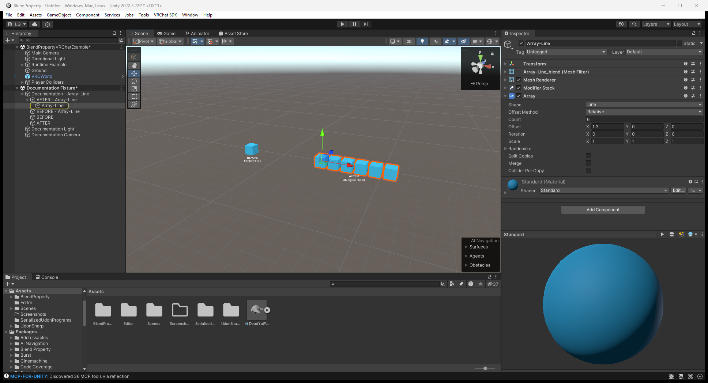](images/features/modifier-array-line.png)

[Open full-size screenshot](images/features/modifier-array-line.png)

## Array: Circle

**Add Component path:** `Blend Property/Modifiers/Generate/Array`

**Use:** Choose Shape Circle, Count 6, Radius 2 and central axis Y.

**Result:** Six copies form a full circle; Arc uses Sweep Angle instead.

[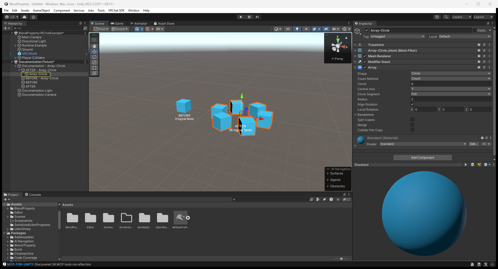](images/features/modifier-array-circle.png)

[Open full-size screenshot](images/features/modifier-array-circle.png)

## Array: Curve

**Add Component path:** `Blend Property/Modifiers/Generate/Array`

**Use:** Choose Shape Curve and assign an ordered list of path Transforms (or a Unity Splines container). Set Count 6.

**Result:** Copies follow the path and Align Rotation turns them along it.

[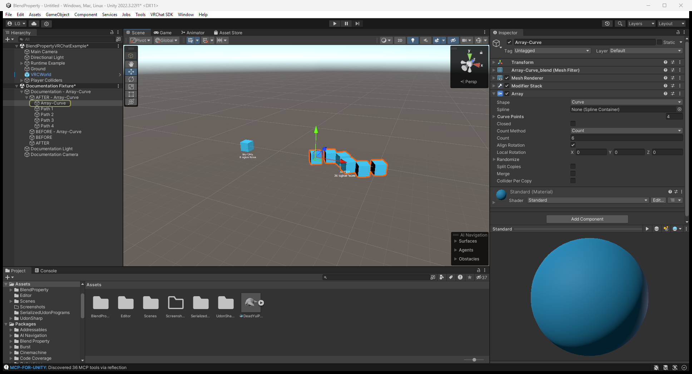](images/features/modifier-array-curve.png)

[Open full-size screenshot](images/features/modifier-array-curve.png)

## Array: Transform

**Add Component path:** `Blend Property/Modifiers/Generate/Array`

**Use:** Choose Shape Transform and assign Array Step. Offset that object by X 1.3, Y 0.3 and rotate Z 12 degrees.

**Result:** Each copy repeats the step object's position and rotation.

[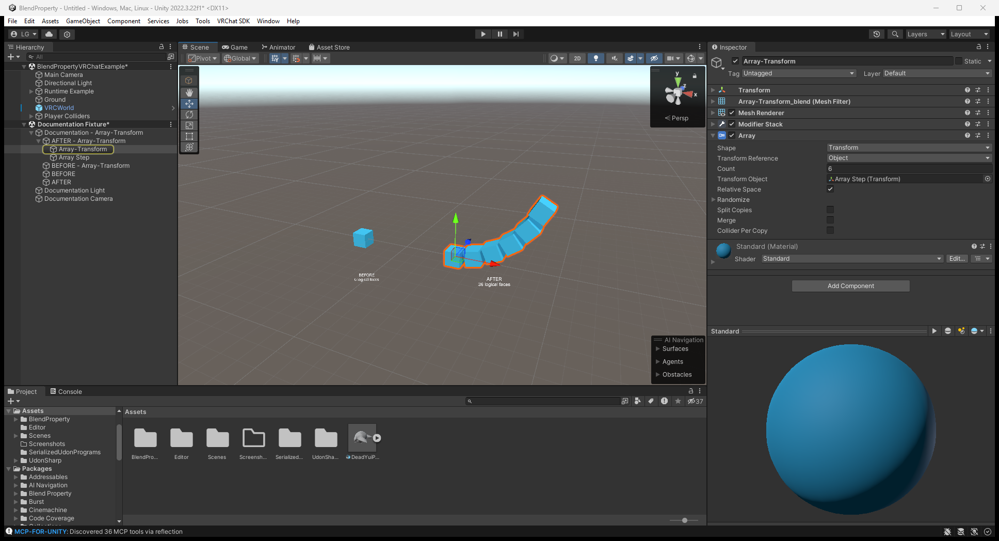](images/features/modifier-array-transform.png)

[Open full-size screenshot](images/features/modifier-array-transform.png)

## Bevel

**Add Component path:** `Blend Property/Modifiers/Generate/Bevel`

**Use:** Add Bevel to a cube. Set Width 0.16 and Segments 4; keep Clamp Overlap enabled.

**Result:** Edges become rounded strips. Inspect the actual corner shading in the result.

[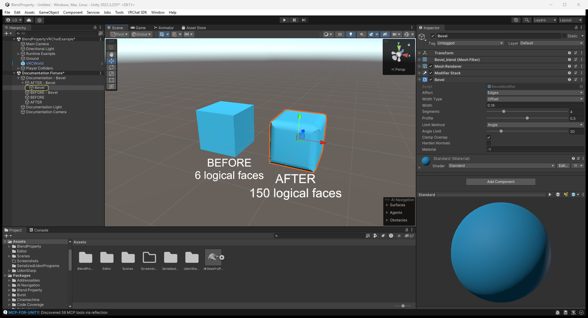](images/features/modifier-bevel.png)

[Open full-size screenshot](images/features/modifier-bevel.png)

## Boolean

**Add Component path:** `Blend Property/Modifiers/Generate/Boolean`

**Use:** Use closed input and cutter meshes. Choose Difference, assign a sphere Target and hide only its MeshRenderer. Move it into the cube.

**Result:** The overlapping sphere is subtracted from the cube. Moving Target updates the cut.

[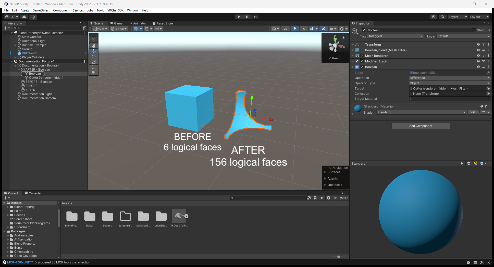](images/features/modifier-boolean.png)

[Open full-size screenshot](images/features/modifier-boolean.png)

## Decimate

**Add Component path:** `Blend Property/Modifiers/Generate/Decimate`

**Use:** Use a sphere. Choose Collapse and Ratio 0.12.

**Result:** The mesh has fewer faces; the wire view and mesh make the reduction visible.

[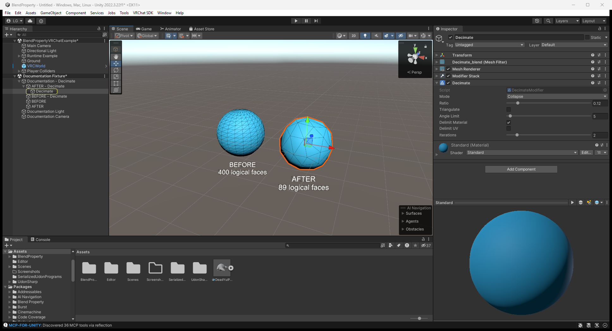](images/features/modifier-decimate.png)

[Open full-size screenshot](images/features/modifier-decimate.png)

## Mirror

**Add Component path:** `Blend Property/Modifiers/Generate/Mirror`

**Use:** Offset the source vertices to one side of the origin and enable X. Optionally assign Mirror Object for a different plane.

**Result:** A mirrored copy appears across the X plane. An already symmetric cube would hide this difference.

[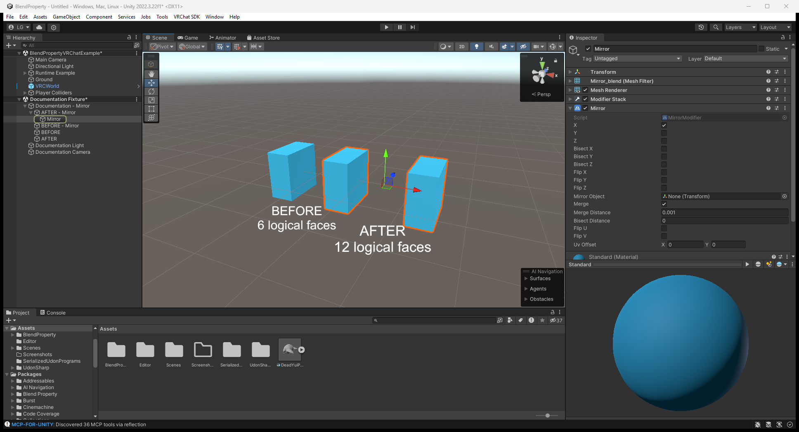](images/features/modifier-mirror.png)

[Open full-size screenshot](images/features/modifier-mirror.png)

## Remesh

**Add Component path:** `Blend Property/Modifiers/Generate/Remesh`

**Use:** Use a closed sphere. Choose Blocks and Octree Depth 3.

**Result:** The sphere becomes a coarse voxel-shaped surface. Smooth, Sharp and Voxel are other supported modes.

[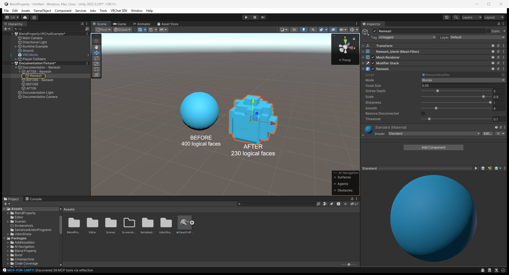](images/features/modifier-remesh.png)

[Open full-size screenshot](images/features/modifier-remesh.png)

## Screw

**Add Component path:** `Blend Property/Modifiers/Generate/Screw`

**Use:** Use a thin strip of faces offset from the Y axis. Set Steps 32, Screw Offset 0.7 and Iterations 2.

**Result:** The strip sweeps into a two-turn spiral. Unity meshes cannot supply loose profile edges.

[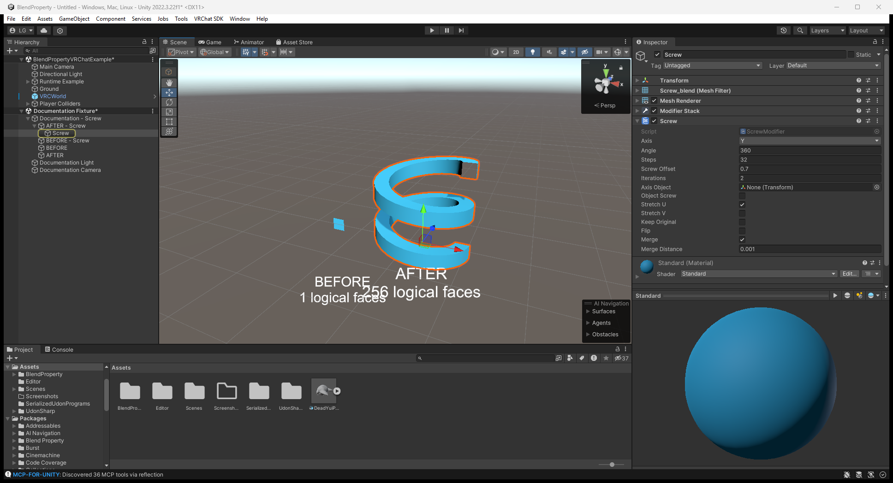](images/features/modifier-screw.png)

[Open full-size screenshot](images/features/modifier-screw.png)

## Solidify

**Add Component path:** `Blend Property/Modifiers/Generate/Solidify`

**Use:** Use an open plane. Set Thickness 0.35 and keep Fill Rim enabled.

**Result:** The plane gains thickness and closed side walls.

[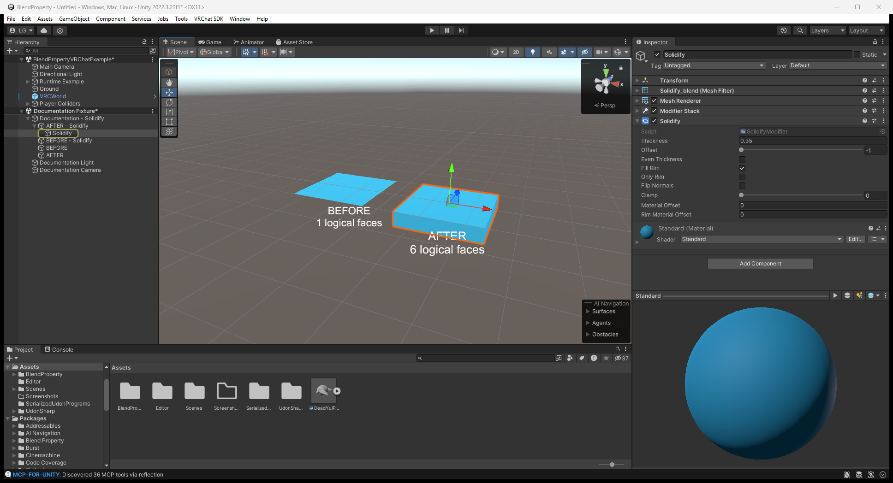](images/features/modifier-solidify.png)

[Open full-size screenshot](images/features/modifier-solidify.png)

## Subdivision Surface

**Add Component path:** `Blend Property/Modifiers/Generate/Subdivision Surface`

**Use:** Add it to a cube. Choose Catmull Clark and Levels 3. Use Simple when you need more vertices without rounding.

**Result:** The cube rounds off and the logical face count increases.

[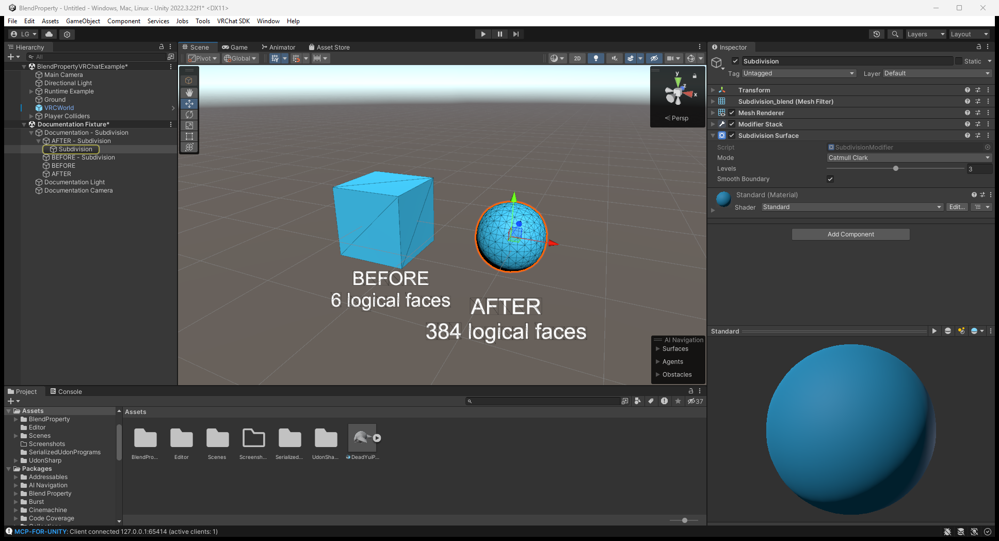](images/features/modifier-subdivision.png)

[Open full-size screenshot](images/features/modifier-subdivision.png)

## Triangulate

**Add Component path:** `Blend Property/Modifiers/Generate/Triangulate`

**Use:** Use a cube with Join Triangles enabled on the stack. Set Quad Method Beauty and Minimum Vertices 4.

**Result:** Logical quad faces become triangles for later modifiers. Unity already draws all meshes as triangles, so the silhouette and visible wire edges can stay the same; the scene labels report logical face counts.

[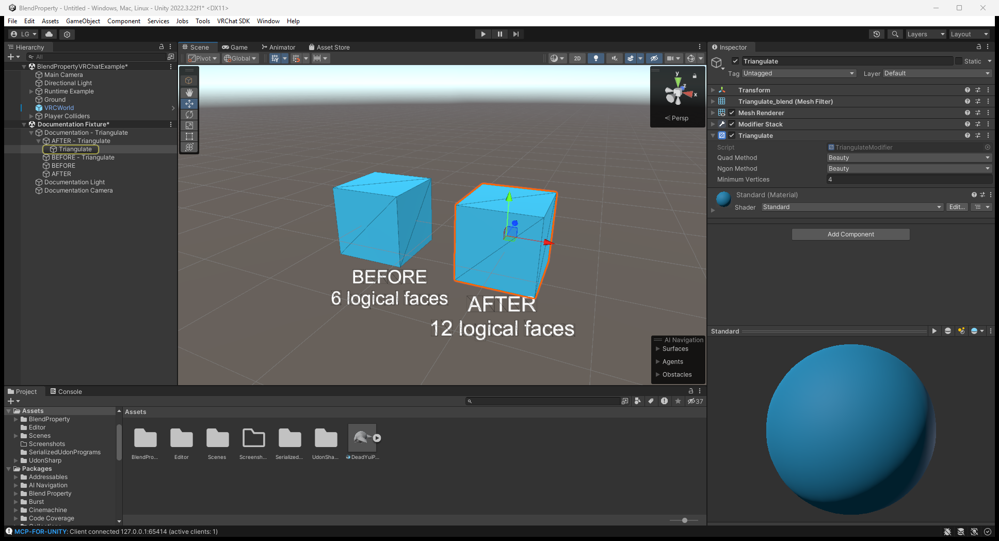](images/features/modifier-triangulate.png)

[Open full-size screenshot](images/features/modifier-triangulate.png)

## Weld

**Add Component path:** `Blend Property/Modifiers/Generate/Weld`

**Use:** For a visible demonstration, use a plane with vertices 0.25 m apart and set Distance 0.26. Use a much smaller distance to clean seams in a real asset.

**Result:** Nearby vertices merge and some faces collapse; compare the surface and logical face counts. An excessive distance destroys detail.

[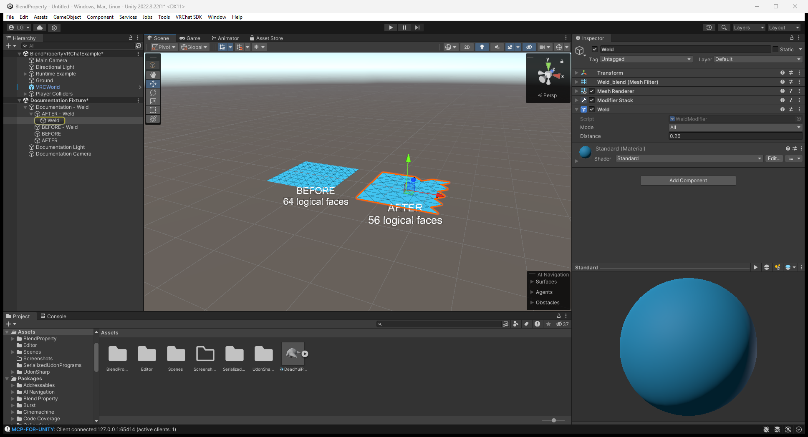](images/features/modifier-weld.png)

[Open full-size screenshot](images/features/modifier-weld.png)

## Wireframe

**Add Component path:** `Blend Property/Modifiers/Generate/Wireframe`

**Use:** Use a cube, Thickness 0.08 and Replace Original on.

**Result:** Solid faces are replaced by struts following their edges.

[Open full-size screenshot](images/features/modifier-wireframe.png)

## Cast

**Add Component path:** `Blend Property/Modifiers/Deform/Cast`

**Use:** Use a subdivided column. Choose Sphere, Factor 1 and Size 1.

**Result:** The vertices move onto a spherical shape. A plain cube has too few vertices for a smooth result.

[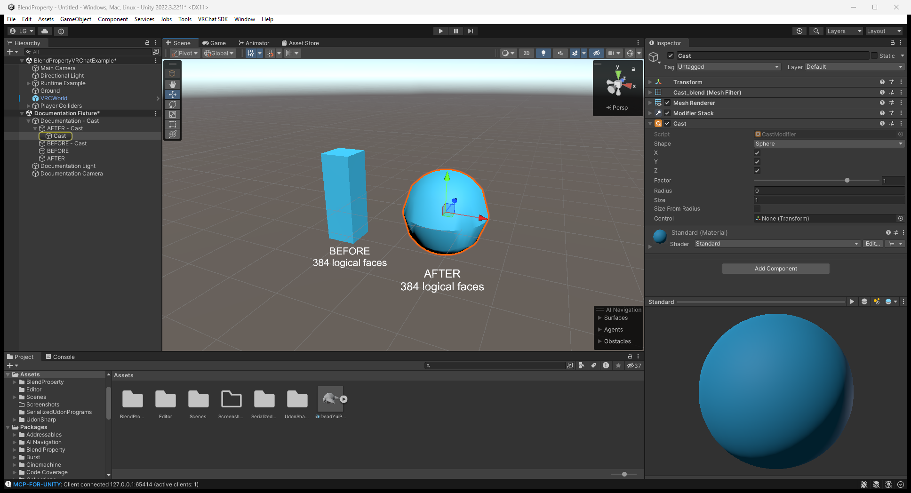](images/features/modifier-cast.png)

[Open full-size screenshot](images/features/modifier-cast.png)

## Curve

**Add Component path:** `Blend Property/Modifiers/Deform/Curve`

**Use:** Use a subdivided bar extending along positive X. Assign four path Transforms and set Deform Axis Pos X.

**Result:** The bar bends continuously along the path; Array Curve instead repeats separate copies.

[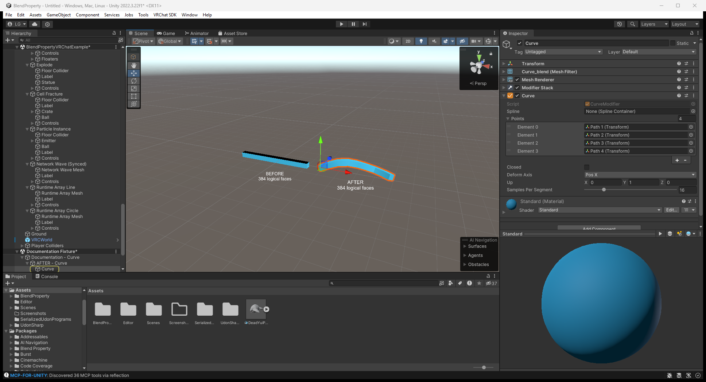](images/features/modifier-curve.png)

[Open full-size screenshot](images/features/modifier-curve.png)

## Displace

**Add Component path:** `Blend Property/Modifiers/Deform/Displace`

**Use:** Use a subdivided plane. Leave Texture empty for procedural noise, set Strength 0.7 and Noise Scale 3.

**Result:** The surface becomes uneven. Assign a texture to use its values instead.

[Open full-size screenshot](images/features/modifier-displace.png)

## Hook

**Add Component path:** `Blend Property/Modifiers/Deform/Hook`

**Use:** Assign Hook Target at the rest position, use Reset Hook, set Radius 1.5, then move Target upward by 1 m.

**Result:** The area near the bound point follows the target with a smooth falloff. Assigning a new target alone establishes its rest position.

[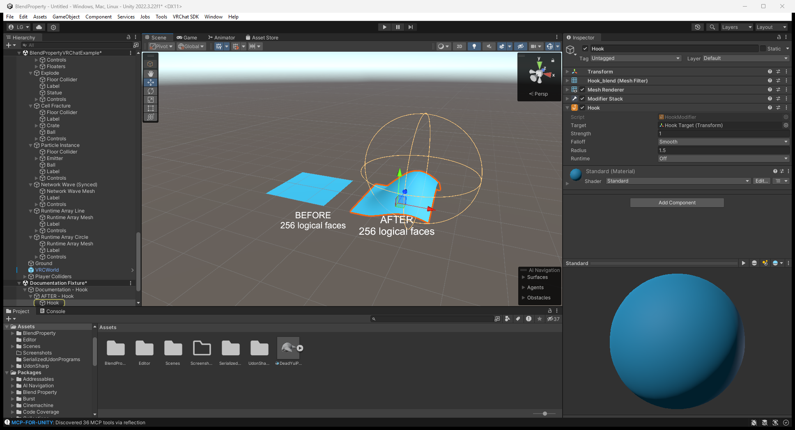](images/features/modifier-hook.png)

[Open full-size screenshot](images/features/modifier-hook.png)

## Laplacian Smooth

**Add Component path:** `Blend Property/Modifiers/Deform/Laplacian Smooth`

**Use:** Use a noisy subdivided plane. Set Factor 0.5, Repeat 8 and Preserve Volume on.

**Result:** The bumps relax while the volume preservation option reduces shrinkage.

[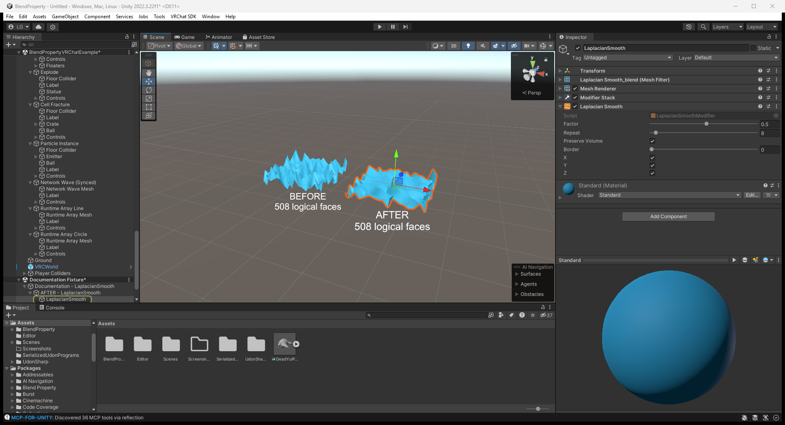](images/features/modifier-laplaciansmooth.png)

[Open full-size screenshot](images/features/modifier-laplaciansmooth.png)

## Lattice

**Add Component path:** `Blend Property/Modifiers/Deform/Lattice`

**Use:** Add Lattice Object to an empty GameObject, fit its scale around a subdivided column, and assign it to Lattice. Keep the 2 x 2 x 2 resolution; select the cage and move its upper points.

**Result:** The upper part of the column follows the cage. Reset Points restores the cage.

[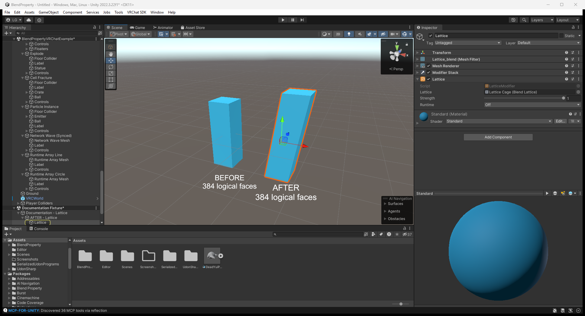](images/features/modifier-lattice.png)

[Open full-size screenshot](images/features/modifier-lattice.png)

## Shrinkwrap

**Add Component path:** `Blend Property/Modifiers/Deform/Shrinkwrap`

**Use:** Use a subdivided plane above a sphere Target. Choose Nearest Surface Point and Offset 0.03.

**Result:** The plane conforms to the sphere's surface, with the configured small gap.

[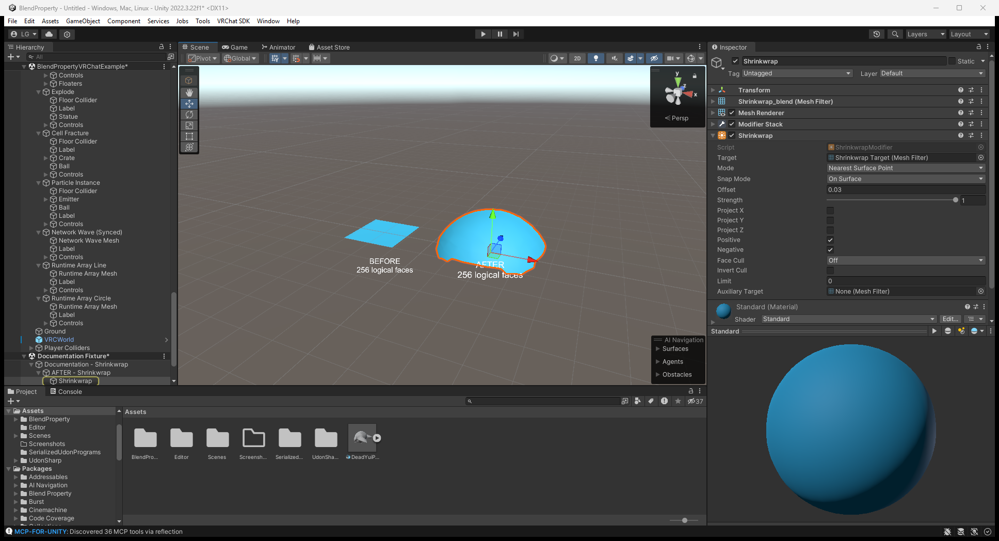](images/features/modifier-shrinkwrap.png)

[Open full-size screenshot](images/features/modifier-shrinkwrap.png)

## Simple Deform: Twist

**Add Component path:** `Blend Property/Modifiers/Deform/Simple Deform`

**Use:** Use a subdivided column. Choose Twist, axis Y and Angle 120.

**Result:** Cross-sections rotate progressively around Y.

[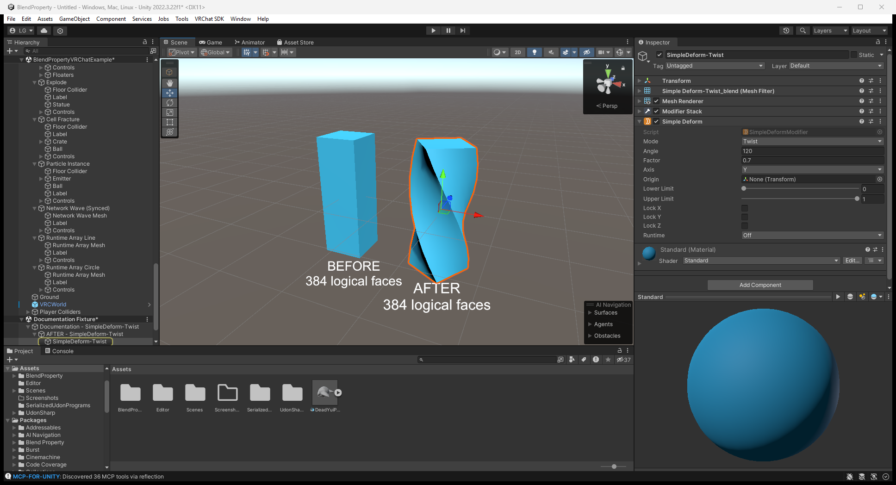](images/features/modifier-simpledeform-twist.png)

[Open full-size screenshot](images/features/modifier-simpledeform-twist.png)

## Simple Deform: Bend

**Add Component path:** `Blend Property/Modifiers/Deform/Simple Deform`

**Use:** Use the same column. Choose Bend, axis Y and Angle 120.

**Result:** The column curves into an arc.

[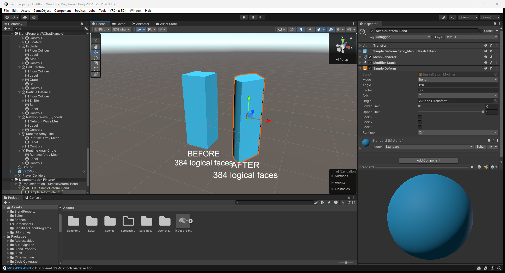](images/features/modifier-simpledeform-bend.png)

[Open full-size screenshot](images/features/modifier-simpledeform-bend.png)

## Simple Deform: Taper

**Add Component path:** `Blend Property/Modifiers/Deform/Simple Deform`

**Use:** Use the same column. Choose Taper, axis Y and Factor 0.7.

**Result:** Cross-sections get narrower or wider along Y.

[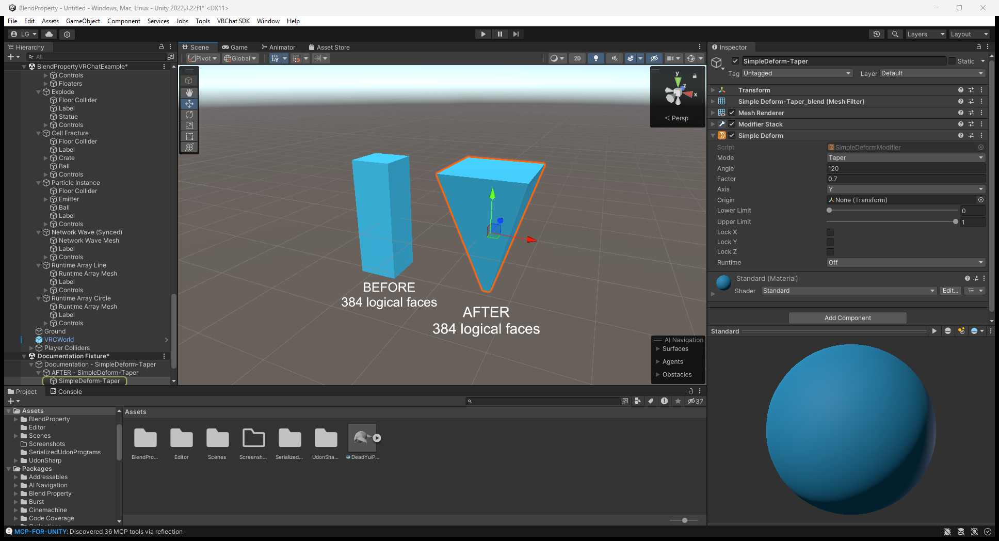](images/features/modifier-simpledeform-taper.png)

[Open full-size screenshot](images/features/modifier-simpledeform-taper.png)

## Simple Deform: Stretch

**Add Component path:** `Blend Property/Modifiers/Deform/Simple Deform`

**Use:** Use the same column. Choose Stretch, axis Y and Factor 0.7.

**Result:** The column length and cross-section change together.

[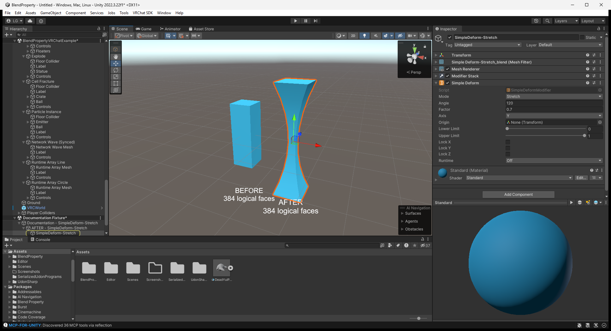](images/features/modifier-simpledeform-stretch.png)

[Open full-size screenshot](images/features/modifier-simpledeform-stretch.png)

## Smooth

**Add Component path:** `Blend Property/Modifiers/Deform/Smooth`

**Use:** Use a noisy subdivided plane, Factor 0.5 and Repeat 10.

**Result:** Neighbour averaging removes the bumps; high repeat counts can shrink the mesh.

[Open full-size screenshot](images/features/modifier-smooth.png)

## Warp

**Add Component path:** `Blend Property/Modifiers/Deform/Warp`

**Use:** Assign From at rest and To 1 m higher. Set Radius 1.6 and Strength 1.

**Result:** Vertices near From move toward the To transform with falloff.

[Open full-size screenshot](images/features/modifier-warp.png)

## Wave

**Add Component path:** `Blend Property/Modifiers/Deform/Wave`

**Use:** Use a subdivided plane, Height 0.4, Width 0.8 and Time 1.5. Scrub Time for other static snapshots.

**Result:** A wave deforms the plane. Runtime Off is baked; GPU and Animate are needed for automatic live motion.

[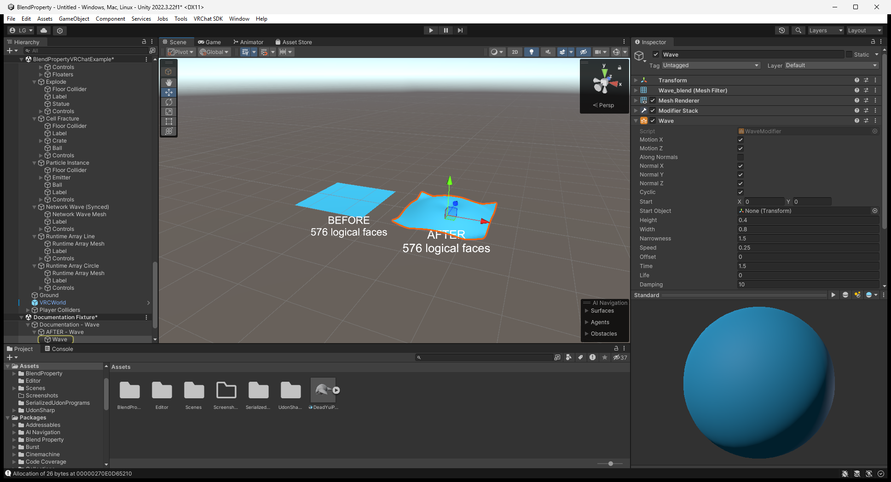](images/features/modifier-wave.png)

[Open full-size screenshot](images/features/modifier-wave.png)

## UV Project

**Add Component path:** `Blend Property/Modifiers/Edit/UV Project`

**Use:** Use a checker material on a plane. Assign a projector rotated X 90 degrees and set Scale to 1.5 on UV0.

**Result:** The checker is projected along the projector's local Z. Geometry is unchanged.

[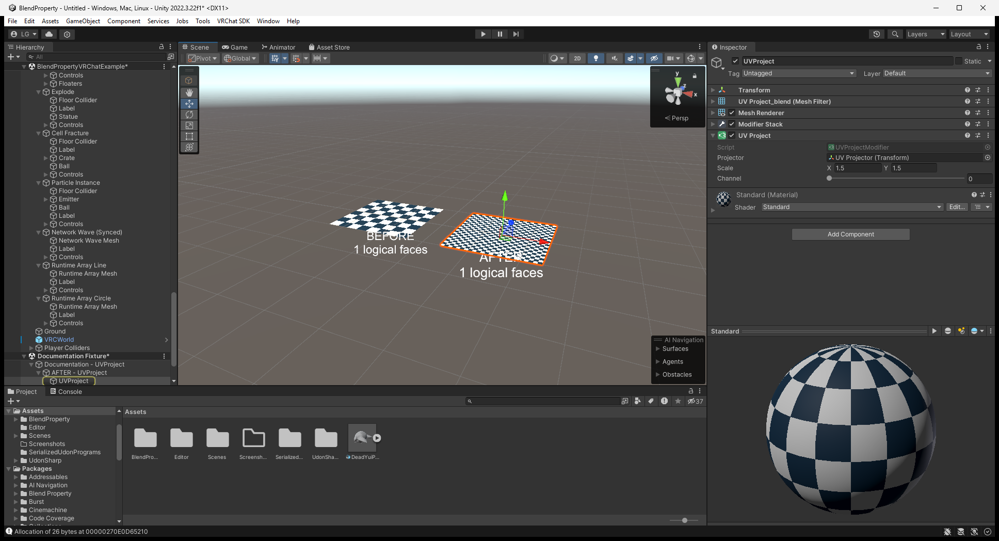](images/features/modifier-uvproject.png)

[Open full-size screenshot](images/features/modifier-uvproject.png)

## UV Warp

**Add Component path:** `Blend Property/Modifiers/Edit/UV Warp`

**Use:** Use a checker material, Channel 0, Rotation 35 and Scale 2.

**Result:** The checker rotates and tiles more densely; mesh positions are unchanged.

[Open full-size screenshot](images/features/modifier-uvwarp.png)

## Smooth by Angle

**Add Component path:** `Blend Property/Modifiers/Normals/Smooth by Angle`

**Use:** Use a cylinder and Angle 45. The input image uses flat shading so the effect is visible.

**Result:** The cylinder's sides become smooth while its cap boundary remains sharp.

[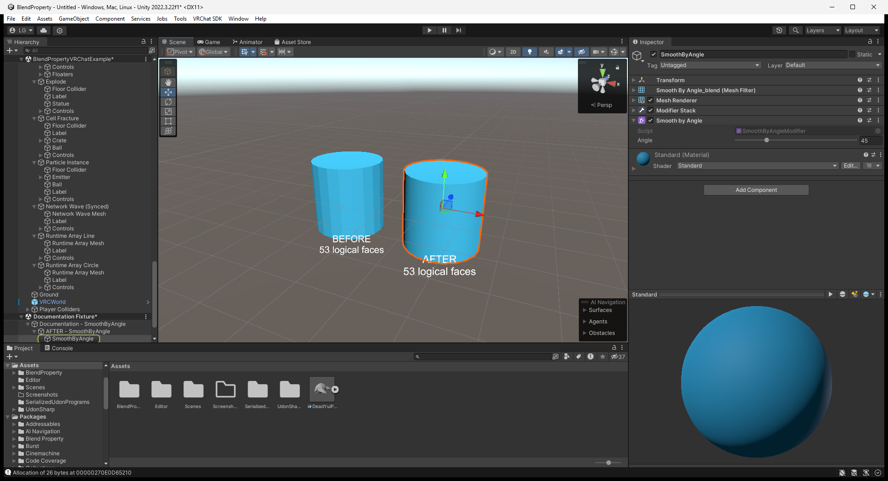](images/features/modifier-smoothbyangle.png)

[Open full-size screenshot](images/features/modifier-smoothbyangle.png)

## Weighted Normal

**Add Component path:** `Blend Property/Modifiers/Normals/Weighted Normal`

**Use:** Use a beveled cube with smooth stack shading. Choose Face Area, Weight 50 and Keep Sharp off.

**Result:** Large faces pull the shading normals toward themselves; the geometry stays the same.

[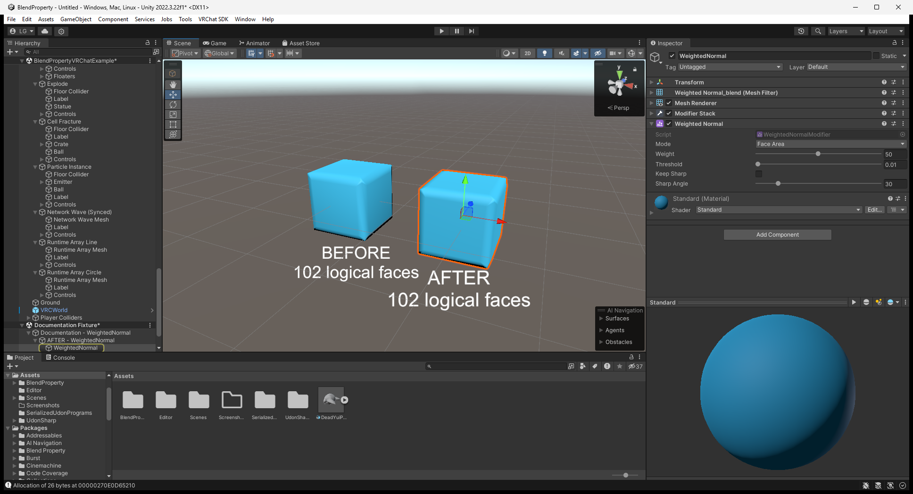](images/features/modifier-weightednormal.png)

[Open full-size screenshot](images/features/modifier-weightednormal.png)

## Normal Edit

**Add Component path:** `Blend Property/Modifiers/Normals/Normal Edit`

**Use:** Use a cylinder. Choose Radial, Offset Y -0.5 and Mix Copy.

**Result:** Shading normals point away from the offset centre. This changes lighting, not geometry.

[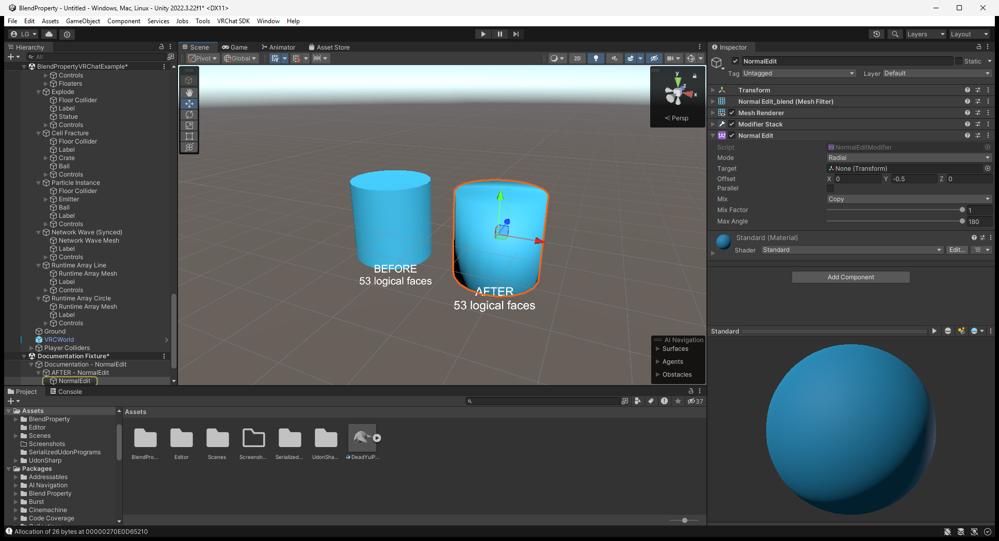](images/features/modifier-normaledit.png)

[Open full-size screenshot](images/features/modifier-normaledit.png)
