# Runtime examples: setup and result

[User guide](BlendProperty.md) · [Modifiers](IllustratedModifiers.md) · [Physics and workflow](IllustratedWorkflow.md)

Open `Packages/Blend Property/Example/VRChat/BlendPropertyVRChatExample.unity`. Each section names a child of **Runtime Example**. Select it, follow the action, then press Play. Turn on **Simulate** on the simulation panel (these examples start paused). The first screenshot shows editor setup; the second shows a local Play Mode capture in ClientSim with the feature running. Click either image for full size.

These screenshots establish local Unity/ClientSim behavior. They do not verify live VRChat multiplayer, late joiners, Quest/mobile performance, or a standalone executable. GPU features use the Built-in render pipeline and compatible graphics hardware. A still image shows one instant of an animation. For these captures, Simulate was enabled and Only When Visible was temporarily disabled so simulations could warm up as the Scene camera moved; these Play Mode changes were not saved to the example scene. ExplodeLocal and BreakLocal were called for the destruction captures.

For standalone projects without the VRChat SDK, the same runtime components compile as MonoBehaviours and use the same bake commands. The separate Standalone example demonstrates Keep at Runtime and RebuildNow(); see the [workflow guide](IllustratedWorkflow.md#standalone-keep-at-runtime).

## Stations

- [Wave Shader (GPU)](#wave-shader)
- [Udon Wave](#wave)
- [Udon Bend](#bend)
- [Udon Lattice](#lattice)
- [Cloth](#cloth)
- [GPU Twist](#twist)
- [GPU Taper](#taper)
- [GPU Stretch](#stretch)
- [GPU Wave HD](#wave-hd)
- [Wind Field](#wind)
- [Vortex Field](#vortex)
- [Dynamic Paint](#paint)
- [Smoke](#smoke)
- [Waves](#waves)
- [Fire](#fire)
- [Liquid](#liquid)
- [Snow](#snow)
- [Soft Body](#soft-body)
- [Particles](#particles)
- [Hair](#hair)
- [Ocean](#ocean)
- [Explode](#explode)
- [Cell Fracture](#fracture)
- [Particle Instance](#particle-instance)
- [Network Wave (Synced)](#network-wave)
- [Runtime Array Line](#array-line)
- [Runtime Array Circle](#array-circle)

## Wave Shader (GPU)

**Select:** `Runtime Example/Wave Shader (GPU)`. **Component:** `BlendUdonPanel`.

**Use:** Select the plane's material and choose Blend Property/Wave. Press Play; use the Height and Speed controls.

**Result to look for:** The subdivided plane waves without a deformer script.

[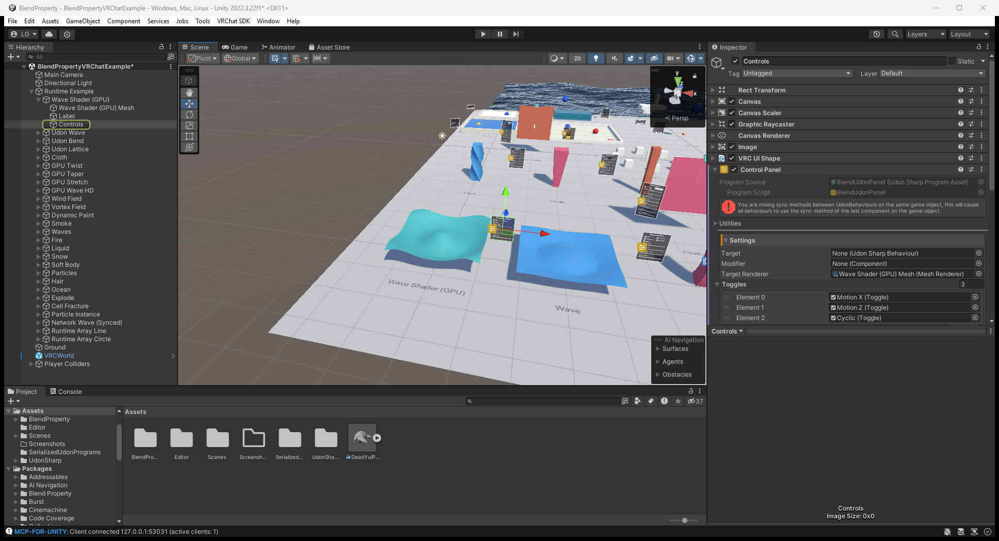](images/features/setup-wave-shader.png)

[Open full-size screenshot](images/features/setup-wave-shader.png)

[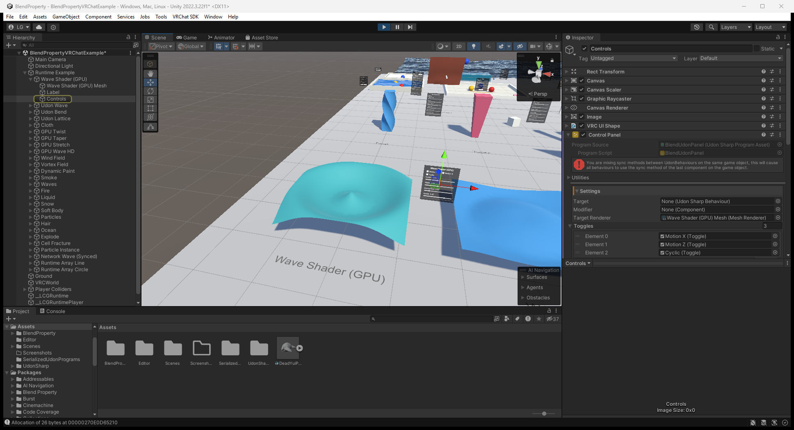](images/features/runtime-wave-shader.png)

[Open full-size screenshot](images/features/runtime-wave-shader.png)

## Udon Wave

**Select:** `Runtime Example/Udon Wave`. **Component:** `WaveModifier`.

**Use:** Select the plane; set Wave Runtime to GPU at the bottom of the stack. Press Play and adjust Height or Speed on the panel.

**Result to look for:** The baked plane becomes a moving wave; Animate advances its time.

[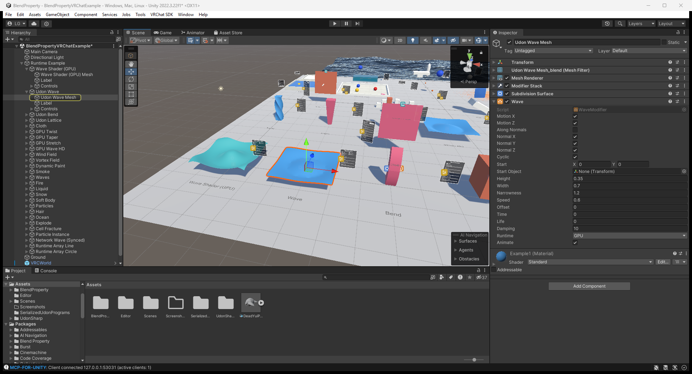](images/features/setup-wave.png)

[Open full-size screenshot](images/features/setup-wave.png)

[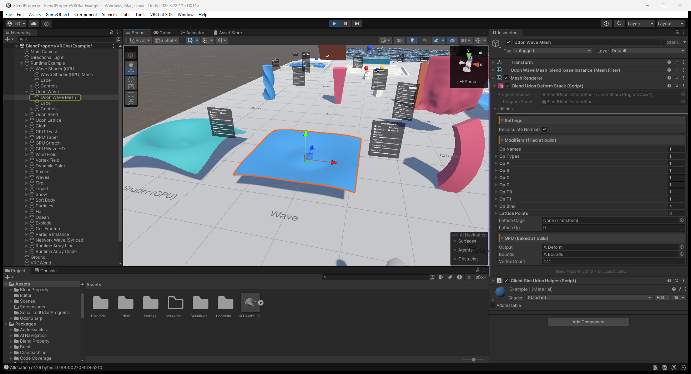](images/features/runtime-wave.png)

[Open full-size screenshot](images/features/runtime-wave.png)

## Udon Bend

**Select:** `Runtime Example/Udon Bend`. **Component:** `SimpleDeformModifier`.

**Use:** Set Simple Deform Mode to Bend, Runtime to GPU and assign Origin. Press Play; the example Animator rotates Origin.

**Result to look for:** The column bends in the rotating Origin's direction.

[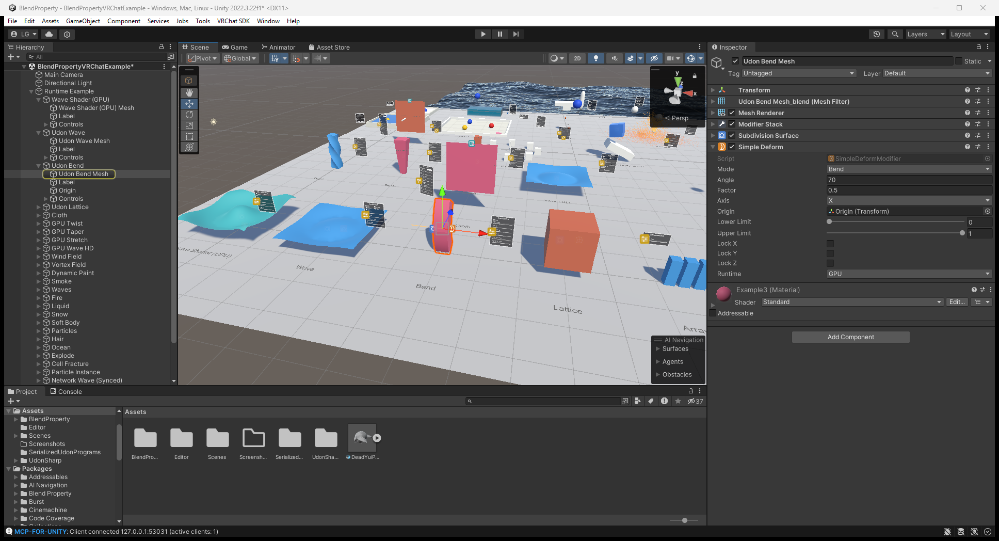](images/features/setup-bend.png)

[Open full-size screenshot](images/features/setup-bend.png)

[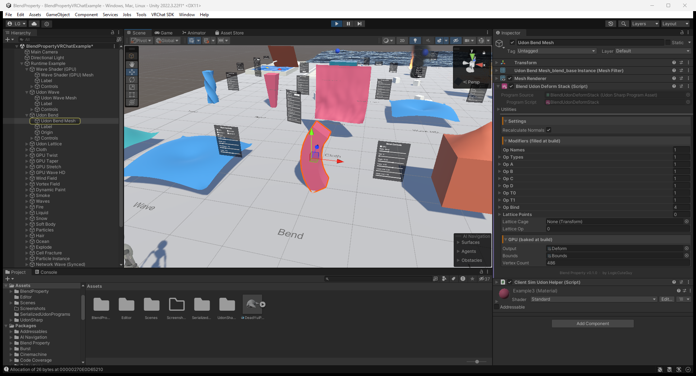](images/features/runtime-bend.png)

[Open full-size screenshot](images/features/runtime-bend.png)

## Udon Lattice

**Select:** `Runtime Example/Udon Lattice`. **Component:** `LatticeModifier`.

**Use:** Assign the Lattice Object, set Runtime to GPU, and create exactly U x V x W child points. Press Play.

**Result to look for:** The animated top centre point lifts the mesh.

[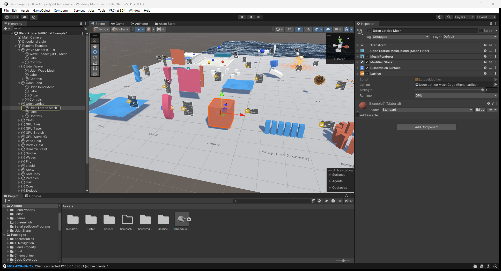](images/features/setup-lattice.png)

[Open full-size screenshot](images/features/setup-lattice.png)

[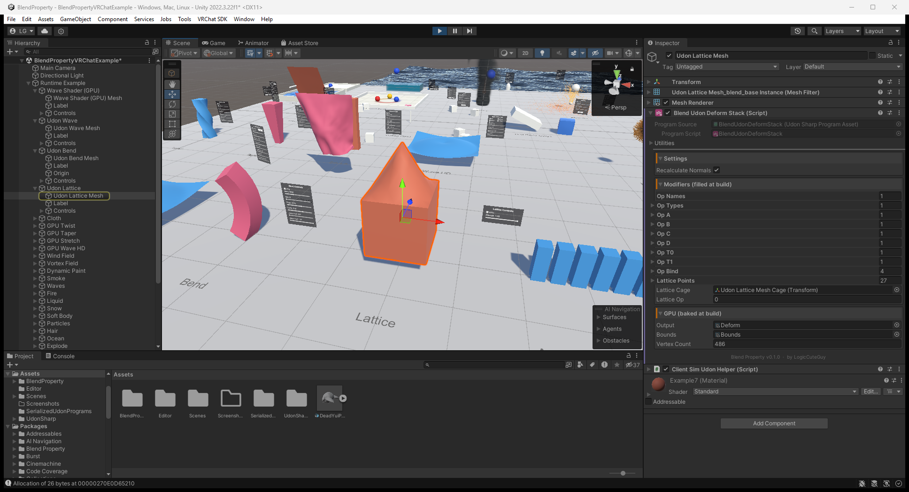](images/features/runtime-lattice.png)

[Open full-size screenshot](images/features/runtime-lattice.png)

## Cloth

**Select:** `Runtime Example/Cloth`. **Component:** `BlendUdonCloth`.

**Use:** Select the sheet, use Bake Cloth after changing its mesh or red-channel pin weights, then press Play. Try the Cloth panel and its reset button.

**Result to look for:** The pinned sheet sags and responds to the sphere collider.

[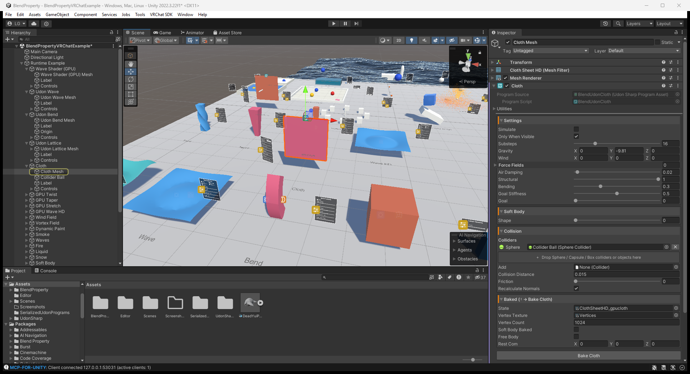](images/features/setup-cloth.png)

[Open full-size screenshot](images/features/setup-cloth.png)

[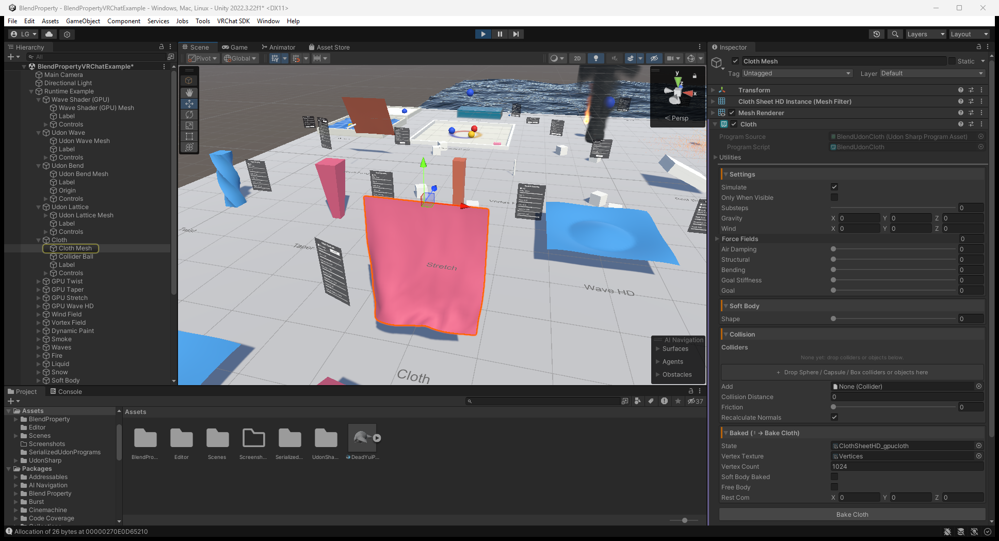](images/features/runtime-cloth.png)

[Open full-size screenshot](images/features/runtime-cloth.png)

## GPU Twist

**Select:** `Runtime Example/GPU Twist`. **Component:** `SimpleDeformModifier`.

**Use:** Use Simple Deform: Twist, Y axis, Runtime GPU. Press Play and change Angle from the panel.

**Result to look for:** The column twists around its vertical axis.

[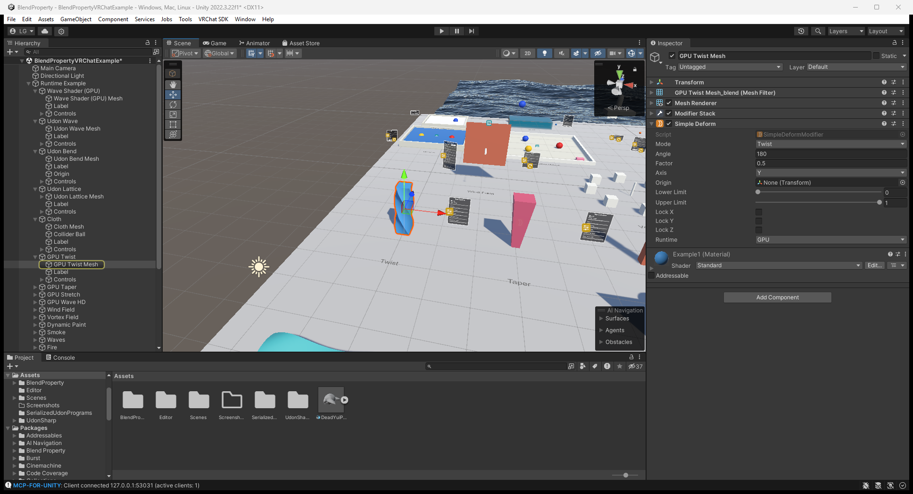](images/features/setup-twist.png)

[Open full-size screenshot](images/features/setup-twist.png)

[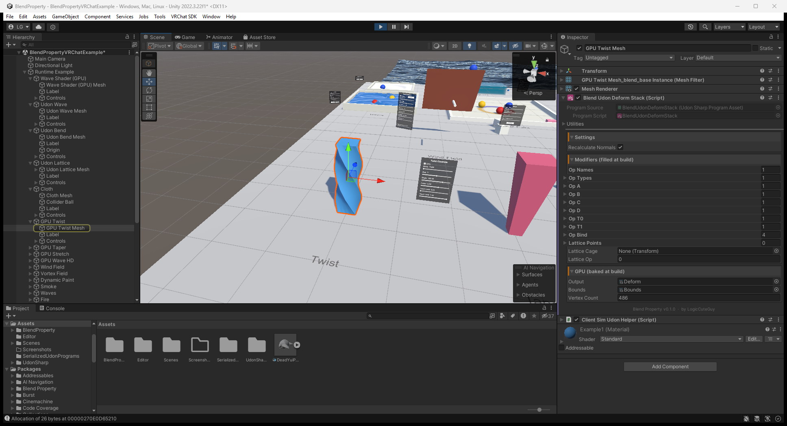](images/features/runtime-twist.png)

[Open full-size screenshot](images/features/runtime-twist.png)

## GPU Taper

**Select:** `Runtime Example/GPU Taper`. **Component:** `SimpleDeformModifier`.

**Use:** Use Simple Deform: Taper, Y axis, Runtime GPU. Press Play and change Factor.

**Result to look for:** The column narrows or widens along Y.

[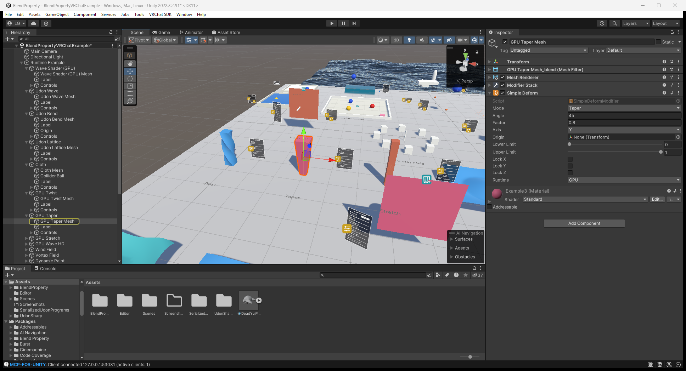](images/features/setup-taper.png)

[Open full-size screenshot](images/features/setup-taper.png)

[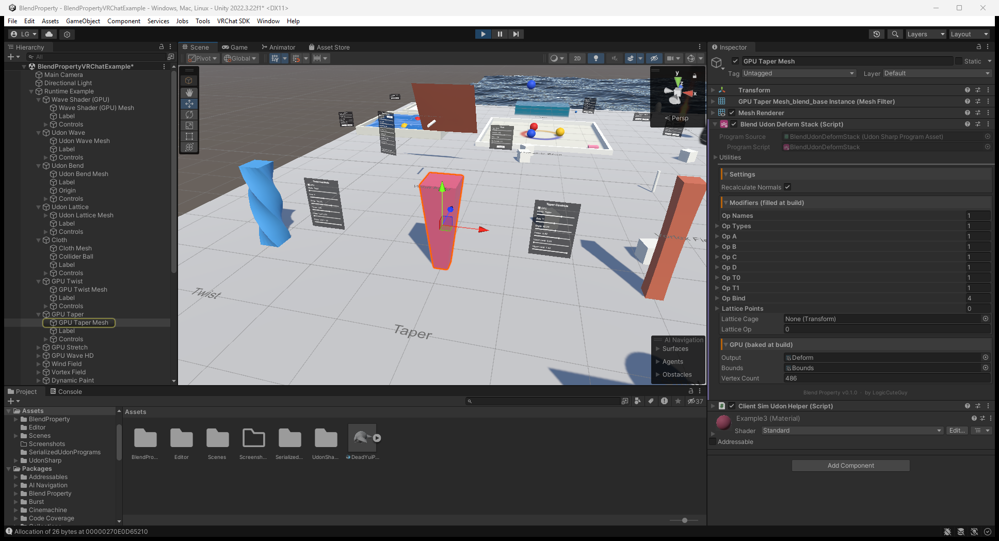](images/features/runtime-taper.png)

[Open full-size screenshot](images/features/runtime-taper.png)

## GPU Stretch

**Select:** `Runtime Example/GPU Stretch`. **Component:** `SimpleDeformModifier`.

**Use:** Use Simple Deform: Stretch, Y axis, Runtime GPU. Press Play and change Factor.

**Result to look for:** The column stretches with the matching cross-section change.

[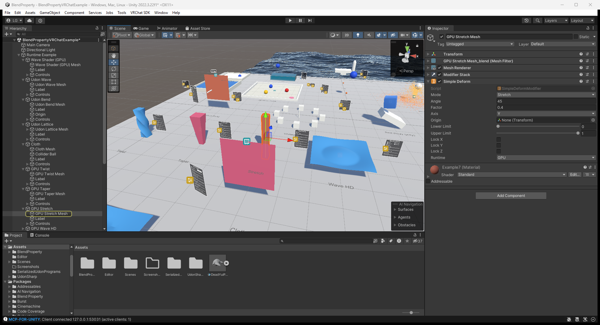](images/features/setup-stretch.png)

[Open full-size screenshot](images/features/setup-stretch.png)

[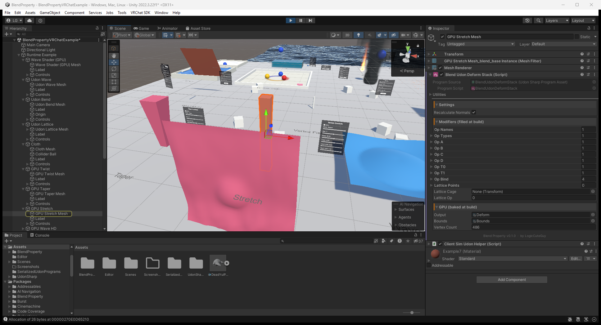](images/features/runtime-stretch.png)

[Open full-size screenshot](images/features/runtime-stretch.png)

## GPU Wave HD

**Select:** `Runtime Example/GPU Wave HD`. **Component:** `WaveModifier`.

**Use:** Use a denser subdivided plane, then Wave: Runtime GPU. Press Play and change Height and Speed.

**Result to look for:** The denser mesh displays a smoother wave silhouette.

[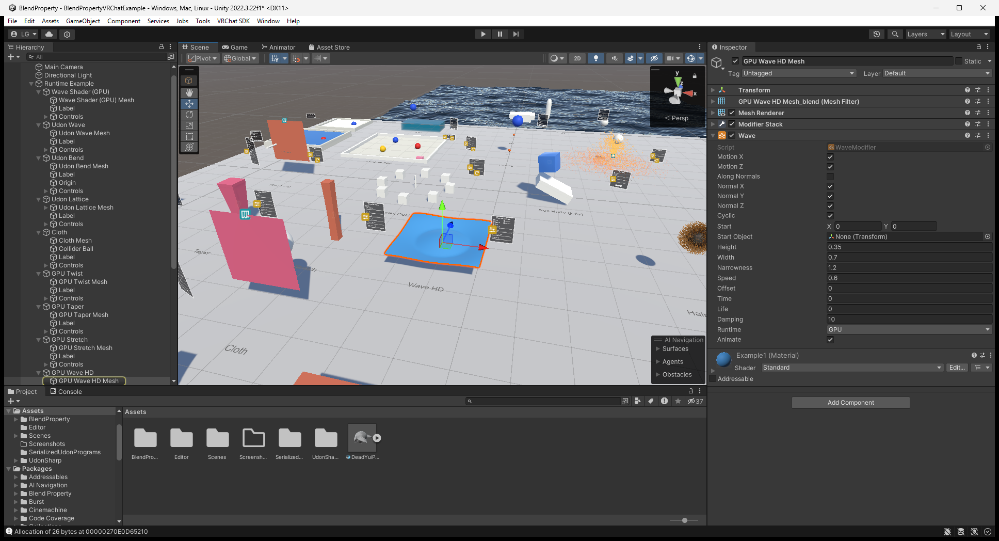](images/features/setup-wave-hd.png)

[Open full-size screenshot](images/features/setup-wave-hd.png)

[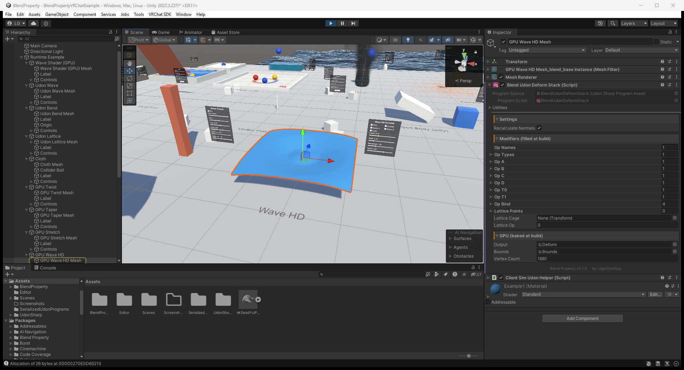](images/features/runtime-wave-hd.png)

[Open full-size screenshot](images/features/runtime-wave-hd.png)

## Wind Field

**Select:** `Runtime Example/Wind Field`. **Component:** `BlendUdonForceField`.

**Use:** Select the field, set Type to Wind, and list it in the cloth's Force Fields (Physics Tab can link these automatically). Press Play, then rotate the field or change Type.

**Result to look for:** Wind pushes the cloth along the field's local up axis.

[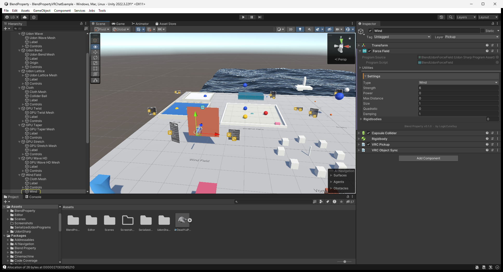](images/features/setup-wind.png)

[Open full-size screenshot](images/features/setup-wind.png)

[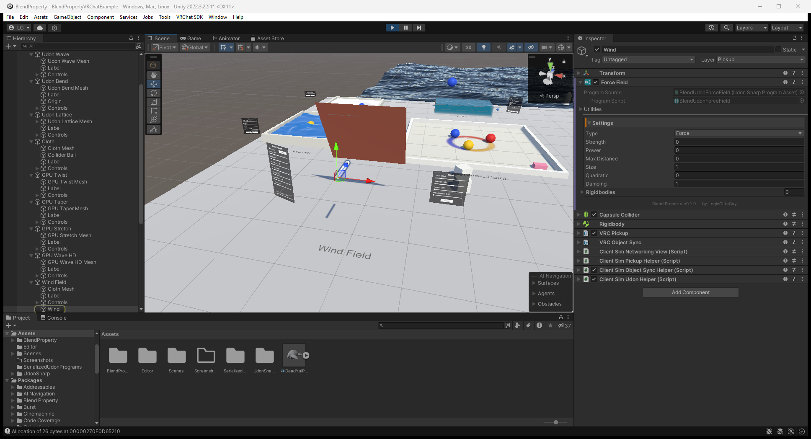](images/features/runtime-wind.png)

[Open full-size screenshot](images/features/runtime-wind.png)

## Vortex Field

**Select:** `Runtime Example/Vortex Field`. **Component:** `BlendUdonForceField`.

**Use:** Set Type to Vortex and assign the eight Rigidbody cubes. Press Play; adjust Strength or select Harmonic. Reset Objects restores the props.

**Result to look for:** The cubes swirl around the field axis; Harmonic pulls them toward the centre.

[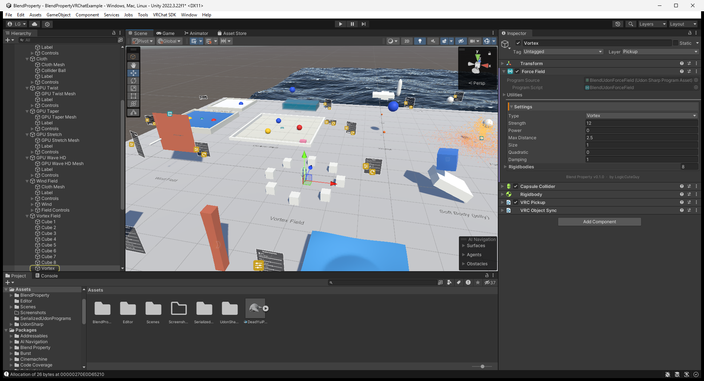](images/features/setup-vortex.png)

[Open full-size screenshot](images/features/setup-vortex.png)

[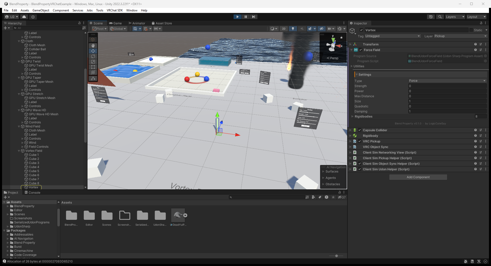](images/features/runtime-vortex.png)

[Open full-size screenshot](images/features/runtime-vortex.png)

## Dynamic Paint

**Select:** `Runtime Example/Dynamic Paint`. **Component:** `BlendUdonDynamicPaint`.

**Use:** Bake the Dynamic Paint Canvas, assign Paint Brushes and press Play. Move a brush over the floor; use Dissolve, Clear Paint and Reset.

**Result to look for:** Coloured brush trails appear and fade; wet paint is darker.

[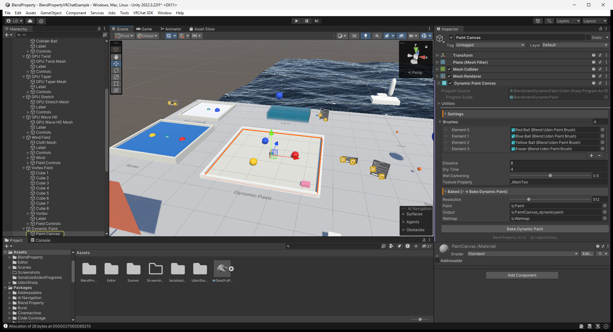](images/features/setup-paint.png)

[Open full-size screenshot](images/features/setup-paint.png)

[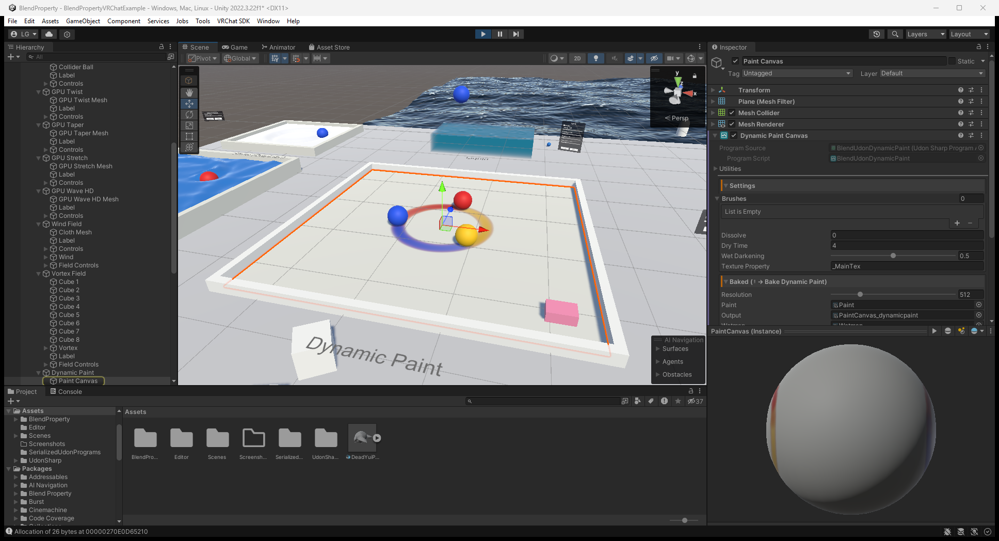](images/features/runtime-paint.png)

[Open full-size screenshot](images/features/runtime-paint.png)

## Smoke

**Select:** `Runtime Example/Smoke`. **Component:** `BlendUdonFluid`.

**Use:** Use a Gas Fluid Domain and Smoke Flow; Bake Fluid Domain, then press Play. Move the source or obstacle and adjust Heat, Vorticity and Dissolve.

**Result to look for:** The smoke plume rises around the sphere effector. For visibility against the bright floor, the result capture uses a dark Smoke Color (0.18, 0.20, 0.23), Thickness 55, and Flow Radius 0.4; those adjustments were made only in Play Mode.

[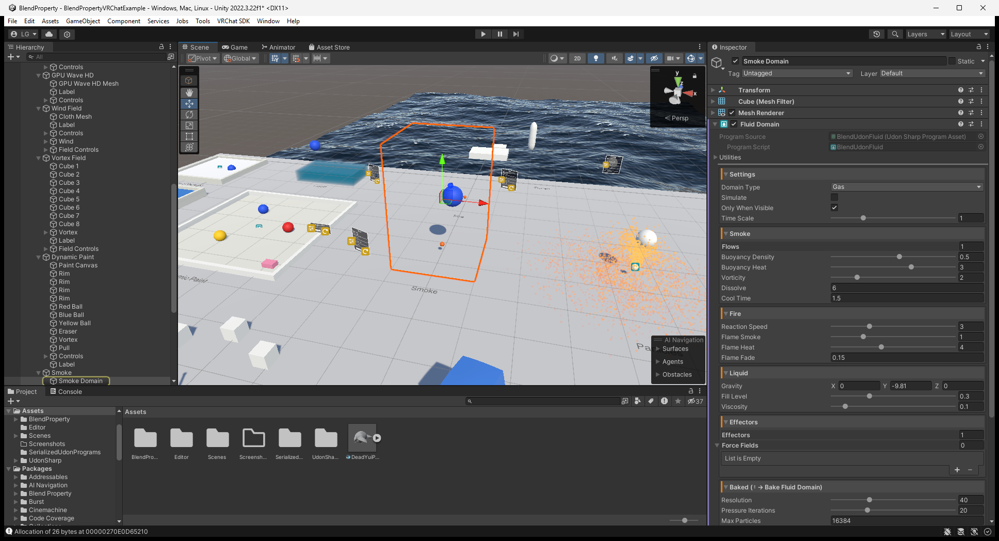](images/features/setup-smoke.png)

[Open full-size screenshot](images/features/setup-smoke.png)

[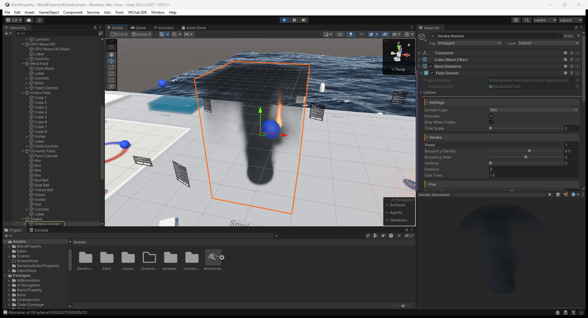](images/features/runtime-smoke.png)

[Open full-size screenshot](images/features/runtime-smoke.png)

## Waves

**Select:** `Runtime Example/Waves`. **Component:** `BlendUdonDynamicWaves`.

**Use:** Bake Dynamic Waves on a subdivided surface, assign the brushes/fields, then press Play. Move a brush or adjust Speed and Damping; Flatten resets the surface.

**Result to look for:** The moving balls leave ripples in the pool.

[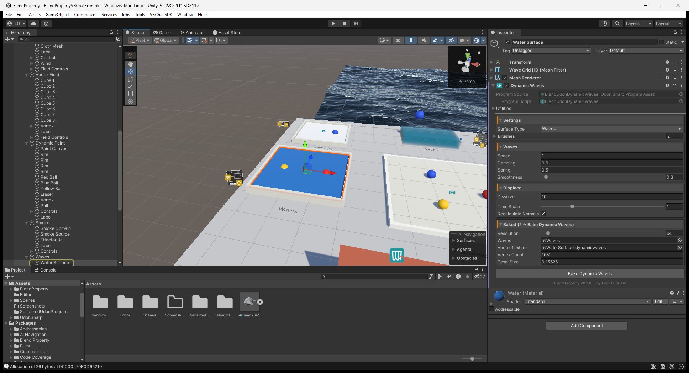](images/features/setup-waves.png)

[Open full-size screenshot](images/features/setup-waves.png)

[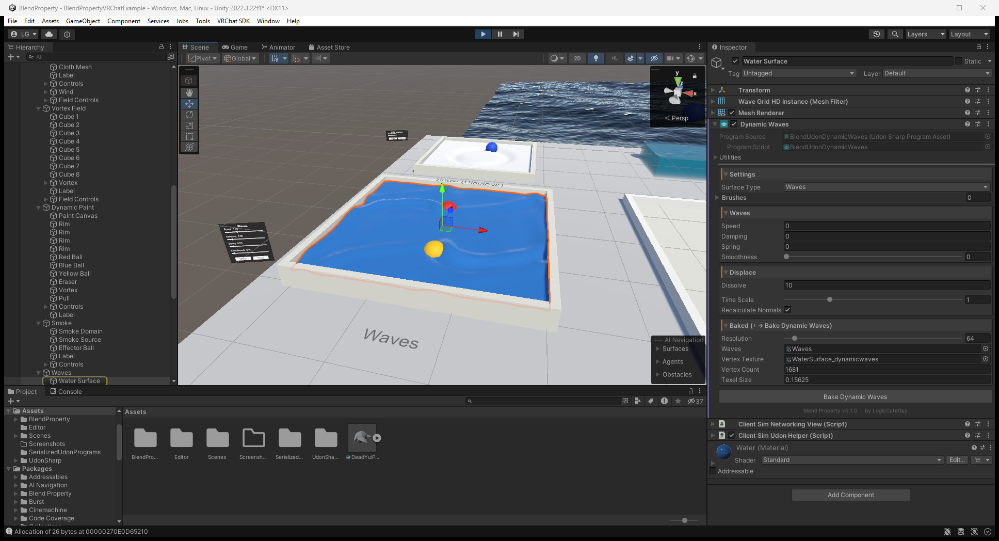](images/features/runtime-waves.png)

[Open full-size screenshot](images/features/runtime-waves.png)

## Fire

**Select:** `Runtime Example/Fire`. **Component:** `BlendUdonFluid`.

**Use:** Use a Gas domain and Fire + Smoke Flow. Bake Fluid Domain, press Play, then move the torch/source and change Reaction Speed or Flame Smoke.

**Result to look for:** The source produces flames that become smoke.

[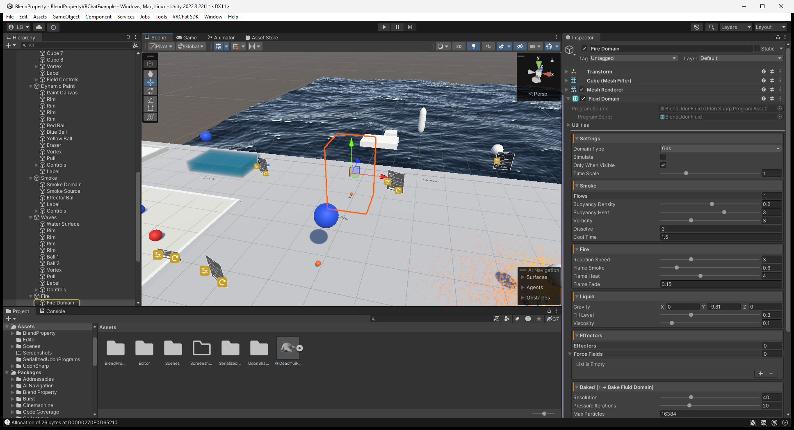](images/features/setup-fire.png)

[Open full-size screenshot](images/features/setup-fire.png)

[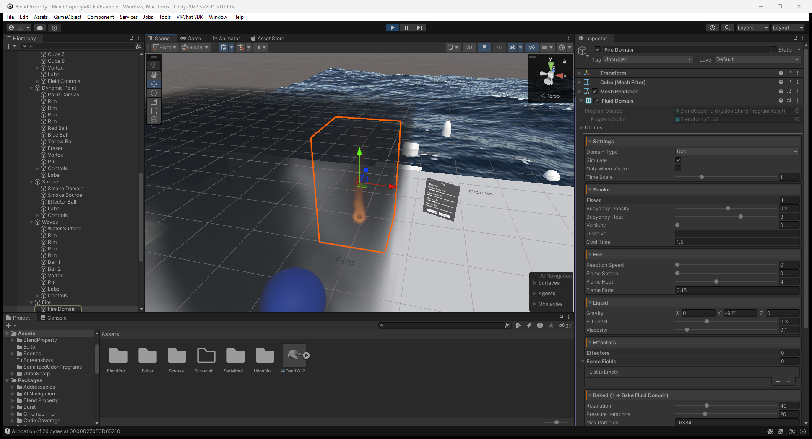](images/features/runtime-fire.png)

[Open full-size screenshot](images/features/runtime-fire.png)

## Liquid

**Select:** `Runtime Example/Liquid`. **Component:** `BlendUdonFluid`.

**Use:** Choose the Liquid domain, set Fill Level and Bake Fluid Domain. Press Play; move the source over the tank or drop the sphere into it. Refill restores the initial fill.

**Result to look for:** Water occupies the tank and reacts to its source and sphere.

[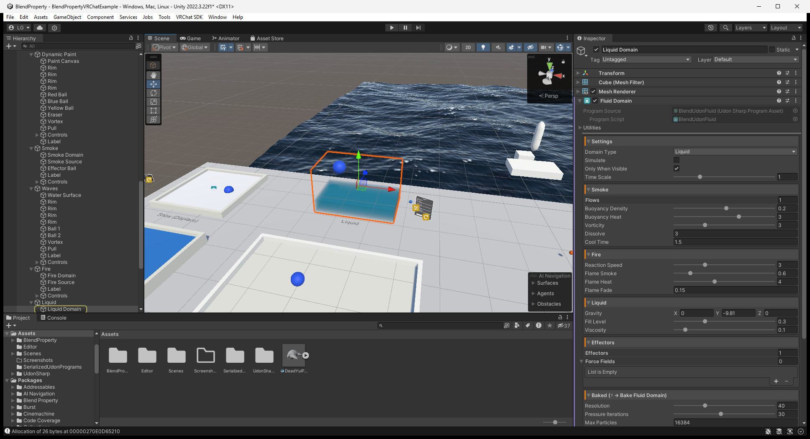](images/features/setup-liquid.png)

[Open full-size screenshot](images/features/setup-liquid.png)

[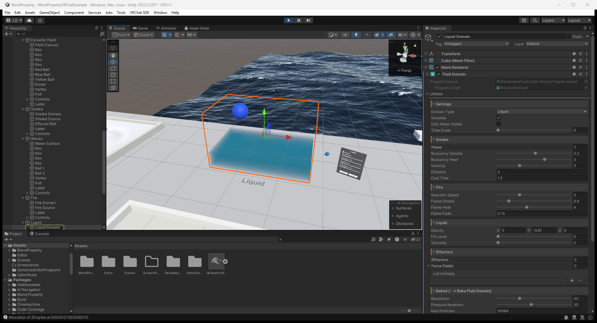](images/features/runtime-liquid.png)

[Open full-size screenshot](images/features/runtime-liquid.png)

## Snow

**Select:** `Runtime Example/Snow`. **Component:** `BlendUdonDynamicWaves`.

**Use:** Choose the Displace surface, bake it, then press Play. Move the brush through it; adjust Dissolve and use Flatten.

**Result to look for:** The ball leaves a temporary depression in the snow.

[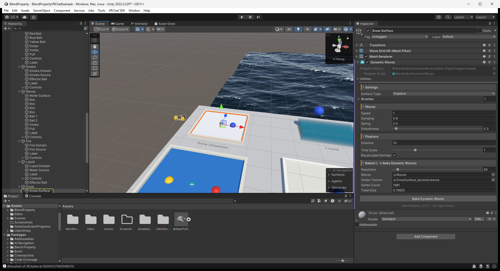](images/features/setup-snow.png)

[Open full-size screenshot](images/features/setup-snow.png)

[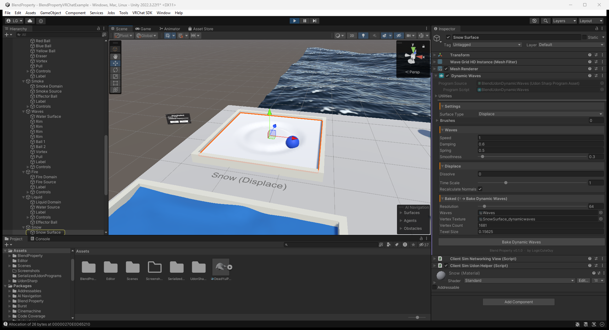](images/features/runtime-snow.png)

[Open full-size screenshot](images/features/runtime-snow.png)

## Soft Body

**Select:** `Runtime Example/Soft Body`. **Component:** `BlendUdonCloth`.

**Use:** Bake Cloth on the closed mesh, turn Shape on, and assign floor/ramp colliders. Press Play; move or throw the object and adjust Shape/Structural.

**Result to look for:** The rounded cube behaves like a deformable jelly body.

[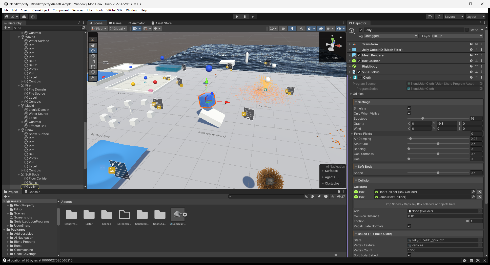](images/features/setup-soft-body.png)

[Open full-size screenshot](images/features/setup-soft-body.png)

[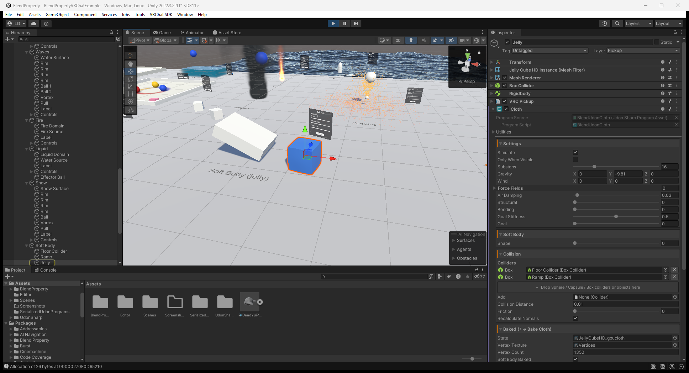](images/features/runtime-soft-body.png)

[Open full-size screenshot](images/features/runtime-soft-body.png)

## Particles

**Select:** `Runtime Example/Particles`. **Component:** `BlendUdonParticles`.

**Use:** Bake the Particle System, keep Render As Halo, assign colliders and press Play. Move the emitter; change Lifetime, Random, Bounce or Size.

**Result to look for:** A fountain of billboard particles falls and bounces.

[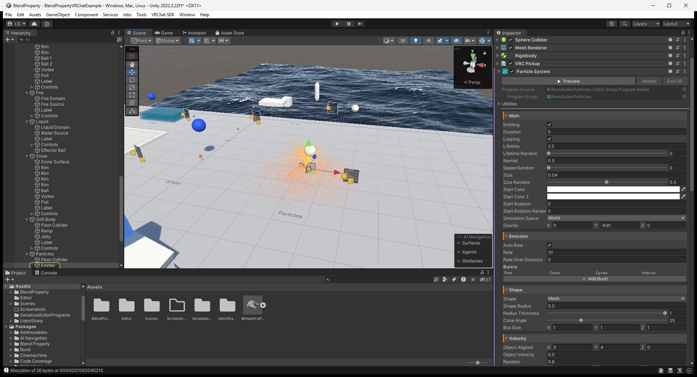](images/features/setup-particles.png)

[Open full-size screenshot](images/features/setup-particles.png)

[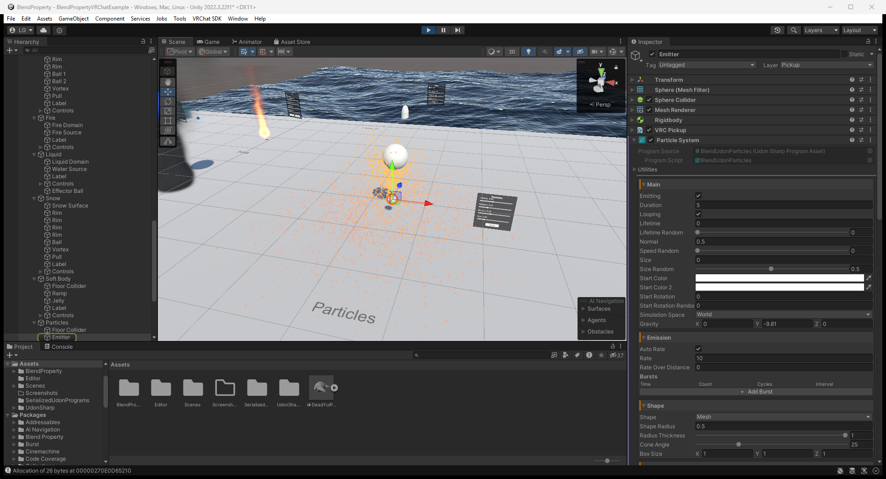](images/features/runtime-particles.png)

[Open full-size screenshot](images/features/runtime-particles.png)

## Hair

**Select:** `Runtime Example/Hair`. **Component:** `BlendUdonHair`.

**Use:** Bake Hair on the sphere, include its sphere collider and a force field, then press Play. Move the sphere and change Stiffness, Air Damping or Substeps.

**Result to look for:** Strands hang and sway around the moving sphere.

[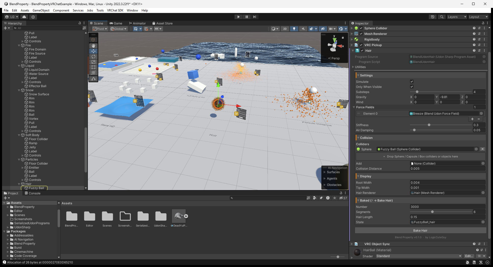](images/features/setup-hair.png)

[Open full-size screenshot](images/features/setup-hair.png)

[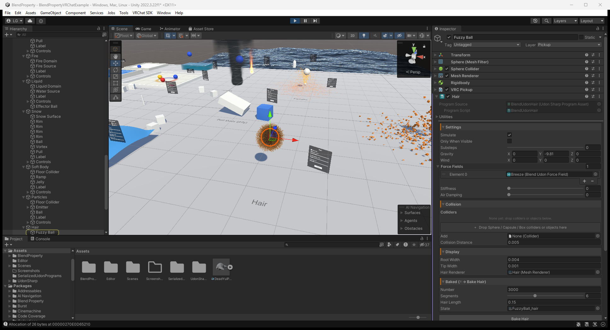](images/features/runtime-hair.png)

[Open full-size screenshot](images/features/runtime-hair.png)

## Ocean

**Select:** `Runtime Example/Ocean`. **Component:** `BlendUdonBuoyancy`.

**Use:** Assign Blend Property/Ocean to a subdivided XZ mesh. List the floating Rigidbodies in Ocean Buoyancy. Press Play; adjust Wind Velocity, Choppiness, Wave Scale and Foam.

**Result to look for:** The ocean waves and the listed props float on it.

[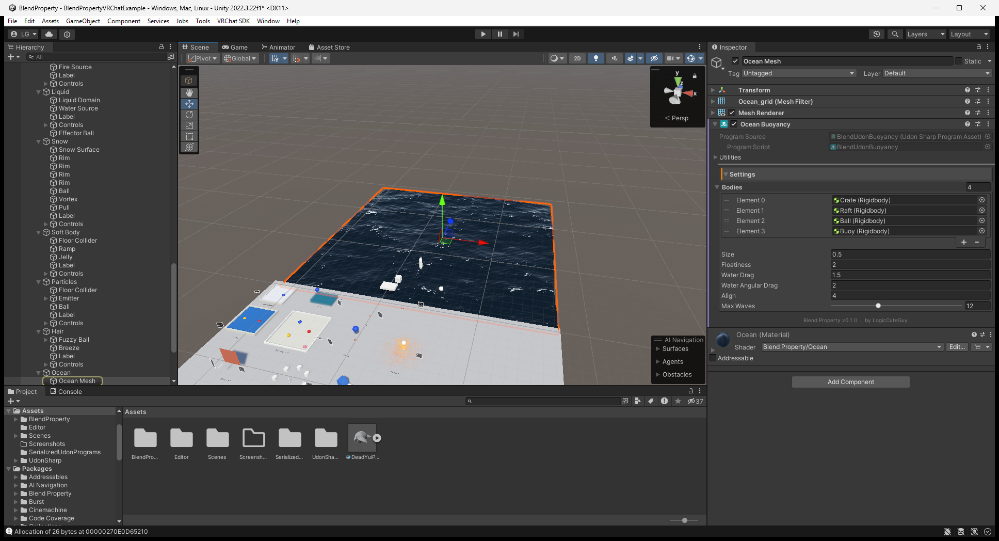](images/features/setup-ocean.png)

[Open full-size screenshot](images/features/setup-ocean.png)

[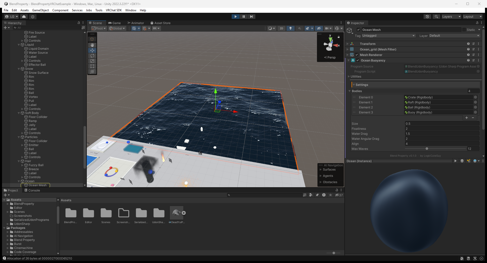](images/features/runtime-ocean.png)

[Open full-size screenshot](images/features/runtime-ocean.png)

## Explode

**Select:** `Runtime Example/Explode`. **Component:** `BlendUdonExplode`.

**Use:** Bake Explode on the mesh. In Play Mode, call Explode (for a local check use ExplodeLocal); ResetExplode assembles it again.

**Result to look for:** The baked faces separate, tumble and fall to the configured floor.

[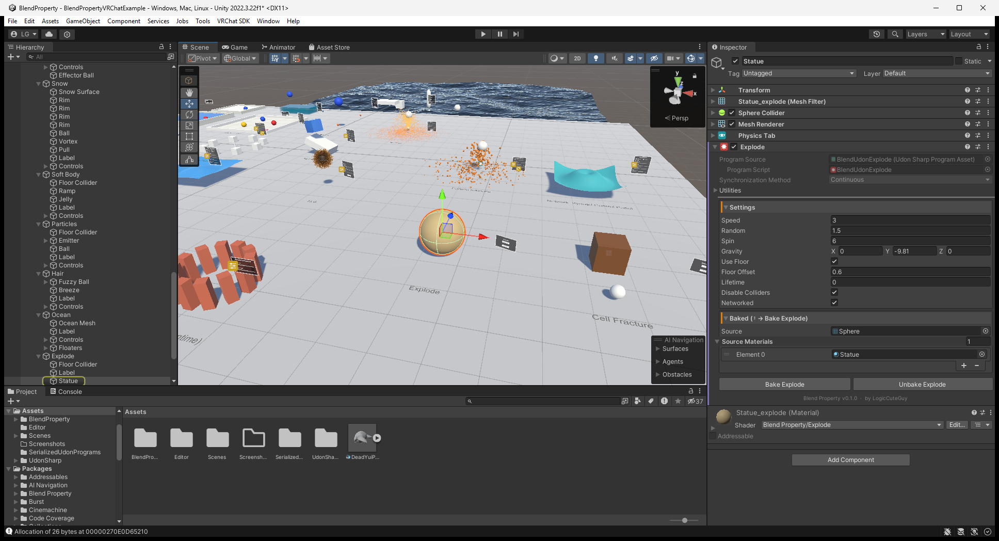](images/features/setup-explode.png)

[Open full-size screenshot](images/features/setup-explode.png)

[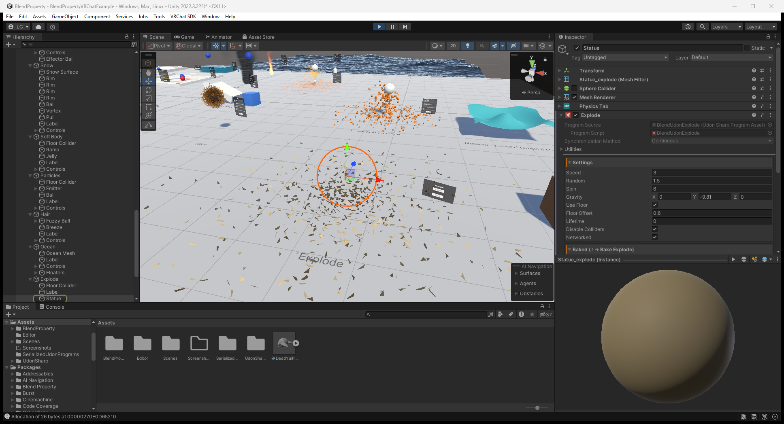](images/features/runtime-explode.png)

[Open full-size screenshot](images/features/runtime-explode.png)

## Cell Fracture

**Select:** `Runtime Example/Cell Fracture`. **Component:** `BlendUdonFracture`.

**Use:** Set Piece Count and Interior Material, then Bake Fracture. In Play Mode, hit it above Break Speed or call Break; ResetFracture restores it.

**Result to look for:** The crate breaks into its baked rigidbody pieces.

[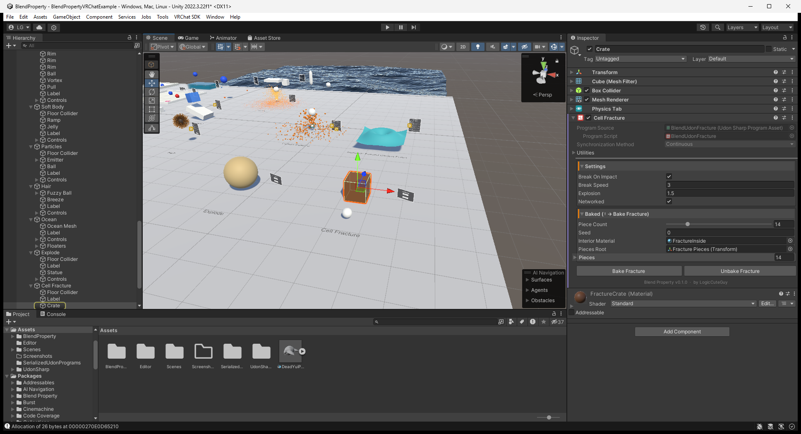](images/features/setup-fracture.png)

[Open full-size screenshot](images/features/setup-fracture.png)

[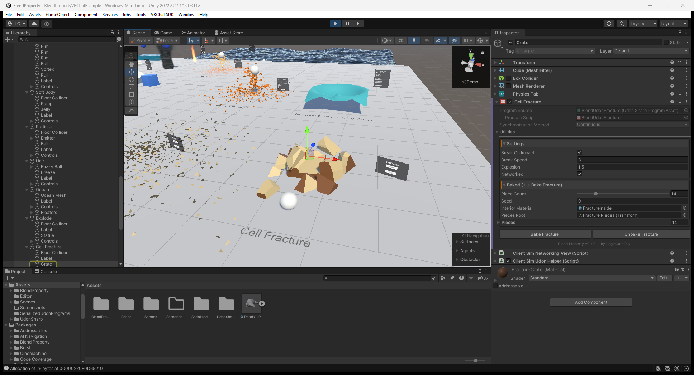](images/features/runtime-fracture.png)

[Open full-size screenshot](images/features/runtime-fracture.png)

## Particle Instance

**Select:** `Runtime Example/Particle Instance`. **Component:** `BlendUdonParticles`.

**Use:** Use Particle System: Render As Object and assign an instance mesh/material, then bake and press Play.

**Result to look for:** Lit tumbling mesh particles replace the billboard sparks.

[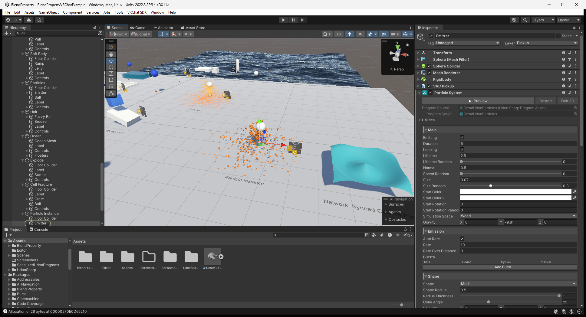](images/features/setup-particle-instance.png)

[Open full-size screenshot](images/features/setup-particle-instance.png)

[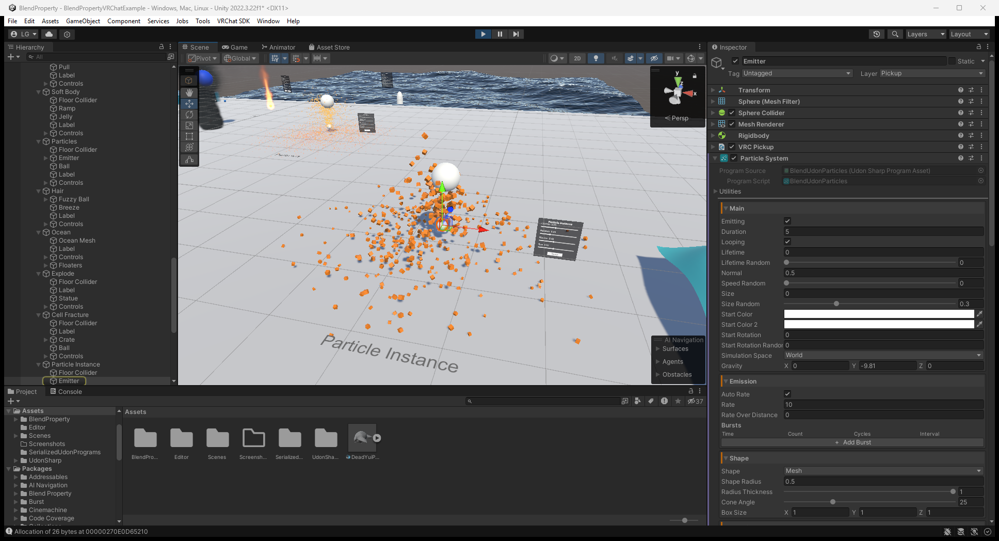](images/features/runtime-particle-instance.png)

[Open full-size screenshot](images/features/runtime-particle-instance.png)

## Network Wave (Synced)

**Select:** `Runtime Example/Network Wave (Synced)`. **Component:** `BlendUdonSyncedPanel`.

**Use:** Inspect the Synced Control Panel and its linked local panel. In Play Mode, move a control; the panel requests ownership and shares its settings.

**Result to look for:** The local plane responds to its controls. A single ClientSim capture does not demonstrate remote delivery or late joiners.

[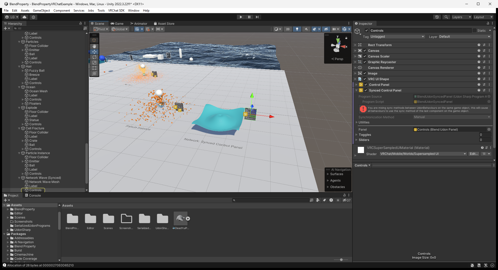](images/features/setup-network-wave.png)

[Open full-size screenshot](images/features/setup-network-wave.png)

[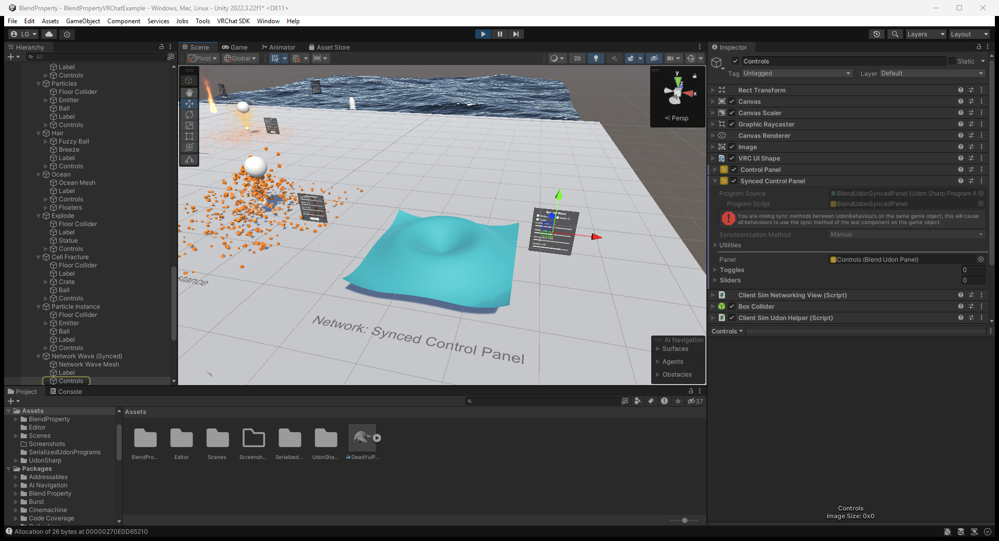](images/features/runtime-network-wave.png)

[Open full-size screenshot](images/features/runtime-network-wave.png)

## Runtime Array Line

**Select:** `Runtime Example/Runtime Array Line`. **Component:** `BlendUdonRuntimeArray`.

**Use:** Use a readable single-submesh Source. Set Circle off; change Copies and Spacing on the panel, or set count/spacing then call Generate().

**Result to look for:** Each client generates a centred line of copies at runtime.

[Open full-size screenshot](images/features/setup-array-line.png)

[Open full-size screenshot](images/features/runtime-array-line.png)

## Runtime Array Circle

**Select:** `Runtime Example/Runtime Array Circle`. **Component:** `BlendUdonRuntimeArray`.

**Use:** Assign Source, set Circle on and adjust Copies/Radius, or set count/radius then call Generate().

**Result to look for:** Each client generates a full circle around local Y. Generated copies have no collider.

[Open full-size screenshot](images/features/setup-array-circle.png)

[Open full-size screenshot](images/features/runtime-array-circle.png)
