# Physics, interaction and editor workflow

[User guide](BlendProperty.md) · [All modifiers](IllustratedModifiers.md) · [Runtime stations](IllustratedRuntime.md)

The screenshots show the normal Unity Editor, including its actual Inspector. Click any image for full size. Workflow images are editor setup; animated physics results are in the [runtime guide](IllustratedRuntime.md).

## Contents

- Modifier Stack and baking
- Standalone: Keep at Runtime
- Lattice cage handles
- Hook: Runtime GPU setup
- Warp: Runtime GPU setup
- Physics Tab and Scope
- Rigid Body: Active
- Rigid Body: Passive
- Rigid Body Constraint: Fixed
- Rigid Body Constraint: Hinge
- Rigid Body Constraint: Point
- Rigid Body Constraint: Slider
- Rigid Body Constraint: Spring
- Rigid Body Constraint: Generic
- ProBuilder
- Physics and interaction helper components
- Reuse the capture tool in Assets

## Modifier Stack and baking

**Use:** Select the mesh and add its first modifier. Modifier Stack appears automatically. Add Modifier lists the categories. Drag component headers or use their menu to change order; toggle the component checkbox to compare the source and result. Rebuild forces an update; Apply All commits the result and removes the modifiers; Remove All restores the source. Apply/Remove affect the selected stack, so use Undo if needed.

**What the screenshot shows:** The screenshot selects the real Modifier Stack; the scene contains a source cube and a Bevel result.

[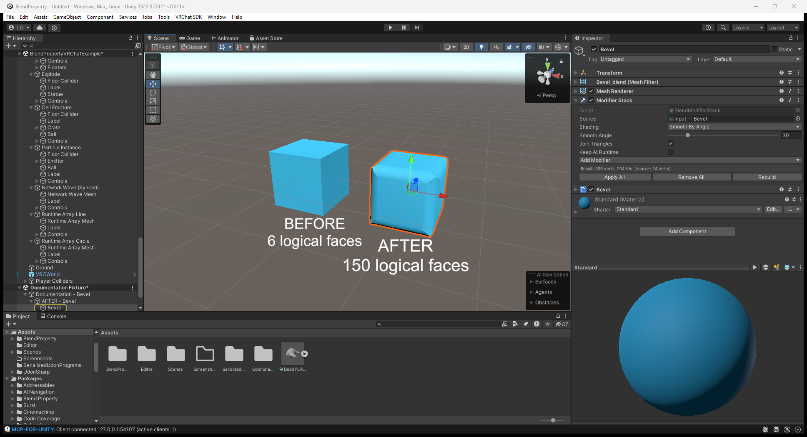](images/features/workflow-stack.png)

[Open full-size screenshot](images/features/workflow-stack.png)

## Standalone: Keep at Runtime

**Use:** In a standalone project without the VRChat SDK, enable Keep at Runtime, enable Read/Write on imported source meshes, change modifier fields from C#, and call RebuildNow(). Open the Standalone example to see Array count and Twist angle change. Leave Keep at Runtime off when using automatic Runtime GPU conversion.

**What the screenshot shows:** This screenshot is editor setup in a VRChat project: the real warning explains that VRChat still strips the stack. A standalone executable has not been run for this tutorial.

[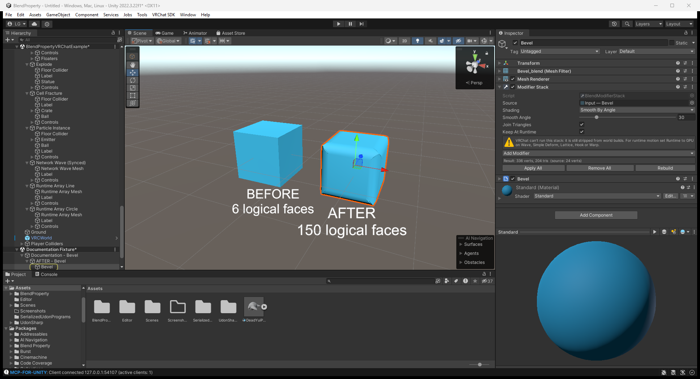](images/features/workflow-keep-runtime.png)

[Open full-size screenshot](images/features/workflow-keep-runtime.png)

## Lattice cage handles

**Use:** Add a Lattice Object, fit it around the mesh and assign it to the Lattice modifier. Set Resolution U/V/W before editing the points. Select the cage to drag its Scene view handles; Reset Points restores the rest cage. For GPU runtime, create exactly U x V x W children, with U changing fastest, and animate/move those children.

**What the screenshot shows:** The cage and its normal Inspector are selected. Its upper points deform the column.

[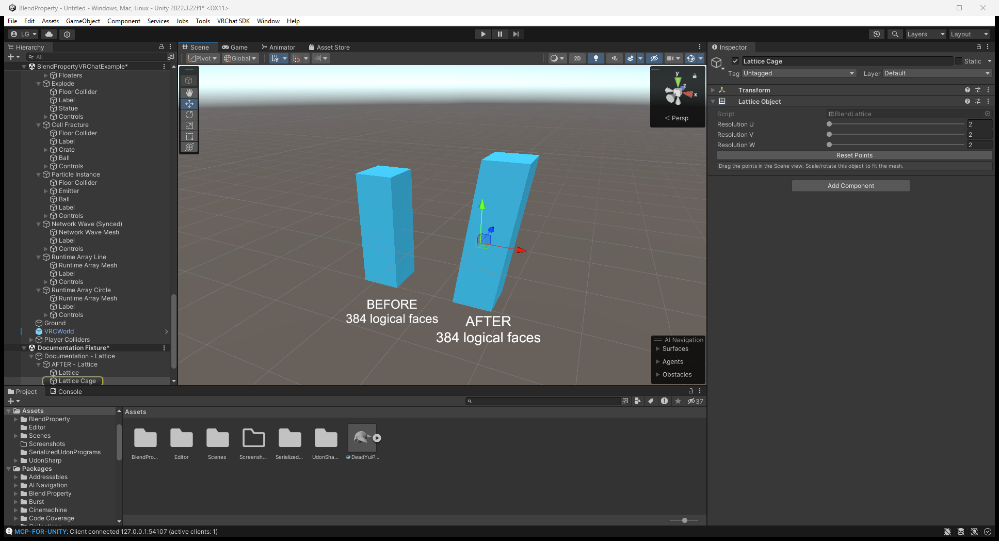](images/features/workflow-lattice-cage.png)

[Open full-size screenshot](images/features/workflow-lattice-cage.png)

## Hook: Runtime GPU setup

**Use:** Bind Hook Target at rest with Reset Hook. Move it to verify the editor deformation, then set Runtime to GPU and keep it at the bottom of the modifier stack. In Play Mode or a VRChat build, the generated BlendUdonDeformStack follows the target.

**What the screenshot shows:** This is an editor setup screenshot; its moving-target runtime behavior is not demonstrated by this still.

[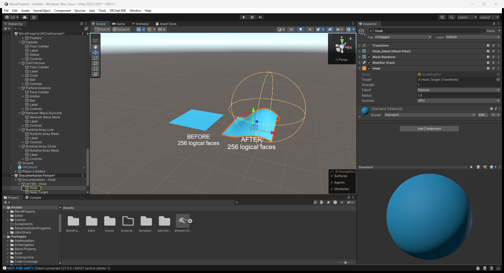](images/features/workflow-runtime-hook.png)

[Open full-size screenshot](images/features/workflow-runtime-hook.png)

## Warp: Runtime GPU setup

**Use:** Assign From and To, choose Strength, Radius and Falloff, then set Runtime to GPU at the bottom of the stack. Animate To to change the deformation. GPU Warp does not implement Preserve Volume.

**What the screenshot shows:** This is editor setup showing the real Runtime field; the before/after meshes show the configured deformation.

[Open full-size screenshot](images/features/workflow-runtime-warp.png)

## Physics Tab and Scope

**Use:** Add Blend Property/Physics/Physics Tab. Click a type to add and bake its component; click again to remove it. Choose the subtype beside Dynamic Paint, Fluid, Rigid Body, Rigid Body Constraint or Particles. Scope Scene links compatible Physics objects across the scene; Parent limits links to the same parent. Manually maintained lists on objects without Physics Tab are not auto-filled.

**What the screenshot shows:** The screenshot shows the actual Physics Tab buttons. Cloth, Soft Body, Waves and Explode write mesh positions, so choose one mesh writer per object.

[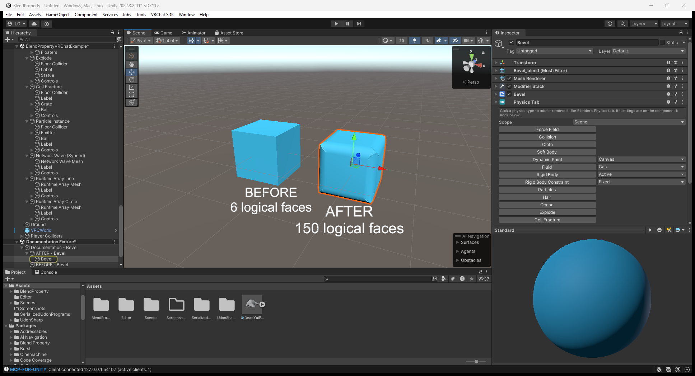](images/features/workflow-physics-tab.png)

[Open full-size screenshot](images/features/workflow-physics-tab.png)

## Rigid Body: Active

**Use:** On Physics Tab choose Rigid Body Active. This adds a non-kinematic Rigidbody and a convex MeshCollider. Set mass, drag and constraints on the Rigidbody. Press Play to let Unity physics move it. Use Collider Per Copy for an Array's compound shape when appropriate.

**What the screenshot shows:** The screenshot shows Rigidbody settings on a temporary example. It is an editor setup image, not a timed physics result.

[Open full-size screenshot](images/features/workflow-rigid-active.png)

## Rigid Body: Passive

**Use:** Choose Rigid Body Passive to use a kinematic Rigidbody. It can act as a collider or an animated anchor while scripts/animation control its transform.

**What the screenshot shows:** Is Kinematic is enabled in the real Rigidbody Inspector.

[Open full-size screenshot](images/features/workflow-rigid-passive.png)

## Rigid Body Constraint: Fixed

**Use:** Choose Fixed on Physics Tab and assign Connected Body. A FixedJoint holds both bodies together; configure break force/torque when needed.

**What the screenshot shows:** The screenshot shows the FixedJoint and assigned Connected Body.

[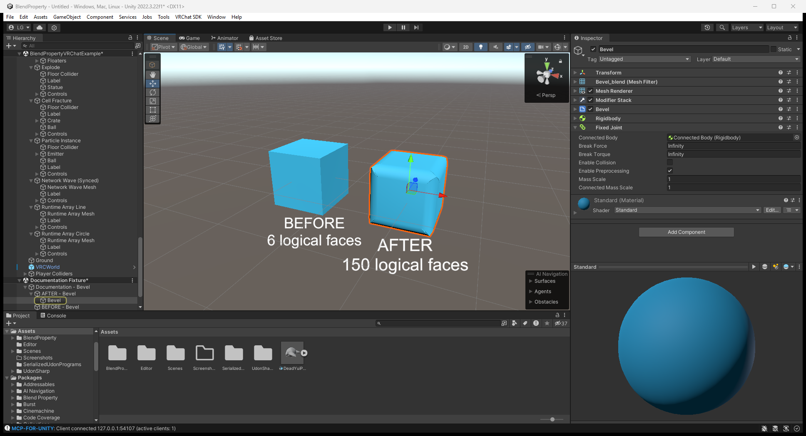](images/features/workflow-joint-fixed.png)

[Open full-size screenshot](images/features/workflow-joint-fixed.png)

## Rigid Body Constraint: Hinge

**Use:** Choose Hinge and assign Connected Body. Set Anchor and Axis, then enable Limits, Spring or Motor for the intended door or lever behavior.

**What the screenshot shows:** The native HingeJoint Inspector shows the available controls.

[Open full-size screenshot](images/features/workflow-joint-hinge.png)

## Rigid Body Constraint: Point

**Use:** Choose Point and assign Connected Body. The generated ConfigurableJoint locks all linear motions and frees all angular motions, giving a ball-and-socket connection.

**What the screenshot shows:** The native ConfigurableJoint Inspector shows the linear locks and free rotation.

[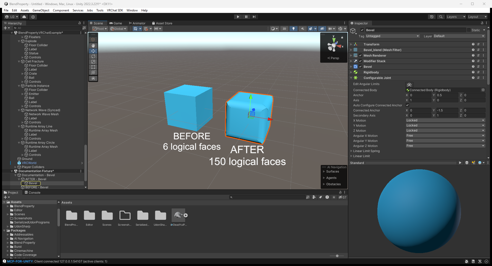](images/features/workflow-joint-point.png)

[Open full-size screenshot](images/features/workflow-joint-point.png)

## Rigid Body Constraint: Slider

**Use:** Choose Slider and assign Connected Body. The generated ConfigurableJoint frees local X translation, locks Y/Z translation and locks rotation. Orient its axis to match the desired sliding direction.

**What the screenshot shows:** The native Inspector shows the slider's allowed and locked motions.

[Open full-size screenshot](images/features/workflow-joint-slider.png)

## Rigid Body Constraint: Spring

**Use:** Choose Spring and assign Connected Body. Set Spring, Damper and the minimum/maximum distance on the SpringJoint.

**What the screenshot shows:** The native SpringJoint Inspector shows the connection and spring controls.

[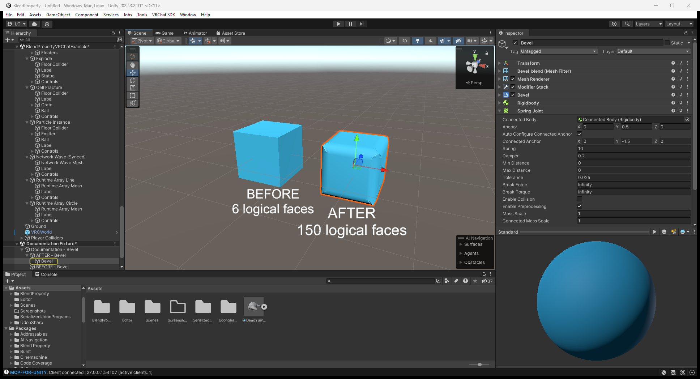](images/features/workflow-joint-spring.png)

[Open full-size screenshot](images/features/workflow-joint-spring.png)

## Rigid Body Constraint: Generic

**Use:** Choose Generic and assign Connected Body. Set the ConfigurableJoint's linear/angular motions, limits and drives for the connection you need.

**What the screenshot shows:** The screenshot shows the native ConfigurableJoint; its defaults need configuration for a particular mechanism.

[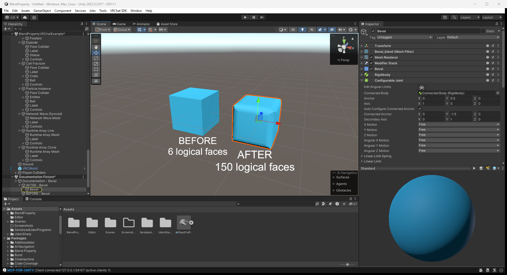](images/features/workflow-joint-generic.png)

[Open full-size screenshot](images/features/workflow-joint-generic.png)

## ProBuilder

**Use:** With ProBuilder installed, create a ProBuilder shape and add a modifier normally. Object mode shows the modified result. In vertex/edge/face mode, the bridge shows the unmodified cage so selection matches the editable geometry. Apply writes the result back into ProBuilderMesh.

**What the screenshot shows:** This screenshot shows a real ProBuilder cube with Bevel. It demonstrates editor setup/result; it does not establish every ProBuilder editing mode or export path.

[Open full-size screenshot](images/features/workflow-probuilder.png)

## Physics and interaction helper components

### Collision

**Component:** `BlendUdonCollision`.

**Use:** Use Physics Tab Collision to create/list a supported Sphere, Capsule or Box collider, then configure collision properties. Cloth, hair, particles and waves use their supported collider lists; fluids use sphere effectors. A manually added component needs its lists assigned.

**Result / scope:** The particle example's collision component controls its bounce/friction response.

[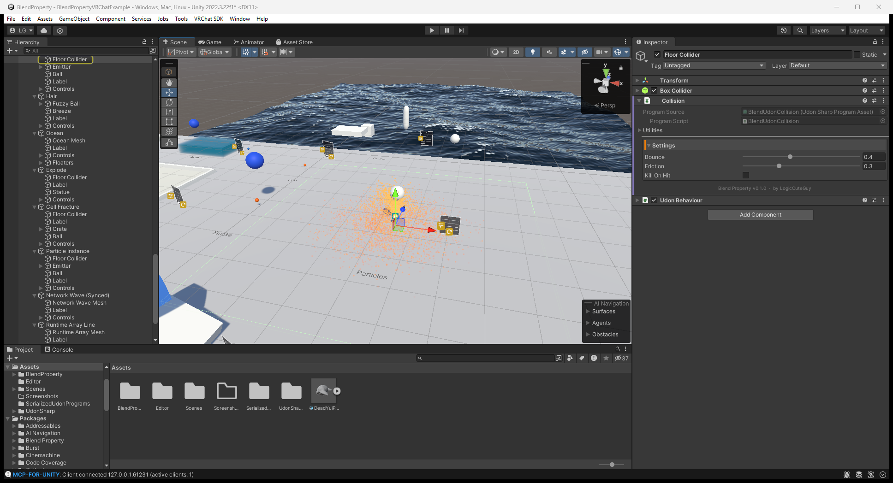](images/features/setup-helper-collision.png)

[Open full-size screenshot](images/features/setup-helper-collision.png)

### Fluid Flow

**Component:** `BlendUdonFluidFlow`.

**Use:** Add a Flow object inside a compatible Fluid Domain and assign it under Flows, or use Physics Tab for automatic linking. Choose Smoke, Fire + Smoke or Liquid as required; set the flow radius and source strength.

**Result / scope:** The Smoke station's source is selected. In Play Mode a gas plume appears only after the domain's Simulate toggle is enabled.

[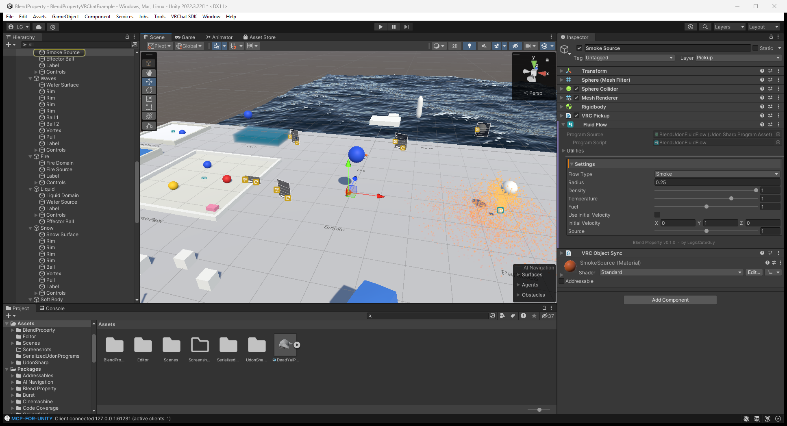](images/features/setup-helper-fluid-flow.png)

[Open full-size screenshot](images/features/setup-helper-fluid-flow.png)

### Dynamic Paint Brush

**Component:** `BlendUdonPaintBrush`.

**Use:** Add a brush to an object, set its colour/radius and assign it to a canvas or waves surface. Move it over the surface. If Require Use is enabled, hold the pickup's use input (standalone input can call OnPickupUseDown/Up). Erase makes it remove paint.

**Result / scope:** The selected ball brush supplies the trails shown in the Dynamic Paint runtime example.

[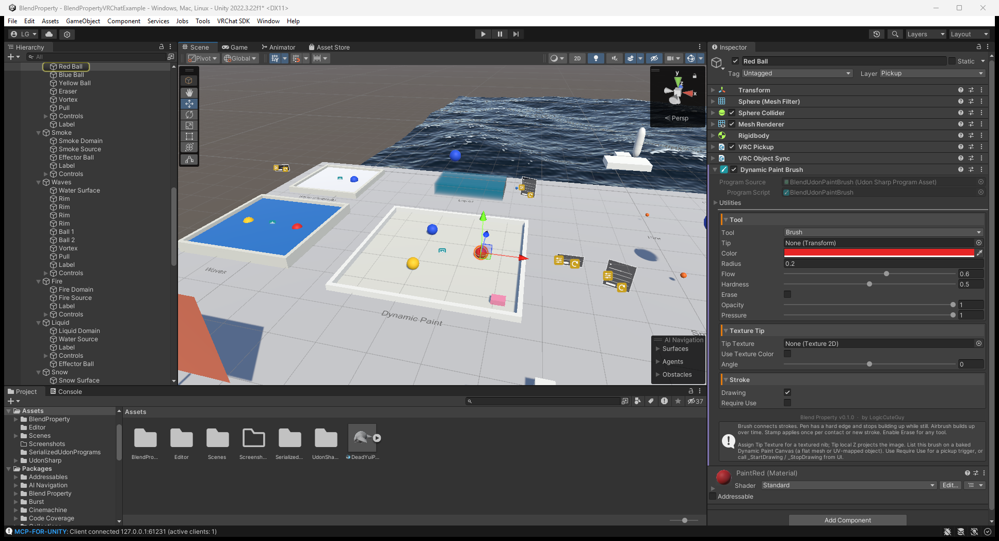](images/features/setup-helper-paint-brush.png)

[Open full-size screenshot](images/features/setup-helper-paint-brush.png)

### Control Panel

**Component:** `BlendUdonPanel`.

**Use:** Assign Target for a runtime component, Modifier for a Runtime GPU modifier, or Target Renderer for shader properties. Match each Toggle/Slider to its exact field/property name. Hook On Value Changed to SendCustomEvent Apply. Whole Numbers sliders can drive integer/enum fields.

**Result / scope:** The Wave panel is selected; its controls drive the example plane.

[Open full-size screenshot](images/features/setup-helper-control-panel.png)

### Cloth Panel

**Component:** `BlendUdonClothPanel`.

**Use:** Assign Cloth and its named UI references: Simulate, Gravity, Wind and the optional parameter sliders. Hook the UI value-change events to Apply for local controls, or Changed on a neighbouring Synced Control Panel for shared settings.

**Result / scope:** The Cloth station's panel exposes its simulation controls.

[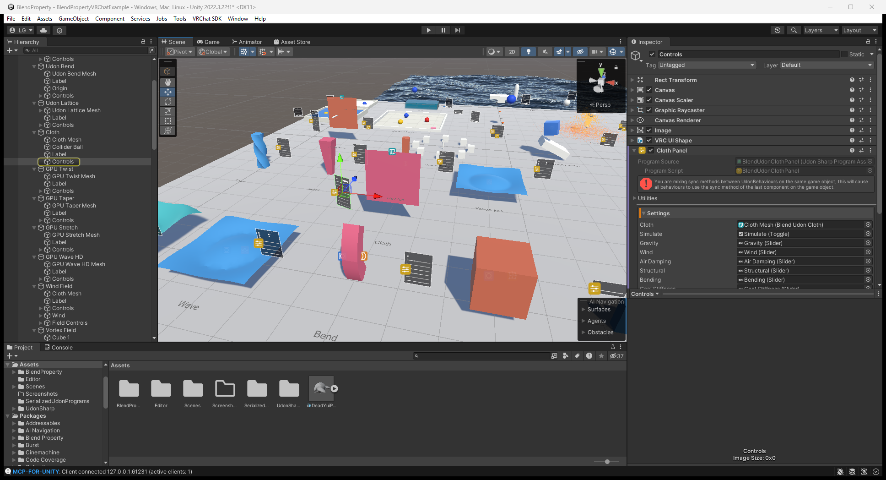](images/features/setup-helper-cloth-panel.png)

[Open full-size screenshot](images/features/setup-helper-cloth-panel.png)

### Synced Control Panel

**Component:** `BlendUdonSyncedPanel`.

**Use:** Put it beside Control Panel or Cloth Panel and assign Panel. Hook UI events to Changed on this component. Empty Toggle/Slider arrays reuse the local panel's controls. The player changing a control takes ownership and shares the setting.

**Result / scope:** The screenshot shows wiring. A single local ClientSim session does not verify replication or late joiners.

[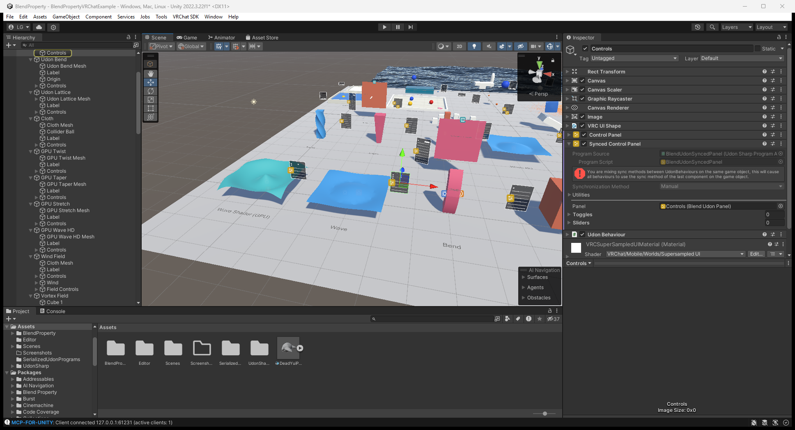](images/features/setup-helper-synced-panel.png)

[Open full-size screenshot](images/features/setup-helper-synced-panel.png)

### Network Event

**Component:** `BlendUdonNetworkEvent`.

**Use:** Assign Target and Event Name, such as ResetSimulation or ClearPaint. Hook a UI Button to SendCustomEvent Send on this component. It invokes Run on current clients; standalone invokes it locally.

**Result / scope:** The Cloth reset event is selected. Events are not replayed for players joining later.

[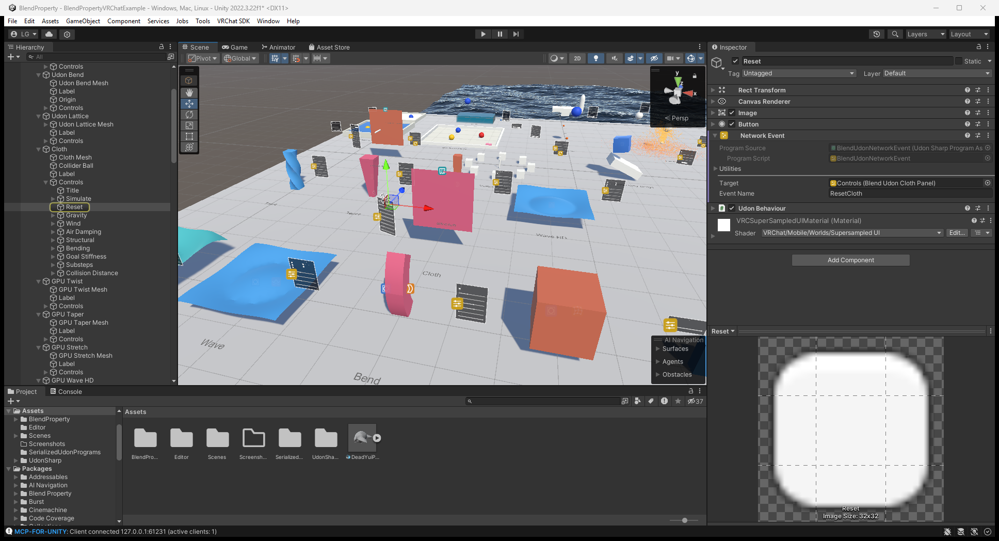](images/features/setup-helper-network-event.png)

[Open full-size screenshot](images/features/setup-helper-network-event.png)

### Reset Objects

**Component:** `BlendUdonResetObjects`.

**Use:** List the example pickups/props and connect the reset button to ResetObjects. The component restores recorded poses; VRChat objects using Object Sync use their shared respawn behavior.

**Result / scope:** The Vortex Field's list contains its field and cubes. Simulation state is separate from resetting prop transforms.

[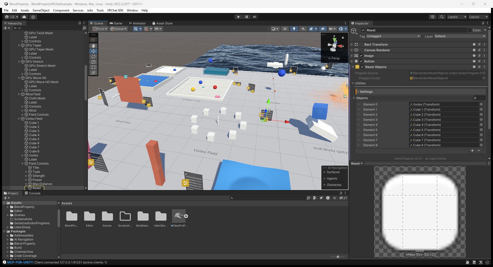](images/features/setup-helper-reset-objects.png)

[Open full-size screenshot](images/features/setup-helper-reset-objects.png)

### Player Colliders

**Component:** `BlendUdonPlayerColliders`.

**Use:** Use GameObject/Blend Property/Physics/Player Colliders. Select the generated object, choose All Players and body parts/radii. The editor fills Body Template and simulation lists. In Play Mode the bodies follow avatar bones; the triggers do not push the player or UI ray.

**Result / scope:** This is the configured template, not a screenshot of every avatar or device. Local ClientSim cannot establish remote-player body behavior.

[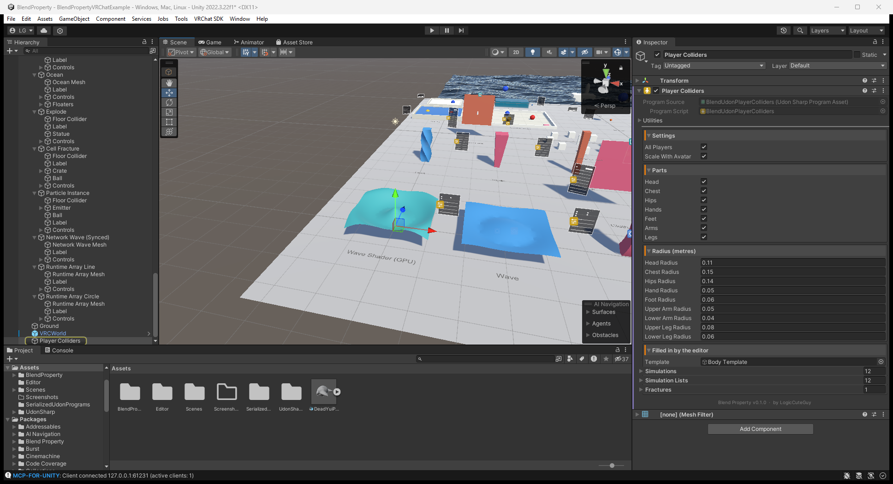](images/features/setup-helper-player-colliders.png)

[Open full-size screenshot](images/features/setup-helper-player-colliders.png)

## Reuse the capture tool in Assets

In this example project the reusable editor tool lives at `Assets/Editor/BlendDocsCapture.cs`; the runtime station list is `Assets/Editor/BlendDocsStations.json`. It is local project tooling, outside the distributed package. It uses Windows window capture and requires Windows Editor; it adds no runtime component to builds.

Use **Tools → Blend Property → Docs Capture**:

1. **Capture Current Editor** saves the normal Unity window exactly as displayed.
2. **Capture All Modifier Examples** builds temporary before/after fixtures and captures all modifier examples. It restores the previous selection and Scene view when finished.
3. **Capture Workflow Setup** captures the stack, Physics Tab, rigid bodies, constraints and ProBuilder fixtures.
4. With the VRChat example open, **Capture Runtime Setup** and **Capture Physics and Interaction Setup** capture the actual station/helper Inspectors.
5. Press Play, turn on Simulate for the relevant simulations and enable rendering of their surfaces. Use **Capture Runtime Results (Play Mode)** to capture their current states. This command captures the current running simulation; it does not turn it on, trigger destruction or test networking for you.
6. **Stop and Restore View** cancels the current batch and removes its temporary fixture.

Original PNGs are saved to `Assets/BlendProperty/DocumentationCaptures/`. Batch captures also copy their PNGs into this package's `Documentation~/images/features/`. Existing files with matching names are overwritten on a repeat capture. The normal Editor layout is preserved, so resize the Inspector and Scene view before capturing if needed. Keep the Unity main window restored while a batch runs.

The tool captures only the Unity process's window. It creates unsaved temporary fixture scenes for modifier/workflow examples, then removes them; it does not save or publish the user's scenes. Save important work before starting a batch, as with any editor automation. The capture result includes the current console/status bar, so clear unrelated messages first if you want a clean tutorial image.
