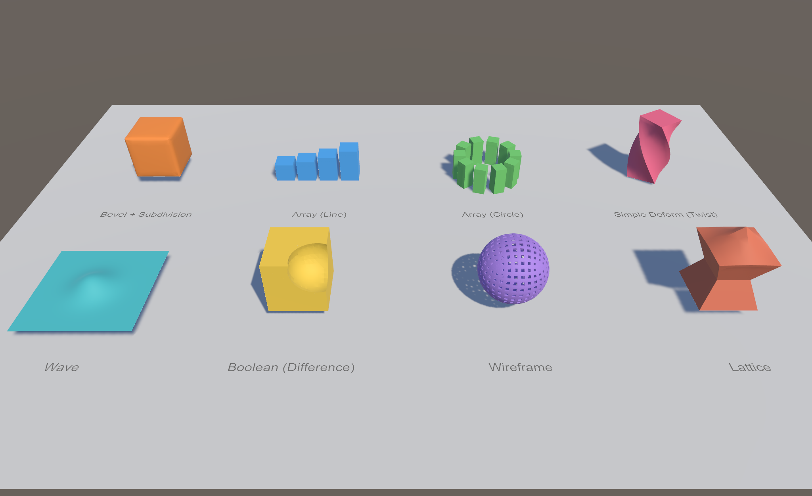
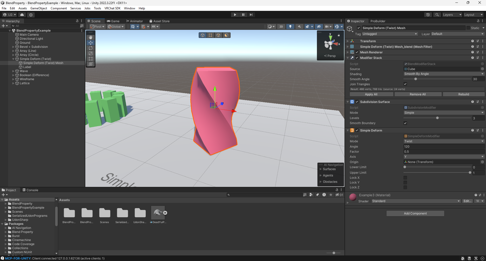

# Blend Property

Blender-style modifiers for Unity meshes, as editor-only components.

- **Install:** Package Manager → **Add package from git URL…**, or copy this folder into `Packages/`. Needs Unity 2022.3+.
- **Examples** in `Packages/Blend Property/Example/`:
  - `BlendPropertyExample.unity` shows eight modifier stacks.
  - `VRChat/BlendPropertyVRChatExample.unity`: runtime motion in a VRChat world (Udon deformers and the Wave shader). Press Play.
  - `Standalone/BlendPropertyStandaloneExample.unity`: `RebuildNow()` in a non-VRChat project. Press Play.
- **Guide:** [Documentation~/BlendProperty.md](Documentation~/BlendProperty.md) covers a walkthrough, Lattice setup, builds and troubleshooting.

## Use
- Select any object with a MeshFilter (an FBX child, a primitive or a ProBuilder mesh), then choose **Add Component → Blend Modifier → …**
- **Stack order is the component order.** Drag components or use their ⋮ menu (Move Up/Down, Move to First/Last).
- The component checkbox shows or hides the modifier, like Blender's viewport toggle.
  Unchecking the **Modifier Stack** turns them all off and shows the original mesh.
- **Remove All** (Modifier Stack button or any ⋮ menu) drops every modifier without applying and puts the original mesh back, in one undo step.
  **GameObject → Blend Modifier → Remove All in Children** does a whole model.
- **Apply** (component ⋮ menu): bakes this modifier and every enabled one above it into the source mesh.
  **Apply All** bakes the whole stack. **GameObject → Blend Modifier → Apply All in Children** bakes a whole model.
- Shading (Smooth by Angle / Smooth / Flat / Keep Imported) is set on the **Modifier Stack** component.
- Results are saved to `Assets/BlendProperty/Baked/`. **Tools → Blend Modifier → Delete Unused Baked Meshes** clears the ones nothing uses anymore. On build, every Blend component is stripped and only the baked mesh ships (unless **Keep at Runtime** is on, see Runtime). That makes it safe for VRChat worlds.

## ProBuilder
Modifiers stay live while you edit the shape. In vertex, edge or face mode the cage is shown without modifiers. **Apply** writes the result back into the ProBuilderMesh, so it stays editable.

## Modifiers
Options follow the Blender 5.2 manual. Unity is Y-up, so Blender's Z (Wave, Cylinder Cast, Simple Deform, Array circle axis) is Y here. Distances are in metres (see Units and axes).

- **Generate**
  - **Array**: Shape Line (Relative / Offset / Endpoint, per-copy rotation and scale), Circle (Full / Arc, radius, sweep, central axis, count or angular distance), Curve (through Transforms) or Transform (input or object, relative or world). Align Rotation, Local Rotation, Randomize (offset, rotation, uniform / per-axis scale, flipping, exclude first / last, seed), Merge.
  - **Bevel**: Affect Edges / Vertices, Width Type Offset / Width / Depth / Percent, Limit Method None / Angle, Segments, Profile, Clamp Overlap (per edge), Harden Normals, Material.
  - **Boolean**: Intersect / Union / Difference, Operand Object or Collection (every mesh under one object).
  - **Decimate**: Collapse (+ Triangulate), Un-Subdivide, Planar (+ Delimit Material / UV).
  - **Mirror**: Axis, Bisect, Flip, Bisect Distance, Mirror Object, Merge, Flip U / V, UV Offset.
  - **Remesh**: Blocks / Smooth / Sharp (Octree Depth, Scale, Sharpness), Voxel (Voxel Size), Remove Disconnected.
  - **Screw**: Angle, Screw, Iterations, Axis, Axis Object, Object Screw, Steps, Merge, Stretch U / V, Flip.
  - **Solidify**: Thickness, Offset, Even Thickness, Rim Fill, Only Rim, Flip Normals, Clamp, Material / Rim material offset.
  - **Subdivision Surface**, **Triangulate** (Quad Method, N-gon Method, Minimum Vertices), **Weld** (All / Connected), **Wireframe** (Thickness, Offset, Even, Relative, Replace Original, Material Offset).
- **Deform:** Cast (+ Size from Radius), Curve, Displace (Normal / Custom Normal / X / Y / Z / RGB to XYZ, Local / Global space and coordinates), Hook, Laplacian Smooth (axes, negative factor exaggerates), Lattice (`Blend Modifier/Lattice Object`), Shrinkwrap (Nearest Surface Point / Project / Nearest Vertex, five Snap Modes, project axes / direction / face cull / auxiliary target), Simple Deform (+ Lock), Smooth, Warp (+ Preserve Volume), Wave (+ Life, Damping, normal axes).
- **Edit:** UV Project, UV Warp
- **Normals:** Smooth by Angle, Weighted Normal (+ Threshold), Normal Edit (+ Subtract, Max Angle)

**Not available:** anything that needs vertex groups, creases, bevel weights or face strength (Unity meshes don't carry them), Boolean's Exact solver and Self Intersection, Solidify Complex mode, Decimate Symmetry, Shrinkwrap Target Normal Project, Remesh Adaptivity.

## Units and axes
- **Distances are in Unity units (metres in the scene)**, whatever the object's scale: Bevel width 0.02 is 2 cm on a Scale 1 cube and on a centimetre FBX imported at Scale 100. Scaling the object rebuilds the stack.
  This covers widths, thicknesses, radii, offsets, merge/weld distances, voxel size, Array spacing and Wave sizes. Percentages, factors, angles and UV values aren't distances and are unchanged.
- **Axes are Unity's**: Y is up, Z is forward. Where Blender defaults to Z-up (Array circle, Wave, Cylinder Cast, Simple Deform, Screw) the default here is Y.
- Non-uniformly scaled objects use the average of their three axis scales for plain distances (per-axis for offsets like Array Translation).

## Limits
- MeshFilter only. SkinnedMeshRenderer, blend shapes and bones aren't supported.
- No vertex groups.
- Bevel caps corners with a triangle fan, not Blender's patch grid. Affect: Vertices is one flat cut (Segments is ignored).
- Decimate Un-Subdivide only works on all-quad meshes that came from subdividing; anything else is left as is.
- Boolean is BSP CSG: closed meshes only, slow past a few thousand faces, leaves T-junctions on cut edges. Hide the cutter's renderer yourself.
- Shrinkwrap checks every target triangle, so big targets are slow.
- UV Project takes one orthographic projector.
- Remesh uses an inside/outside voxel grid (no distance field): parts thinner than a voxel vanish, max 192 voxels per axis.
- Hook has no vertex groups: it moves everything within its radius. **Reset Hook** (⋮ menu) rebinds.
- Decimate uses greedy QEM.
- Lattice is trilinear.
- The Wave modifier is baked at a fixed time. For motion, use BlendUdonWave or the Wave shader (see Runtime).

## Performance
- Only what changed is rebuilt: modifiers above the first one that follows another object (or above the last modifier) are cached.
- A stack that takes more than 80 ms to rebuild waits until you release the mouse, so dragging stays smooth. Light stacks update live.

## Runtime
Stacks are baked in the editor and stripped from builds by default. For runtime changes:

- **Standalone (non-VRChat) builds:** tick **Keep at Runtime** on the Modifier Stack. The stack ships with the build: change modifier fields from a script, then call `stack.RebuildNow()`. The source mesh needs **Read/Write** enabled (the build warns if it isn't). Each call re-runs the whole stack, so keep it out of `Update` for heavy stacks.
- **VRChat worlds (UdonSharp / LCGUdonSharp):** Udon can't run the modifier stack, so VRChat builds always strip it. Use these instead, on top of the baked mesh (one per mesh):
  - **BlendUdonWave**: animated Wave.
  - **BlendUdonSimpleDeform**: Twist / Bend / Taper / Stretch, optionally following an animated origin.
  - **BlendUdonLattice**: the cage points are child Transforms you can animate or pick up. Use **⋮ → Create Cage Points**; it copies a Lattice Object's points if the cage has one.

  They run on the CPU in Udon, so keep animated meshes to about 1,000 vertices. They're in `Udon/` and only compile when the VRChat Worlds SDK is installed.
- **Examples:** `Example/VRChat/` and `Example/Standalone/`, one scene per project type.
- **Project detection:** the package checks at compile time whether the VRChat SDK is installed. With it, the Udon deformers compile and every stack is stripped from builds. Without it, Keep at Runtime works and the standalone example script compiles.
- **Any platform, any size:** the **Blend Property/Wave** shader animates a wave on the GPU with no script. Subdivide the mesh first so it has vertices to move.

## Add a modifier
Write one file: `class MyModifier : BlendModifier { public override void Apply(MeshData mesh) { … } }`

## License
[MIT](LICENSE) © 2026 LogicCuteGuy
